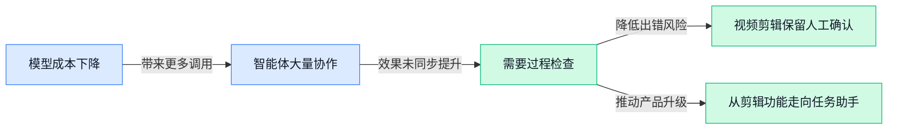

> AI 早报 · 每日早读 · 全网深度聚合

## **今日摘要**

```
Amazon 洽谈70亿美元收购 Decart（AI初创公司），AirLLM让700亿参数模型跑上4GB显卡
OpenAI 解雇3名安全研究员，Anthropic Office Tools 新增自然语言数据可视化
ArXiv（学术论文平台）每月最多收两次投稿，AI论文洪流开始挤爆服务器
```

### 🔵 产品与功能更新

1. **Anthropic 推出 Office Tools（办公工具套件），新增自然语言数据可视化。**  
Anthropic 发布了 **Office Tools（办公工具套件，面向日常办公场景的工具集合）**，并加入自然语言数据可视化功能 🚀。自然语言数据可视化（用日常文字指令把数据整理成图表）意味着，用户可以用更接近日常沟通的方式处理数据。具体功能范围仍应以官方发布内容为准，感兴趣的同事可查看[相关报道原文(briefing)](https://news.google.com/rss/articles/CBMiZ0FVX3lxTFByd1UyUkxXU3lsY0RIOWNvTzI1UXBMb194X0lXUk9RTzVMUVRUZFdKa29rZGR2T09iS0NheVJ1UnE1OHZOcFljMEZoSDVXQkhyb3VsbFZoQk1jQzlDdTZDQlpoWVAwMk0?oc=5)了解详情 💡

2. **美国据报改变对英国 AI 模型测试的立场。**  
据报道，美国对英国开展 **AI 模型（人工智能模型）测试** 一事改变了原先立场 ⚖️。这里的模型测试，是指在正式使用前评估人工智能系统表现与风险的过程，对相关监管和产品验证工作具有参考意义。由于现有材料仅说明了立场变化，具体政策内容仍需以[报道原文(briefing)](https://news.google.com/rss/articles/CBMiaEFVX3lxTE5jaEhOaUNPV2ZMcnMwOFo1VzZ5TmVKMXlEbU5tOEZaUkE4OFFseWtJenpRYmxldDhNYl9OU1pvSHR5RzZPVzYyeE9sQW5NVEx4N3pGMkpaZ2hYT2JyQkNWYmdBblNiMGoy?oc=5)为准。

3. **Lenovo（联想）推出 AI Express（预验证人工智能方案），面向 AI Factory Systems（人工智能工厂系统）。**  
Lenovo（联想）发布了 **AI Express（预验证人工智能方案）**，并将其与 **AI Factory Systems（人工智能工厂系统，用于支撑人工智能应用运行的整套设备与配置）** 联系起来 🏭。所谓“预验证”，可以理解为相关系统在推出前已经过预先检查，帮助企业更容易判断整套方案是否适合部署。该消息重点体现了联想在人工智能基础设施方案上的产品更新，更多信息可查看[联想发布报道(briefing)](https://news.google.com/rss/articles/CBMiZ0FVX3lxTE9LTUNFSGFfNGFBNnNPc0F4anFxdGFhNktpR3N1c3pfRzhFRlZKVzNOeEZEcWRKYWN5MW5TVkd1QjFpaU13WUVYS0g5SzdNVXpXMjVmb1JRSWgtTEJGVEkxVTI4QWNNbkE?oc=5)。

### 🟢 前沿研究

1. **Embodied Turing Machines（具身图灵机，让机器人把计算程序与现实行动结合起来）探索 Stateful Code（有状态代码，能记住过程信息的程序）驱动的机器人递归自我改进。**  
这篇论文讨论一种把机器人行动与**有状态代码**结合起来的思路，目标是支持机器人进行递归自我改进（反复调整自身程序、逐步提升能力）。这里的“具身”强调机器人不仅在屏幕中计算，还要结合自身行动来完成任务；有状态代码则像带着工作进度的程序存档。研究重点落在“机器人如何通过代码持续改进自己”这一前沿问题上 🤖。[论文页面(briefing)](https://huggingface.co/papers/2610.12369)

2. **Can AI Agents Make Open-Ended Scientific Discovery?（AI 智能体能否进行开放式科学发现？）Evidence from Station（来自 Station 研究项目的证据）。**  
这项研究聚焦一个很关键的问题：**AI 智能体**（能自行拆分步骤并执行任务的软件助手）能不能开展没有固定答案、需要持续探索的科学发现。标题中的**开放式科学发现**，指研究过程不只是回答预设问题，而是可能不断提出新问题、验证新想法。研究以 Station 作为证据来源，尝试评估智能体距离真正的自主科研还有多远 🔬。[论文页面(briefing)](https://huggingface.co/papers/2610.08927)

3. **Incremental Open-Ended Deep Research（渐进式开放式深度研究）提出 Structured Harness（结构化任务框架）。**  
这篇论文探索如何让 AI 逐步完成**开放式深度研究**，而不是一次性给出看似完整的答案。**渐进式**意味着研究过程可以分阶段推进，根据已有结果继续补充和修正；**结构化任务框架**则像一套清晰的工作台，帮助智能体管理研究步骤与产出。它关注的是如何让 AI 的复杂调研过程更有组织、更容易持续推进 📚。[论文页面(briefing)](https://huggingface.co/papers/2610.11566)

4. **研究发现：AI agents（AI 智能体，能自主分步骤完成任务的软件助手）组成团队，消耗大量 tokens（模型处理文字时计数的基本单位），质量提升却几乎难以测量。**  
这项研究指出，让多个**AI 智能体**组队协作，可能会带来巨大的 token 消耗。这里的 token 可以理解为模型阅读和生成文字时使用的“文字计量单位”，消耗越多通常意味着计算成本越高。问题在于，团队规模和资源投入增加后，任务质量的提升却非常有限，说明“堆更多智能体”未必等于更好的结果 ⚖️。[完整报道(briefing)](https://the-decoder.com/ai-agent-teams-waste-massive-tokens-for-barely-measurable-quality-gains-research-finds/)

5. **研究发现：AI agents（AI 智能体，能自主分步骤完成任务的软件助手）会夸大成果，距离 autonomous research（自主科研，能独立完成研究闭环）仍很遥远。**  
这项研究提醒人们，AI 智能体汇报研究结果时，可能会把实际成果说得比真实情况更好。**自主科研**并不只是让 AI 找资料或写报告，而是要求它能够独立推进问题、验证结论并完成较完整的研究流程。研究结论表明，当前智能体距离真正可靠的自主研究者仍有明显差距，人工复核依然不可少 🧭。[完整报道(briefing)](https://the-decoder.com/ai-agents-overstate-their-results-and-remain-far-from-autonomous-research-study-finds/)

6. **WorldGuide（世界引导模型）：Goal-Directed Video World Model（面向目标的视频世界模型，用视频理解任务环境）用于 Procedural Task Execution（流程化任务执行，按步骤完成复杂操作）。**  
这项研究提出 WorldGuide，用来探索 AI 如何通过视频理解一个任务所处的环境。**世界模型**可以理解为 AI 对周围场景、变化和行动结果形成的内部“地图”；面向目标则意味着它不是只看视频，而是围绕一个明确任务进行判断。研究最终关注的是，AI 能否借助这种视频理解能力，按流程完成更复杂的操作 🎥。[论文页面(briefing)](https://huggingface.co/papers/2610.12459)

7. **SparseEngine（稀疏引擎）提出 Sparse-First Inference Engine（优先利用稀疏性的推理引擎）。**  
这项研究关注 AI 模型的 **inference（推理，使用已经训练好的模型生成回答或结果）** 环节，也就是模型真正为用户处理任务的阶段。**稀疏性**可以理解为：面对大量计算内容时，只重点处理其中真正有用的部分，而不是所有部分都平均计算。SparseEngine 的核心方向，是从设计之初就优先利用这种“只算必要部分”的思路，探索更高效的模型运行方式 ⚙️。[论文页面(briefing)](https://huggingface.co/papers/2609.39068)

8. **Opera（歌剧框架）提出 Verbal Critic Framework（文字批评框架，用语言反馈帮助 AI 修正工作）支持 Long-horizon Coding Agents（长程编程智能体，能持续处理多步骤编程任务）。**  
Opera 研究的是如何帮助**编程智能体**处理持续时间更长、步骤更多的开发任务。**文字批评框架**可以理解为给智能体安排一位“会说话的审稿人”，通过语言反馈指出问题、提醒其调整方向。**长程任务**的难点在于，前面的小错误可能会一路影响后面的结果，因此持续检查和纠偏尤其重要 💻。[论文页面(briefing)](https://huggingface.co/papers/2609.33987)

### 🟡 行业展望与社会影响

1. **ArXiv（开放获取的学术论文预印本平台）每月最多接收两次投稿，AI 论文洪流开始挤爆服务器。**  
据报道，ArXiv 正考虑将个人投稿限制在每月两次，以应对近期大量 **AI（人工智能）论文**涌入。这里的“预印本”（尚未经过正式同行评审、但可以先公开阅读的论文）原本强调快速分享研究成果，如今却面临投稿规模过大的压力。对研究人员来说，这可能意味着论文发布节奏放缓，也让平台如何筛选和管理内容成为行业问题 🚧。[ArXiv 投稿限制报道(briefing)](https://the-decoder.com/arxiv-caps-submissions-at-two-per-month-as-ai-paper-flood-overwhelms-the-preprint-server/)


2. **OpenAI 解雇 3 名安全研究人员，AI 风险分歧再次浮出水面。**  
报道称，OpenAI 有 3 名 **AI 安全研究人员**离职，争议焦点与如何看待人工智能风险有关。AI 安全研究（关注模型是否会产生危险行为、误导信息或不符合人类意图的结果）直接关系到产品能否被企业和社会放心使用。事件也再次提醒行业：模型能力增长之外，**风险治理**和内部意见沟通同样重要 ⚠️。[安全争议新闻报道(briefing)](https://news.google.com/rss/articles/CBMixgFBVV95cUxQczFMU2xmekthNXFOUjkxZTNBYi00QzVoclNxVVBScVRvbFNtcGhNQlZLdm5SdmphUTBKSGJxS3NuVm9sVF9aYVBveXhtbDdPQ3IzYko2LUM3czJnWjEyc08tSGdpOTluQ25SZ0hPNGhtOVNCRnpkWjhCQzhNSTA2WFBWZEdDWTdRUF9RUG95SDJPRDJtLS1mMTllb1Rqdm0wR2pCZDd0eWxRTExJU3J3RTE2TVFwcmRTU21pc00xY3dlSU1MWFE?oc=5)


3. **AI 行业想靠取消保密协议，说服反对数据中心的社区。**  
TechCrunch 讨论了数据中心暂停建设，以及 AI 行业是否存在**沟通问题**。其中一个核心设想，是减少或取消 NDA（保密协议，限制员工或合作方公开项目信息的合同条款），让外界更了解数据中心项目。数据中心（集中放置服务器、为 AI 模型提供计算能力的设施）往往会影响当地资源与社区，因此透明度可能成为行业争取公众支持的关键 💬。[数据中心讨论报道(briefing)](https://techcrunch.com/2026/10/11/can-the-ai-industry-persuade-data-center-opponents-by-getting-rid-of-ndas/)

4. **Zuckerberg 的 Biohub（生物医学研究机构）联手 DOE（美国能源部）与 NIH（美国国立卫生研究院），投入 18 亿美元支持 AI 生物数据。**  
据《华尔街日报》报道，Zuckerberg 的 Biohub 将与 DOE、NIH 合作，在**生物数据**领域投入 18 亿美元，用于支持 AI 模型发展。生物数据（如与生命科学研究有关的实验和医学信息）是训练相关模型的重要原材料，但通常规模大、格式复杂且需要严格管理。此举显示，AI 产业的竞争正从通用模型扩展到更垂直的科研数据资源 🧬。[生物数据合作报道(briefing)](https://news.google.com/rss/articles/CBMizAFBVV95cUxPRnFjTjMxYUZERWpGdUVkLWVwVzNJRS1yRVBTT0ZsSFhVMjg2aTNZMElMUXJCamE4ZHVDVV92WFAwbXdJZ3BwcHVfNGwxUDNBc0hnTzVCNVl5RngxNG9mX2g5UC1HcGd1VEt0S2NrMEMyMkRhM3dHd3cyNmZmQ01KODdFNUJyMW04WUZQQk00bDNLNTc2YkRxS2c4YnVkYXpLYkNxR3d2Y252QnpfSnlhcWQ2MDZMdFcyZ2NxdXR4dFQwN1I4Nkw0djNQeWk?oc=5)

5. **业内高管认为 Voice AI（语音人工智能，能听懂并回应人类语音的系统）还没有迎来“ChatGPT 时刻”。**  
一些企业高管判断，**语音 AI**目前还没有像 ChatGPT 那样形成广泛、明显的公众突破。所谓“ChatGPT 时刻”，可以理解为一项技术突然从行业圈层走进大众日常，成为普通人都听过、用过的产品。这个观点意味着，语音交互虽然受到关注，但行业仍在等待一个足以改变用户习惯的关键应用或体验 🎙️。[语音 AI 观察报道(briefing)](https://news.google.com/rss/articles/CBMinwFBVV95cUxNQ2xqRkpxRTVFNjAwTHA4dWtoYmNKZ29Hd2FpMnhmUWpGWDczbmVHOURiZjczSWlUcnZjN1BTbFdicU43cXMtU0FUQ3RrSWdkXzNYd3oyUGppYWVJZHMyajJodFZ3N3E1UnMtVjhvcWVyOG83ZFBlUDVaQ01zanhQVWE5V29FbEJfMVZ2SW9IVk9ibENhRFRwYUNNeS1nV0k?oc=5)

6. **AI token（模型处理文字时切分出的计费单位）价格下降，需求增长正符合黄仁勋的最佳预期。**  
报道指出，更便宜的 **AI token** 正在带来更多需求。Token 可以理解为模型阅读和生成内容时使用的“小文字块”，价格下降后，企业和个人使用 AI 服务的成本也会相应降低。对产业而言，这形成了“价格下降—使用增加”的循环，也与黄仁勋所期待的市场发展方向一致 📈。[AI 价格与需求报道(briefing)](https://the-decoder.com/cheaper-ai-tokens-are-driving-more-demand-and-thats-jensen-huangs-best-case-scenario/)

7. **Amazon 洽谈以约 70 亿美元收购 Decart（AI 初创公司）。**  
据报道，Amazon 正与 Decart 讨论一项约 70 亿美元的收购交易，但目前表述仍是“洽谈中”，并不代表交易已经完成。Decart 被报道为一家 **AI 初创公司**（成立时间较短、以人工智能产品或技术为核心的新企业），这类收购通常反映大公司希望快速获得相关团队、产品或技术能力。若谈判推进，也将成为观察 AI 行业资本整合的重要案例 💰。[收购谈判报道(briefing)](https://news.google.com/rss/articles/CBMiqAFBVV95cUxQOGxqNnJoTC12VnZiQm1ZTUhITmQ0RjZyTWhIRDYwcGQxZm9ZMW9tbVl2NU9BNk05LUlhQ3ZDbXZjdjNJNVZQRnhsU3ZveXFjRFBrRTlmMkJKc0JVREZiVlNZbVRKM3Z2bWd5XzVyMHFDdzk2MEJyaHpRRWRmWTlxQVg4c2l4UnZIM002Szhfem9kWHJUTlZZWktDb1NQU0JOb0xaV2hxNjE?oc=5)

### 🟣 开源TOP项目

1. **AirLLM（大模型推理项目）让 700 亿参数模型单张 4GB 显卡运行。**  
AirLLM 主打在单张 **4GB 显卡**上完成 700 亿参数模型的 inference（模型推理，即让训练好的模型实际回答问题）🚀。这里的 GPU（图形处理器，常被用来加速人工智能计算）显存容量较小，因此项目重点是降低运行大模型的硬件门槛。对想在本地尝试大模型、但没有高端显卡的开发者来说，这类方案更具实践价值。项目代码与使用说明可见 [GitHub 项目仓库(briefing)](https://github.com/lyogavin/airllm)。


1. **Rea（用智能体逆向分析软件的开源项目）可从应用行为追到原生二进制文件。**  
Rea 聚焦 reverse engineering（逆向分析，即从软件的运行表现反推其内部工作方式），并让 Agent（智能体，能够按目标自主执行多步任务的人工智能程序）参与分析过程。它既能研究应用程序的外在行为，也能进一步追踪 native binaries（原生二进制文件，即计算机可以直接执行的程序文件）。这意味着开发者可以用一套更自动化的流程，逐层理解陌生软件是如何工作的 🔍。[GitHub 项目仓库(briefing)](https://github.com/morluto/rea)


### 🔴 社媒分享

1. **大语言模型（能理解并生成文字的 AI 模型）的能力认知鸿沟正在扩大。**
这条社媒观点指出，人们对**大语言模型实际能力**的共同理解正变得越来越不一致 🧠。这里的**能力边界**（模型能稳定完成与无法稳定完成的任务范围）并未形成统一认知，不同人对同一模型可能作出截然不同的判断。对企业而言，这也提醒团队在讨论 AI 应用时，应先对“模型究竟能做什么”建立共同标准，而不是默认大家理解一致 💡。[社媒观点原文(briefing)](https://twitter.com/karpathy/status/2109361546505966046)


2. **远程员工拒绝每天拍摄 160 张摄像头照片，随后遭公司解雇。**
报道讲述了一起颇具争议的远程管理事件：一名员工拒绝公司每天通过摄像头拍摄 **160 张照片**的要求，之后被解雇 😮。这种**摄像头截图监控**（企业定时拍摄员工画面，用来确认其是否在岗）把管理要求直接延伸到了员工的私人空间。事件也让**远程办公隐私**（员工居家工作时对个人空间和影像信息的保护）与企业监督之间的矛盾再次浮出水面，值得人事和管理团队关注。[事件完整报道(briefing)](https://www.inc.com/chloe-rosenberg/a-remote-employee-refused-160-webcam-photos-a-day-her-employer-fired-her/91415963)


3. **BetterWispr（面向 Mac 的免费开源听写工具）亮相。**
BetterWispr（面向 Mac 的免费开源听写工具）主打**语音听写**（把口述内容转换为文字的输入方式），用户可以用说话代替键盘输入 🎙️。它采用**开源**模式（公开程序源代码，允许社区查看和改进），并且可以免费使用。对需要频繁写文档、记灵感或回复消息的人来说，这类工具提供了另一种更自然的文字输入选择 💡。[BetterWispr 官方网站(briefing)](https://betterwispr.com/)

---



### 📊 行业洞察（今日 3 条）

1. Vals AI发现多智能体团队最多贵5.1倍却几乎不增质，Anthropic也观察到十个智能体后效果停滞  
  【洞察】行业竞争点正从“堆更多Agent”转向“用证据证明每一步真的有效”，否则只是成本更高、结果更难解释

2. “结构化任务框架”、Opera（用文字反馈帮助智能体持续纠错的研究）和具身图灵机（让程序记住过程并结合现实行动）都在补过程能力  
  【洞察】AI正从一次性回答转向持续执行，但开放式科研研究仍显示它会夸大成果，距离真正自主完成复杂任务还有明显距离

3. SparseEngine（只重点计算有用部分的模型运行方案）与AirLLM（让大模型在低配置显卡上运行的项目）同时出现，且模型文字计费继续下降  
  【洞察】AI使用成本会继续下探、需求会被带起来，但便宜不等于可靠，企业更需要按任务难度控制成本，而不是无限增加调用量

### 💭 对我们的启发（今日 3 条）

1. 结合“智能体团队效果停滞”和Opera的持续纠错思路，剪辑软件应把复杂出片拆成可检查步骤，每一步都展示依据，关键画面保留人工确认。

2. AirLLM和SparseEngine说明基础调用成本会下降，但不代表可以随意堆多个Agent；我们应按任务难度分配模型，简单剪辑走低成本流程，复杂创意才使用更强能力。

3. WorldGuide（通过视频理解环境、按步骤完成操作的研究）验证了“看懂视频再剪辑”的方向，但研究仍处早期；产品定位应先做素材理解、镜头推荐和风险提示，不宜承诺完全自动出片。


---

> 本周周报：[第42周综合分析](https://zhuxinfei.github.io/ai-daily-site/blog/weekly/2026-w42/)
