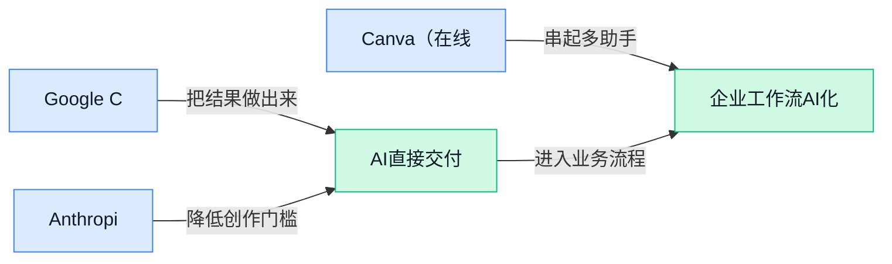

> AI 早报 · 每日早读 · 全网深度聚合

## **今日摘要**

```
OpenAI筹资300亿美元估值或达1.25万亿，DeepSeek美方限制后融资150亿美元
Google Cloud一站集齐OpenAI、Gemini与Claude，三强模型同台
Anthropic推出Claude Duet（常驻任务代理），从问答助手升级为持续待命
```

### 🔵 产品与功能更新

1. **Google Cloud（谷歌云，提供云计算与人工智能服务的平台）同时提供 OpenAI、Gemini 和 Claude 模型。**  
Google Cloud 现在把 **OpenAI、Gemini 和 Claude** 放到同一云平台中提供，成为首个同时覆盖这三类模型的主要云服务商。这里的**多模型接入（在同一平台调用不同公司的模型）**，意味着用户不必只绑定一家模型供应商。对企业来说，这种布局也让模型选择更加集中，便于在不同需求之间进行比较与切换 🚀。[Google Cloud 模型服务报道(briefing)](https://the-decoder.com/google-cloud-now-offers-openai-models-alongside-gemini-and-claude-becoming-the-only-major-provider-with-all-three/)


1. **Anthropic 推出 Claude Duet（常驻式人工智能助手，持续待命的任务代理）。**  
Anthropic 正通过 Claude Duet 进军**常驻式 Agent（能围绕目标持续执行多步任务的人工智能助手）**赛道。与一次一问一答的聊天工具不同，“always-on”（持续在线、随时待命）的定位强调助手可以长期处于工作状态。报道将它放在 Grok Bot、Meta 的 Muse 和 OpenAI 的 Dots 等产品的竞争环境中，显示 AI 助手正从聊天窗口走向更主动的任务协作 💡。[Claude Duet 产品报道(briefing)](https://the-decoder.com/anthropic-takes-on-grok-bot-metas-muse-and-openais-dots-with-its-always-on-agent-claude-duet/)


1. **Canva（在线设计平台）发布首个图像生成模型（根据指令生成图片的人工智能模型）。**  
Canva 推出了自己的首个**图像生成模型（根据文字等指令生成图片的人工智能模型）**，并向所有用户开放。官方强调，新模型在生成效果和**可定制性（让用户更容易控制最终图片的样式与结果）**方面有所提升，同时使用成本更低。对日常做海报、社交媒体素材和视觉提案的团队来说，这意味着设计平台本身开始直接承担更多图片创作工作 🎨。[Canva 模型发布报道(briefing)](https://techcrunch.com/2026/10/22/canva-releases-its-first-image-generation-model/)

### 🟢 前沿研究

1. **TraceForge（让模型用自身思考过程完成知识蒸馏的研究方案）探索“自己教自己”。**  
论文关注**知识蒸馏**（把复杂模型的能力迁移给另一个模型，类似老师把解题经验教给学生），并尝试利用模型自己产生的思考内容。这里的**推理轨迹**（模型一步步得出答案的中间过程）不只是输出记录，也被视为可用于学习的材料 💡。这项研究瞄准的核心问题是：模型能否从自己的思考中提炼经验，减少对外部“老师”的依赖。[查看完整论文(briefing)](https://huggingface.co/papers/2610.29680)


2. **游戏规模化研究探索持续预训练（让已有模型继续从新环境中学习）如何增强具身智能体。**  
这项研究把**具身智能体**（能在游戏或现实环境中观察、行动并完成任务的 AI）放入多种虚拟世界，关注持续预训练带来的能力变化。所谓持续预训练，是在已有模型基础上继续输入新环境经验，而不是每次都从零开始训练 🎮。研究主题指向一个重要问题：当虚拟世界和任务类型不断增加时，智能体能否把积累的经验用于更广泛的场景。[查看完整论文(briefing)](https://huggingface.co/papers/2610.28698)


3. **多模态具身智能体（能看、听并采取行动的 AI）获得从电脑操作到机器人控制的统一视角。**  
论文以“能力”为主线，尝试把电脑操作和机器人使用放进同一个分析框架。这里的**多模态**（同时处理文字、图像等不同形式的信息）决定了智能体如何理解环境，而**具身交互**（通过点击、移动或操控物体来影响环境）则决定了它如何行动 🤖。这种统一视角有助于理解：看似不同的电脑助手与机器人，究竟依赖哪些共同能力、又在哪些环节存在差异。[查看完整论文(briefing)](https://huggingface.co/papers/2610.30108)

4. **记忆中心的持续学习（让 AI 在长期使用中不断积累经验）瞄准智能体成长难题。**  
这项研究从“记忆”出发讨论智能体如何持续学习，而不是每完成一次任务就重新开始。**持续学习**（模型在接触新任务时继续吸收知识，同时尽量保留旧能力）面临的关键挑战，是如何管理新旧经验之间的关系 🧠。以记忆为中心的视角，意味着研究重点不只是模型能记多少，还包括如何保存、调用和利用过往信息。[查看完整论文(briefing)](https://huggingface.co/papers/2610.29357)

5. **FrontierCS 2（评估计算机科学研发能力的测试基准）关注 AI 能否胜任真正的研究工作。**  
这项工作提供了一个面向计算机科学研发的**基准测试**（用统一任务和标准比较不同模型能力的“考试”）。它考察的重点不是普通知识问答，而是更贴近研发场景的能力评估 🔬。对行业而言，这类基准可以帮助判断 AI 在计算机科学研究与开发任务上的真实水平，而不仅仅看模型是否会生成流畅答案。[查看完整论文(briefing)](https://huggingface.co/papers/2610.29932)

6. **Google 绘制全球森林类型地图，细化到每块 10 米土地。**  
这项研究不再只回答“这里有没有树”，而是进一步区分全球不同的森林类型 🌲。地图把地球陆地划分为一个个 **10 米尺度地块**（每块土地以约 10 米的空间粒度进行分类），让森林分布呈现得更加细致。相比单纯统计**树木覆盖率**（某一区域被树冠覆盖的比例），森林类型信息能提供更丰富的地表分类视角。[森林地图研究博客(briefing)](https://deepmind.google/blog/beyond-tree-cover-mapping-the-worlds-forest-types/)

7. **RAG（让 AI 回答前先查资料）研究进一步追问多份信息能否正确组合。**  
论文关注**组合性**（把多个独立信息片段拼接起来，形成完整答案的能力），而不只是看模型有没有检索到资料。对 RAG 来说，搜到正确内容只是第一步，模型还需要理解不同材料之间的关系并加以整合 🧩。这项研究因此把评估重点推进到更实际的问题：AI 能否基于检索结果完成需要多段信息共同支撑的回答。[查看完整论文(briefing)](https://huggingface.co/papers/2610.29722)

8. **DiffResearch（利用扩散语言模型加速深度研究的方案）尝试缩短复杂研究流程。**  
论文探索用**扩散语言模型**（通过多轮逐步修正内容来生成文本的模型）加速深度研究。这里的**深度研究**（让 AI 搜集、分析并整合多方面信息的复杂任务）通常涉及多个步骤，而不仅是一次问答 ⚡。该工作的核心方向，是研究这种不同于常规逐字生成的方式，能否让复杂的信息研究过程更快完成。[查看完整论文(briefing)](https://huggingface.co/papers/2610.28909)

### 🟡 行业展望与社会影响

1. **OpenAI 筹划融资 300 亿美元，估值或达 1.25 万亿美元。**
OpenAI 据报正在筹划新一轮**上市前融资**（公司公开上市前向投资者募集资金），目标规模约为 **300 亿美元** 🚀。[科技媒体完整报道(briefing)](https://techcrunch.com/2026/10/22/openai-working-on-new-30b-raise-at-1-25t-valuation-ahead-of-ipo/) 若交易按计划推进，其**估值**（投资者对公司整体价值的判断）可能达到 **1.25 万亿美元**。报道指出，一旦估值突破万亿美元，OpenAI 将刷新全球非上市公司（尚未在证券交易所公开交易的企业）的估值纪录。


2. **美国大型银行开始拦截使用客户账号登录的人工智能代理。**
美国多家大型银行正在限制那些使用客户账号和密码登录的**人工智能代理**（能代替用户自动操作账户、完成任务的软件）🔐。[银行限制措施报道(briefing)](https://the-decoder.com/major-us-banks-are-locking-out-ai-agents-that-log-in-with-customer-credentials/) 争议焦点在于**客户凭证**（用户名、密码等用于证明账户身份的信息）能否交给自动化工具使用。对普通用户而言，这意味着人工智能虽然可以帮忙处理事务，但在银行等高敏感场景中，便利性仍须让位于账户安全和访问边界。


3. **人工智能建设账单高企，Meta 等科技热门股承压。**
大规模建设人工智能能力需要持续投入资金，昂贵账单正在给 Meta 及其他受市场追捧的科技公司带来压力 📉。[路透社完整报道(briefing)](https://news.google.com/rss/articles/CBMipAFBVV95cUxOaG4yYUM1ZzJnZmtpWnhIUVEzU01PRmxZM1BDRDJLazA1dkdaX3k0Z2pPMHJJUi1HUEM2OF9oV1JzSFh3d1dEU0dzc3JMQWRCeDhRa2JvNGVBbVluUlY4UGY3REoyWVZkTFBZT3BGa0swX2s1RzY3MDM5ZWlBTm1wYVBYNEt5M2VlTFoyRVNTTXJUaUVVYzVNcUtQQ2hfUW9nalZGbQ?oc=5) 这里的**基础设施扩建**（为人工智能增加服务器、数据中心等底层资源）往往伴随高额**资本开支**（企业为长期资产投入的资金）。这反映出市场正在重新权衡：人工智能前景固然诱人，但短期投入和财务压力同样不能忽视 💡。

4. **DeepSeek 据报融资 150 亿美元，紧随美国限制措施之后。**
DeepSeek 据报完成 **150 亿美元融资**，这被称为中国规模最大的融资交易之一 🚀。[融资消息完整报道(briefing)](https://techcrunch.com/2026/10/22/deepseek-reportedly-raises-15b-days-after-us-restrictions/) 所谓**融资轮次**（企业在某个阶段集中向投资者募集资金的过程），通常能够为后续研发和运营提供资金支持。消息出现前几天，美国刚以国家安全担忧为由，要求联邦机构（美国中央政府所属部门）移除 DeepSeek 相关技术，使这笔融资更受关注。

5. **企业投资转向人工智能，岗位削减压力随之上升。**
随着更多投资流向人工智能，一些企业正在同步削减岗位，资金方向与人员配置开始发生变化 👥。[路透社专题报道(briefing)](https://news.google.com/rss/articles/CBMirgFBVV95cUxOTzk5bDFrWVpNb3dlZ1ZMR2ZhU1NYTkJYRzh2c3JXWHcwQVBVNDhtLUo3QU1XNGFXU3kzZWFvdjdEMnd3TDc4eTI2T2NXemhfcEg5U0dISVRBRE9RUW0yMngyQy1tOXFfZ1kyZUhCa2JoOVBWcm55QWVXekVnWC1HUmw3WmI1Mm9MUE1yNEUyeXZhOXpXMnlWSzZIX3AxMHpYdjBEcXZZQmhwR2lKc2c?oc=5) 这类**预算再配置**（把有限资金从原有业务转移到新重点领域）可能直接影响招聘计划和团队规模。对职场人而言，值得关注的不只是“岗位是否减少”，还包括**岗位结构调整**（企业重新组合不同职责和技能需求）带来的工作内容变化 💡。

6. **OpenAI 推出 Decisions API（为应用程序提供快速决策的接口），主打低成本与高响应。**
OpenAI 发布 **Decisions API（让应用程序调用快速决策能力的连接接口）**，定位是为各类应用提供快速、聚焦且低成本的决策支持 ⚡。[OpenAI 官方发布页(briefing)](https://openai.com/index/decisions-api) **接口**（不同软件之间传递请求和结果的统一通道）可以让开发者把相关能力接入自己的产品，而不必让用户单独切换工具。其核心卖点是提升应用的**响应性**（用户发出请求后，产品能更快给出处理结果），让人工智能决策更容易成为产品流程的一部分。

### 🟣 开源TOP项目

1. **php/php-src（PHP 解释器源码仓库）公开语言运行核心。**
该项目收录 **PHP（常用于网站和服务端应用的编程语言）解释器**的开源代码。解释器（负责读取并执行程序代码的软件）是让程序真正运行起来的底层核心，而不是普通用户直接操作的应用 💡。对于使用 PHP 的技术团队，这个仓库提供了查看和研究其底层实现的入口。[项目代码仓库(briefing)](https://github.com/php/php-src)


2. **Anthropic 开源 knowledge-work-plugins（知识工作者插件库），服务 Claude Cowork（Claude 的协作工作环境）。**
这个仓库集中开放了一批**插件**（为现有产品增加功能的小模块），主要供知识工作者使用 🚀。这里的知识工作者（主要处理信息、文档和协作任务的人群）正是办公场景中的核心用户。项目主要面向 **Claude Cowork（Claude 的协作工作环境）**，意味着相关插件将围绕 Claude 的协作使用场景展开，并允许外界查看其开源内容。[开源插件仓库(briefing)](https://github.com/anthropics/knowledge-work-plugins)


### 🔴 社媒分享

1. **TorchNeuron（让人工智能模型适配亚马逊专用芯片的软件组件）实战：在 AWS（亚马逊云服务）Trainium（亚马逊训练人工智能模型的专用芯片）上做系统级性能分析。**
这篇系列文章的第一部分，聚焦如何观察模型在专用训练芯片上的实际运行情况。所谓**性能剖析**（记录任务在哪些环节消耗了时间和硬件资源），就像给训练过程做一次全面“体检”；而**系统级分析**（从计算、内存和任务调度等整体环节寻找瓶颈）则能帮助团队判断问题究竟出在哪里 🔍。对使用云端专用芯片训练模型的团队来说，这类分析是改善运行效率的重要基础。[系统性能分析原文(briefing)](https://huggingface.co/blog/amazon/profiling-torchneuron-part-1)


2. **ThinkingBox（把数据库评分用于训练智能体的方案）将数据库评分变成 RL（强化学习，用奖惩信号训练模型）奖励。**
文章介绍了一种思路：把**数据库评分**（让数据库任务的完成结果变成可比较分数）转换成模型能够学习的奖励信号。它用于智能体的**后训练**（基础模型训练完成后，再针对具体任务继续优化），让模型根据任务结果调整后续行为 💡。核心看点是把原本用于判断“做得对不对”的评分机制，进一步变成智能体学习的反馈来源。[智能体训练方案介绍(briefing)](https://huggingface.co/blog/microsoft/thinkingbox-training)


3. **OlmoEarth v1.3（面向全球尺度数据生成数字表征的模型）带来更先进的地球嵌入能力。**
文章称，新版本实现了面向整个地球数据的**先进嵌入表现**。这里的**嵌入**（把复杂信息转换成一组数字，方便模型比较、检索和分析）相当于为数据制作可计算的“特征名片”；**表征**（用精简数字特征表达原始信息）则决定模型能否抓住数据之间的联系 🌍。这项更新的重点不是直接生成内容，而是让全球尺度的信息更容易被人工智能系统理解和处理。[模型版本发布介绍(briefing)](https://huggingface.co/blog/allenai/olmoearth-v1-3)


4. **The Last Museum（提供大型博物馆藏品语义搜索的网站）可检索 580 万件艺术品。**
该网站提供覆盖多家大型博物馆、共计 **580 万件艺术品**的搜索入口 🎨。它采用**语义搜索**（按照问题和作品描述的含义匹配，而不是只寻找完全相同的关键词），用户因此可以用更自然的方式寻找相关作品。这样的**跨馆检索**（一次搜索覆盖多家博物馆藏品）也减少了逐个网站查询和反复更换关键词的麻烦。[艺术品语义搜索网站(briefing)](https://lastmuseum.com/)

5. **Anthropic 将 Agent Skills（供智能体复用的任务能力包）捐给 Agentic AI Foundation（承接智能体生态项目的基金会）。**
文章转引了 Anthropic 当日发布的消息，核心事件是将相关**智能体能力包**（把一类任务所需内容整理成可重复使用的单元）捐给基金会。与单纯发布一个模型不同，这次关注的是这些能力资产由谁承接，以及未来如何在更广泛的智能体生态中延续 🤝。不过，候选摘要没有披露具体捐赠范围和后续安排，相关细节仍应以原文为准。[智能体能力捐赠解读(briefing)](https://simonwillison.net/2026/Oct/22/donating-agent-skills/)

6. **多款人工智能模型对人类给出了相同的“争议性”看法。**
这篇文章关注一个有意思的现象：不同模型似乎对人类给出了相同或相近的争议性判断 🤔。所谓**跨模型比较**（把同一个问题交给多个模型，再对照它们的回答），可以观察模型之间是否存在共同倾向；**模型一致性**（多个模型对同一问题给出相近结论）则不代表这些结论一定正确。候选摘要并未披露具体观点、测试问题和参与比较的模型名单，因此不宜只凭标题推断最终结论。[多模型观点比较原文(briefing)](https://www.modelcompare.ai/blog/ai-models-controversial-take-on-humans)

---



### 📊 行业洞察（今日 3 条）

1. Google Cloud同台提供OpenAI、Gemini和Claude。
   【洞察】多模型接入（同平台使用不同模型）更具吸引力，因企业可比较效果与成本，但集中依赖仍有风险。

2. Anthropic推出Claude Duet，可自主处理工作并在付款前请求确认。
   【洞察】主动型助手将进入高敏感操作，因为其能连接多种服务，但权限误用风险也随之增加。

3. Canva向所有用户开放首个图像生成模型（按文字要求生成图片的AI）。
   【洞察】设计工具正内化素材生产，因为生成与编辑结合可减少步骤，但内容趋同与版权风险上升。

### 💭 对我们的启发（今日 3 条）

1. Canva事件提示创作智能体平台加入可控视频素材生成，机会是减少找图与改图步骤，风险是画面趋同和版权争议。

2. Google Cloud多模型布局提示平台支持模型对比，机会是按脚本、字幕和画面择优，风险是体验不一致与成本复杂。

3. Claude Duet提示视频工具可主动拆解脚本、完成粗剪与复核，机会是缩短创作路径，风险是误改素材，需保留预览确认。


---

> 本周周报：[第43周综合分析](https://zhuxinfei.github.io/ai-daily-site/blog/weekly/2026-w43/)
