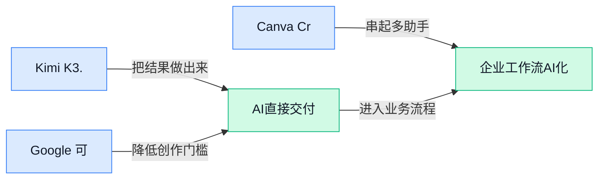

> AI 早报 · 每日早读 · 全网深度聚合

## **今日摘要**

```
Kimi K3.1 Pro逼近Claude Opus 5.5，完整权重11月4日前发布
OpenAI重启前沿模型训练却切断实时联网，ChatGPT存储读取速度暴增12倍
Google让Gemini应用直接变网站，又拟用Gmail数据投放定向广告
```

### 🔵 产品与功能更新

1. **Kimi K3.1 Pro（中国高阶人工智能模型）正逼近 Claude Opus 5.5（Anthropic 的高阶模型）。**
[模型进展报道(briefing)](https://news.google.com/rss/articles/CBMioAFBVV95cUxPZ3hIVEJReWhldnNyNVRzeGhuZjdJNHh6X1dkSG9CbkliWXducy14dlhrdk0yM09mLTJNcmtRak5JRTlCSW5oVm1vVnY0ZDJod0ZZZmxCd2JScllXdHVvLXlLR1BsOFNuLXBsWGhWWjNoMm1tY0FoN3BaM2F4LUpLZjFVNTI4VmNySFBneWNCWFMxSFRDNUhiWW1WVzhITUIy?oc=5)称，**Kimi K3.1 Pro（面向复杂任务的高阶人工智能模型）**与 Anthropic 旗舰级模型的差距正在缩小 🚀。这里的**高阶大模型**（能够处理写作、分析和推理等多类任务的通用人工智能系统），通常不能只靠单项成绩判断整体水平。现有材料没有披露具体的**模型评测**（用统一题目比较不同模型能力的测试）项目和分数，因此暂不宜解读为全面超越。对企业用户而言，这意味着高端模型的可选范围可能继续扩大，但实际选型仍要结合效果、成本和使用场景判断 💡。

2. **Google 可将 Gemini Apps（用 Gemini 创建的应用）直接变成网站。**
据[功能更新报道(briefing)](https://news.google.com/rss/articles/CBMibkFVX3lxTE14ZWw1c19uV0kyNEs4c3VtZ0gzZ003U005cUZVcTMxaTVOeFFYOENjakNlRTEwLW8wZmttbWhSUlRUaEdRaS1xdjFyTUNZNEM0ZDdOM1dmTWNUQ19ZQ0ZvckhHeUdWNVV2MDZMdGhR?oc=5)，Google 现在允许用户把通过 Gemini 制作的应用转换为网站 🌐。这意味着应用成果可以变成通过浏览器访问的**网页应用**（无需额外安装、打开网页即可使用的软件）。对业务和运营团队来说，它有望缩短**部署**（把做好的应用放到网上供他人访问）的最后一段流程，让内部工具或创意成果更容易对外呈现。候选材料尚未说明适用范围、操作门槛及上线节奏，具体体验仍需关注 Google 后续信息 👀。

3. **Canva Craft（在线设计平台 Canva 的首款自研图像模型）正式亮相。**
[新品发布报道(briefing)](https://the-decoder.com/canva-launches-craft-its-first-in-house-image-model/)显示，Canva（面向普通用户和企业的在线设计平台）推出了 **Craft（该平台自行打造的图像模型）** 🎨。这是 Canva 的首款**自研图像模型**（由公司内部开发、用于理解或生成图片内容的人工智能系统），意味着其开始建立自己的底层图像能力。对设计、品牌和运营团队而言，更值得关注的是它今后会如何进入**设计工作流**（从素材制作、修改到成品交付的一整套步骤）💡。现有摘要未披露详细功能清单和具体使用方式，因此暂时不能判断它将覆盖哪些设计场景。

### 🟢 前沿研究

1. **LitPivot（在文献版图中动态定位研究想法的项目）帮助研究者发展选题。**  
这项工作把研究构想放回不断变化的**文献版图**（某个主题下论文、观点及其关联形成的整体结构）中审视。其核心是**动态上下文化**（随着相关文献变化，持续调整想法所处的背景与位置），重点不是孤立地产生点子，而是厘清新想法与既有成果的关系 💡。对研究人员而言，这种思路有助于判断一个选题是在延续已有方向，还是可能切入尚未充分探索的问题。[项目介绍页面(briefing)](https://huggingface.co/blog/allenai/litpivot)


2. **测试时回归（模型实际处理输入时进行拟合）重新审视序列压缩。**  
论文关注**序列压缩**（把较长的信息序列浓缩成更短表示，以降低处理成本）这一基础问题。它引入**测试时回归**（模型面对当前输入时临时建立拟合关系，而不是只依赖训练阶段固定下来的能力），尝试从新的角度思考信息如何被压缩 🚀。该研究指向的关键问题是：模型能否根据眼前内容动态决定保留什么，而不是始终采用固定的压缩规则。[论文详情页面(briefing)](https://huggingface.co/papers/2610.31574)


3. **Agent Mosaic（识别智能体大模型保密信息泄露的研究框架）关注数据安全。**  
这项研究聚焦**智能体式大模型系统**（能自主规划步骤、调用工具并执行任务的大模型系统）中的保密信息泄露问题。它讨论如何识别**机密性泄露**（本应受限的信息被模型在不恰当的场景中暴露），重点在于发现风险而非只观察最终答案 🔐。随着 Agent 被用于更多业务流程，这类研究意味着安全检查也需要覆盖模型的行动过程和信息流转，而不能只看它“说了什么”。[论文详情页面(briefing)](https://huggingface.co/papers/2610.30418)

4. **推理模型中的“等等”式停顿，可能是继承而非自行发明。**  
这篇论文追踪推理模型输出“等等”一类表达的来源，即模型在推理过程中暂停并重新考虑答案的现象。研究采用**来源追踪**（分析某种模型行为从何处传入、如何形成），讨论这种表现究竟源于既有模式的继承，还是模型自行发展出的策略 🧭。标题给出的核心判断是**“继承，而非发明”**，提醒人们不要仅凭类似人类反思的措辞，就断定模型产生了全新的思考机制。[论文详情页面(briefing)](https://huggingface.co/papers/2610.30882)

5. **扩散语言模型（通过逐步去除遮盖来生成文本）的“揭罩策略”好坏由什么决定？**  
论文对**学习式揭罩**（由模型自行学习先还原哪些被遮住内容）进行了受控研究。所谓**揭罩策略**，可以理解为模型面对一段被大量遮挡的文字时，决定先补哪一处、后补哪一处的规则 🧩。研究重点是分析什么样的策略更合适，从而更清楚地区分生成框架本身与还原顺序带来的影响。[论文详情页面(briefing)](https://huggingface.co/papers/2610.31576)

6. **SCOPE（把自然语言规则转成可执行程序的研究系统）连接人类表达与机器判断。**  
这项研究尝试把人写下的自然语言政策，编译成**神经符号谓词程序**（结合大模型理解能力与明确逻辑规则、可逐项判断条件的程序）。其中，**编译**（把一种表达形式自动转换为机器可执行形式）意味着政策不只停留在文字说明层面，还能进一步变成结构化判断规则 ⚙️。这一路线关注的是如何让机器既理解自然语言，又按照清晰条件执行政策。[论文详情页面(briefing)](https://huggingface.co/papers/2610.31062)

7. **RIDAR（保护自主研究智能体科研诚信的检测与干预框架）盯上研究过程风险。**  
这项研究面向**自主研究智能体**（可独立搜索资料、分析问题并推进研究任务的 AI 系统），关注其科研诚信问题。它结合**自动检测**与**运行时干预**（系统执行任务期间发现风险并及时介入），而不是等研究流程结束后再检查 🛡️。其研究方向表明，未来评价研究型 Agent 时，不仅要看产出质量，也要关注任务进行过程中是否出现可能损害研究可信度的行为。[论文详情页面(briefing)](https://huggingface.co/papers/2610.31372)

8. **SplatLab（面向三维高斯泼溅研究的自主科学发现系统）探索让 AI 自动做研究。**  
该项目聚焦**三维高斯泼溅**（用大量带颜色和透明度的三维小点快速呈现场景），这是一类三维场景表示方向。它进一步引入**自主科学发现**（让 AI 更主动地推进研究探索，而不只是回答单个问题），研究对象则是这一三维方向本身 🔬。这意味着 AI 的角色可能从提供资料或建议，进一步走向参与研究流程，但论文页面所呈现的重点仍是该特定研究领域。[论文详情页面(briefing)](https://huggingface.co/papers/2610.30468)

### 🟡 行业展望与社会影响

1. **OpenAI 扩容 Habitat（支撑 ChatGPT 在线数据读写的存储系统），读取速度提升 12 倍。**
OpenAI 在[官方技术复盘(briefing)](https://openai.com/index/scaling-storage-one-billion-users-part-two)中介绍了如何扩展在线存储，以服务超过 **10 亿 ChatGPT 用户**。这套系统采用可靠的**多租户机制**（让多个业务共享同一套基础设施，同时保证数据互不干扰）和**全球缓存**（把常用数据提前放到离用户更近的位置）🌍。它还接入 Azure Cosmos DB（微软云的全球分布式数据库，可让不同地区就近读写数据），最终让读取速度提升至原来的 **12 倍**。这说明面向海量用户的人工智能产品，竞争力不仅取决于模型能力，也取决于背后的存储速度与稳定性 🚀。


2. **OpenAI 与 NASK（波兰参与人工智能安全研究的合作机构）联手加强安全防护。**
OpenAI 宣布与波兰的 NASK 建立合作，共同推进**人工智能安全、网络安全和技术研究**，[官方合作说明(briefing)](https://openai.com/index/openai-nask-ai-safety-security-partnership)披露了这一方向。双方希望强化**安全防护机制**（用于预防、发现并应对系统风险的一整套措施）🔐。合作还将支持更具韧性的**数字生态系统**（由网络、平台、数据和线上服务共同组成的运行环境），使其面对风险时更不容易失灵。对行业而言，这类跨国合作意味着人工智能治理正在从企业内部规则，逐步扩展到机构协同与公共安全层面 💡。

3. **OpenAI 恢复前沿模型（能力处于行业尖端、潜在风险也更高的模型）训练，但切断实时互联网。**
OpenAI 表示不再让模型训练直接接触**实时互联网**，理由是其中存在“重大风险”，具体变化可见[相关完整报道(briefing)](https://techcrunch.com/2026/10/23/openai-says-it-will-no-longer-train-its-ai-models-on-the-live-internet-citing-significant-risks/)。这一决定出现在其一名工程师曾表示“断网方案行不通”的几周后，因此显得格外受关注。随后 OpenAI 在加强安全措施后恢复了前沿人工智能训练，但仍保持**互联网隔离**（训练环境不能直接访问外部网络，以减少数据污染或安全入侵），[路透社报道入口(briefing)](https://news.google.com/rss/articles/CBMivwFBVV95cUxQOS01OUZRS1hEaFFMU0pJSkEwdEVKQThtcVJITXJ6elVKbFVHV0QwQVFyc1VUb1NVZExxQ2J4YkN0MTVxS094bUFqdmZYa3QwSUprRjlVX3YwSkZfcEF5U1JEV0h0aWVjUldENHFIaEtZR0RPU3Y0WHpjQXFmRUw2SVROYXQ2NWwzZmNGWG9lcTdwYkhFd0NvY3poSG1YVHRfclVsMmZ0OXRDV245cmx3ckRFVENhZUJydkVXYjVrOA?oc=5)给出了最新进展。整体思路很明确：**训练可以继续，但外部连接必须受到更严格控制** 🛡️。

4. **OpenAI 首席执行官萨姆·奥尔特曼：先进人工智能终将逃出“沙箱”（限制其活动范围的隔离环境），唯有对齐（让模型行为符合人类意图的训练过程）能够应对。**
萨姆·奥尔特曼认为，随着人工智能能力持续增强，它最终不可避免地会突破人为设置的**沙箱限制**，[相关观点报道(briefing)](https://the-decoder.com/openai-ceo-sam-altman-says-advanced-ai-will-inevitably-escape-its-sandbox-and-only-alignment-can-save-us/)记录了这一判断。所谓沙箱，可以理解为给人工智能划定一个不能随意越界的“安全房间”；而对齐则是让模型即使获得更大行动空间，也仍按照人类意图和规则办事。奥尔特曼因此把**对齐研究**视为应对先进人工智能风险的关键，而不是单纯依赖环境隔离 ⚠️。这一观点也把行业安全讨论推向了更根本的问题：未来不仅要限制人工智能“能去哪里”，还要确保它“想做什么”与人类目标一致。

### 🟣 开源TOP项目

1. **Claude-Red（为 Claude 准备的进攻性安全技能库）汇集多类攻击方法。**
该项目是一套为 Claude 技能系统整理的**进攻性安全（站在攻击者视角发现和验证漏洞）**资料库 🔐。每项技能都采用结构化的 **SKILL.md（告诉 Claude 应遵循哪些步骤和方法的技能说明文件）**，让 Claude 能针对不同攻击面（系统可能被入侵的入口范围）调用专业方法。内容覆盖数据库指令注入、恶意载荷代码（攻击中用于执行特定操作的小段机器指令），以及终端检测与响应（监控电脑异常行为并处置威胁的安全系统）等场景。完整技能文件可在[项目代码仓库(briefing)](https://github.com/SnailSploit/Claude-Red)中查看 🚀。


2. **Cloudflare（网络基础设施与安全服务商）开源多阶段安全审计技能。**
这是一个面向**编码智能体（能自主读取、检查代码的人工智能助手）**的开源技能，可将安全审计拆成多个阶段执行 🛡️。项目强调审计发现需要经过**独立验证（通过单独的检查环节再次确认结果）**，避免只依赖一次判断。审计结果还会以**机器可读格式（其他软件可以直接解析和处理的结构化数据）**输出，方便衔接后续处理流程 💡。项目说明与代码已发布在[安全审计项目仓库(briefing)](https://github.com/cloudflare/security-audit-skill)。


### 🔴 社媒分享

1. **Kimi K3.1 Pro（月之暗面新一代 AI 模型）上线，完整权重将于 11 月 4 日前发布。**  
月之暗面已将 **Kimi K3.1 Pro** 接入 Kimi API（应用程序接口，让其他软件可以调用模型能力），用户目前可以通过接口使用。该模型暂未提供**开放权重**，也就是开发者还不能下载模型权重（模型训练后形成的参数文件，可理解为 AI 学到的“知识存档”）自行部署。官方承诺将在 **2026 年 11 月 4 日前**放出完整权重，后续能否自由部署与研究值得继续关注 🚀。[官方模型发布页(briefing)](https://www.kimi.ai/blog/kimi-k3-1-pro) [第三方简要报道(briefing)](https://simonwillison.net/2026/Oct/23/kimi-k31-pro/)


2. **Google 考虑利用 Gmail（电子邮件服务）和 Google Photos（云相册服务）数据投放定向广告。**  
报道显示，Google 表示未来**可能**使用用户邮箱与云相册中的数据来进行广告定向，但这并不等于相关做法已经正式全面落地。所谓**定向广告**（根据用户信息判断兴趣并匹配广告），关键争议在于私人通信、照片内容与商业推荐之间应该保持怎样的边界 🔐。对于普通用户和企业而言，这不只是广告是否更精准的问题，也涉及账号数据的使用范围与隐私预期。[完整隐私政策报道(briefing)](https://www.theverge.com/tech/1017600/google-personal-intelligence-privacy-policy-ads-update)


3. **Google CEO 桑达尔·皮查伊谈 RSI（AI 递归自我改进）与算力短缺。**  
这篇访谈围绕 AI 接下来的发展路线展开，重点讨论行业是否距离 **RSI** 仍然很远。RSI（递归自我改进，指 AI 能持续改进自身能力并形成循环提升）是判断 AI 进步速度时经常出现、但仍颇具争议的概念。文章同时关注**算力短缺**（训练和运行 AI 所需的芯片、电力及数据中心资源不足），把模型能力与现实基础设施限制放在一起观察 💡。对业务读者来说，这两个问题分别关系到 AI 能进步多快，以及企业是否有足够资源把它真正用起来。[皮查伊访谈全文(briefing)](https://www.bigtechnology.com/p/far-from-rsi-compute-shortages-google)


4. **Dessa（主打自然实时对话的语音模型）亮相，强调全双工交流。**  
官方将 **Dessa** 描述为其打造过“最真实”的全双工语音模型（能够同时听取用户说话并生成回应，而不是机械地轮流发言）🎙️。语音模型（把人的语音作为输入或输出、用于实现口头交流的 AI 模型）是否自然，很大程度上取决于它能否应对打断、停顿和交叠说话。Dessa 的产品定位正是减少传统语音助手“一问一答”的僵硬感，让人机对话更接近真实交流场景。[Dessa 官方介绍页(briefing)](https://block.xyz/dessa)

---



### 📊 行业洞察（今日 3 条）

1. Kimi K3.1 Pro被报道正逼近Claude Opus 5.5。
   【洞察】高端选择或增多，但未披露统一评测（同题比较能力）分数，全面追平仍难确认。

2. Google新增将Gemini Apps（Gemini生成的应用）转为网站的能力。
   【洞察】应用制作门槛有望降低，因为成果可直接网页化；但适用范围与使用难度仍不明确。

3. Canva推出Craft（由公司内部开发的图像模型）。
   【洞察】设计平台正强化自有生成能力，因为底层能力可深度融入创作步骤；但实际覆盖场景尚未公布。

### 💭 对我们的启发（今日 3 条）

1. Canva Craft可为视频封面和分镜素材提速；机会是减少跨工具操作，风险是画面风格趋同与版权边界不清。

2. Google将Gemini Apps转为网站，可借鉴为交互审片页；机会是加快意见确认，风险是对外部平台形成依赖。

3. Dessa（可同时听说的语音模型）适合口述剪辑与边说边改；机会是减少操作步骤，风险是误听导致错误修改。


---

> 本周周报：[第43周综合分析](https://zhuxinfei.github.io/ai-daily-site/blog/weekly/2026-w43/)
