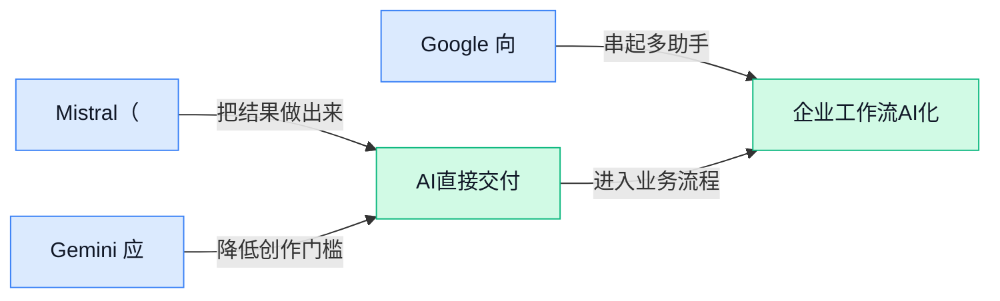

> AI 早报 · 每日早读 · 全网深度聚合

## **今日摘要**

```
Mistral（大模型公司）开放万亿参数权重，Mistral Large 4直指网络安全
OpenAI支持的Thrive（企业改造控股）斥资153亿美元收购ADT（家庭安防商）
Google向第三方智能代理开放Android开发，Gemini聊天直接编辑文档和PDF
```

### 🔵 产品与功能更新

1. **Mistral（大模型开发公司）发布万亿参数模型权重，瞄准网络安全。**
该公司公开了这款**万亿参数模型**的模型权重（训练完成后保存的核心数值，类似模型的“知识存档”），应用方向聚焦**网络安全** 🔐。Mistral 表示，企业可以借此获得更强的网络防御控制权，这是封闭模型（不公开内部参数、主要通过线上服务使用的模型）难以提供的。对重视系统自主掌控的组织而言，能拿到权重是这次更新的核心看点 🚀。[完整发布报道(briefing)](https://techcrunch.com/2026/10/29/mistral-releases-weights-for-its-trillion-parameter-ai-model-targeting-cybersecurity/)


2. **Gemini 应用支持在聊天中直接编辑文档和 PDF（固定版式电子文档格式）。**
用户现在可以在 Gemini 的聊天界面内直接修改**普通文档与 PDF 文件**，把内容讨论和编辑操作放进同一个流程 📝。这种对话式编辑（直接用日常语言告诉助手如何修改内容）减少了在聊天工具与文档工具之间来回切换的需要。对经常处理报告、方案或材料的办公用户来说，Gemini 正从问答助手进一步变成**文档处理入口** 💡。[功能更新报道(briefing)](https://news.google.com/rss/articles/CBMihgFBVV95cUxQNEVnS0dhZnN6TmR6eU9MNHA5WFZaaEF5czl6Y0VHZGppeUwtYldtcTN6c0lxMmJSTUN1bXFROUZpTWFlNjg4NEZzM0stTkRtdjk5c1VqeURwNjdGcDFoYldkakNJbnM5YXlkaUkzUHJ4bG9KZDh0TjltWnVIaUwyMXF4NC1tQQ?oc=5)


3. **Google 向第三方智能代理开放 Android 开发，并推出新的 Gemini API（供外部软件调用 Gemini 能力的接口）。**
Google 正在向第三方智能代理（由 Google 以外厂商提供、可自主执行多步任务的助手）开放 **Android 开发**能力 🤖。与此同时，公司还公布了新的 Gemini API，让开发者能够通过标准接口把 Gemini 能力接入自己的软件或工作流程。两项更新共同扩大了外部开发者使用 Google 人工智能能力的渠道，也让更多第三方工具有机会参与 Android 应用开发 🚀。[完整更新报道(briefing)](https://the-decoder.com/google-opens-android-development-to-third-party-ai-agents-and-unveils-new-gemini-apis/)

### 🟢 前沿研究

1. **OpenAI 用分层监控提前发现前沿模型失准。**
OpenAI 通过**分层监控（用多道检查机制持续观察模型行为）**，识别前沿模型（能力处于当前最先进水平、潜在影响也更大的模型）的异常迹象。监控重点包括**对齐偏差（模型行为没有遵循人类意图与规则）**，以及智能体未经授权自行采取行动等问题 🚨。这套思路的核心，是在风险演变成严重事故前向响应人员发出信号，让人能够及时介入处理。[OpenAI 安全研究说明(briefing)](https://openai.com/index/how-we-detect-frontier-model-misalignment)

2. **Efficient Streaming Audio-Visual Target Speaker Extraction（面向真实环境的流式音视频目标说话人提取研究）聚焦嘈杂场景。**
这项研究关注如何在真实声学环境中，从混杂声音里持续提取**指定说话人的语音**。其关键方向是流式处理（声音和画面一到就立即处理，而非等全部录完）与**音视融合（同时参考声音和人物口型等画面信息）** 🎧。研究标题特别强调效率，目标是在复杂环境下兼顾实时处理需求与目标语音分离，为会议、采访等语音处理场景提供研究思路。[研究论文页面(briefing)](https://huggingface.co/papers/2610.32749)

3. **RealCLI（评估人与命令行智能体协作的统一测试体系）探索人机协作评测。**
这项研究面向**命令行智能体（通过文字命令操作计算机并执行任务的人工智能）**，尝试建立统一评测（使用同一套标准比较不同系统表现）的框架。它关注的不只是智能体能否单独完成任务，还把**人与智能体如何共同工作**纳入评估范围 🤝。这意味着相关研究开始更重视真实协作体验，而非只看一次任务的最终成败。[评测研究论文(briefing)](https://huggingface.co/papers/2610.22507)

4. **OmniShowcase（利用多视角图片生成主体一致全向视频的研究）瞄准视频一致性。**
该研究尝试从**多视角图像（从不同方向拍摄同一对象的一组图片）**生成全向视频，让画面能够覆盖主体的多个观察方向。它特别关注主体一致性（人物或物体换角度后，外形、身份特征仍保持统一）这一生成难题 🎬。从研究目标看，这类能力有望让视频生成不再局限于单一正面视角，并减少主体在镜头转换时“变样”的情况。[视频生成论文(briefing)](https://huggingface.co/papers/2610.35684)

5. **Sensorimotor Alignment（用感知与动作协调度预测具身策略成败的研究）提出替代评估视角。**
这篇研究将**感觉运动对齐（观察到的信息与随后采取的动作是否协调匹配）**，作为判断具身策略表现的线索。具身策略（机器人等实体根据环境观察决定下一步动作的规则）最终是否成功往往需要实际执行才能确认，因此论文探讨以**代理指标（用较容易测量的数据间接估计最终结果）**进行判断 🤖。其研究重点，是考察这种较理想化的指标能否代表真实任务中的策略成功情况。[具身智能论文(briefing)](https://huggingface.co/papers/2610.31670)

6. **Amortizing Sequential Experimental Design（让推理大模型分摊连续实验规划成本的研究）探索更高效的实验设计。**
研究聚焦推理大模型（擅长进行多步骤分析和判断的大模型）中的**连续实验设计（根据上一轮结果，逐步决定下一轮做什么实验）**。这里的“分摊”指把反复发生的规划成本进行复用，而不是每次遇到新一轮实验都完全从头思考 💡。论文由此探讨如何让模型更高效地处理一连串相互关联的实验决策。[实验设计论文(briefing)](https://huggingface.co/papers/2610.20832)

7. **TauIndianBankBench（面向印度银行流程的工具型对话智能体评测）强调按规程办事。**
该评测以**印度银行业务场景**为背景，考察能够使用工具的对话智能体。工具调用（让模型连接外部系统完成查询或操作）意味着评估不能只看回答是否流畅，还要关注它是否能依照业务流程采取行动 🏦。论文标题突出**流程感知（理解任务所处步骤及前后规则）**和行动导向，反映出银行类智能体评测正从“会聊天”转向“能否按程序做事”。[银行智能体评测论文(briefing)](https://huggingface.co/papers/2610.30161)

8. **PersonaCUABench（评估计算机操作智能体服务不同用户能力的测试体系）关注人群差异。**
这项研究面向**计算机操作智能体（能够代替用户点击、输入并完成电脑任务的人工智能）**，评估它们服务不同用户画像的能力。用户画像（代表不同类型用户及其需求的设定）被纳入测试，意味着研究不再只问智能体“会不会操作”，还要看它能否适配多样化服务对象 👥。这一评测方向把**用户差异**带入智能体能力比较，有助于观察系统面对不同角色时的服务表现。[计算机操作评测论文(briefing)](https://huggingface.co/papers/2610.22990)

### 🟡 行业展望与社会影响

1. **OpenAI 支持的 Thrive Holdings（专注收购并改造传统企业的控股公司）斥资 153 亿美元收购 ADT（家庭安防服务商）。**
这笔交易计划把 **AI 引入家庭安防业务**，交易金额达到 **153 亿美元** 💰。所谓家庭安防，主要包括住宅报警、风险监测等保护家庭安全的服务；AI 的加入，意味着传统安防企业正成为智能化改造的新目标。Thrive Holdings 获得 OpenAI 支持，也让这次收购带有明显的 **“资本收购+AI 改造”** 色彩 🚀。更多交易信息可查看[收购交易完整报道(briefing)](https://techcrunch.com/2026/10/29/openai-backed-thrive-holdings-acquires-adt/)。


2. **Google 推出 Gemini 4 Carbon（主打编程与网络安全能力的 AI 模型），宣称网络安全能力大幅跃升。**
Google 表示，该模型在**发现、利用和修复漏洞**方面处于领先位置；漏洞利用（验证软件缺陷能否被实际攻击）通常用于判断安全问题究竟有多危险 🔐。它同时强调了 **AI 编程**与网络安全能力，意味着模型不只是帮人写代码，也开始更深入地参与安全检测和修复。对企业而言，这类能力有望改变安全团队排查问题的方式，但“发现漏洞”和“利用漏洞”同时增强，也会让模型的安全使用边界更加重要 ⚖️。相关说法可参考[安全能力报道(briefing)](https://news.google.com/rss/articles/CBMisgFBVV95cUxOTG5ieV8waVFPcVFXd1VsVlN2aUlDb3RMeHhUMWRGRGpiUjBIek1xeEVkQlh5N2FWcjNVclhzalRLMkg4Wjd3ZWdiOUpQY2xIRU1PQWJpckE2aXdEZlEtSGFXWkIyT2hnYVdwNHdRbXhEM3JjOWxKRjVIOGtEYlYzYW56aldrZHFHSnlNQzFxcXNiT1F4Vm5XVktJOGJyX3Q2RmJIVHJGdkQwMVhXV0puTWlR0gG3AUFVX3lxTE9sMHdrMXJiYTk1bm0zX3FmX2d0OUpITS03NElfYUhHcm5LTVpudzVzQnZHemxJbmJHR1kzYWhVMVRidTc5eF9ITlZ0ak1BSGxlc2h5MjUwbmxuOVczWjZVM2UzZWF4emZmWXJQdFRnQU8tY0RianlRekMzcmpMQmQ1akJOcFRvRTB0NXdaa2R1TzN4WnpnVjg5ZHI4cFdrTk92Z1A4cEtoaENiMmJHeU5WaHBLaG9xQQ?oc=5)与[编程和安全解读(briefing)](https://news.google.com/rss/articles/CBMisAFBVV95cUxNanJ1aUpDN1VQTzZ0bFdjaHhzODlYczl2aVdRZ3FoVHJPRnlsRy15ZW9RNHFPVWY4QlExQXFSckxDazRscm03RlZyT1QtSGdjWUxiYUY4c0lvd1ljWmRYc0pLQmRBSE1CRk9XcUlYc3lwOThfTGtOMzlRYlFFcmJCUk0wWTN2QzFiLWI1NUEwWlBlenVOcmU4Sno4ZjZqNk5rdVJxQWZWQzhxdGsxR2xVbw?oc=5)。


3. **OpenAI 更新 Model Spec（规定模型应如何回应用户的行为规范），兼顾更强能力与社会效益。**
Model Spec（用于说明模型该遵守哪些行为原则、如何处理用户要求的规范文件）迎来更新，目标是让 AI **能力更强，同时更有益于用户与社会** 💡。这类文件关系到模型对齐（让模型行为符合人类意图与规则的训练目标），也是外界理解 AI 产品行为边界的重要窗口。随着模型可以完成越来越复杂的任务，行业竞争已不只是比较“谁更聪明”，还包括**模型应该做什么、如何做得更稳妥**。具体更新可查看[官方规范更新说明(briefing)](https://news.google.com/rss/articles/CBMiV0FVX3lxTE5xNEEzYVdFemd2ZlNTclVaYVZ4M0JlcTBSODQ2ODlQRWpkc05hWk5sMDIxVG00OEJCbm8wX284VFBTTm1kUEktV0VlemVUQzI2WWFBNTlOWQ?oc=5)。

4. **Google 的 AI 搜索压力开始进入财报视野，部分投资者担忧其核心业务。**
有报道认为，Google 面临的 **AI 搜索问题**已开始在财报中显现；AI 搜索（由模型直接整理并生成答案的搜索方式）正在改变用户获取信息的路径 📉。部分投资者因此担忧，生成式搜索（根据用户问题即时生成内容，而非只展示网页链接）可能给 Google 带来实际经营压力。另一篇报道更以约 **5000 亿美元的市场震荡**形容投资者反应，凸显资本市场对 Google AI 风险的敏感程度。相关观点可参阅[财报影响分析(briefing)](https://the-decoder.com/googles-ai-search-problem-finally-shows-up-in-the-earnings-report-some-investors-believe/)与[经济学人相关报道(briefing)](https://news.google.com/rss/articles/CBMiqgFBVV95cUxPRkxZWHJELW1Obk50akt1TlJPX1RMVUdBVEcwMEdPOFN6dTNHQ2NTV3M4ZzJlSkx5eHNUczlhNGlUS0pIajFtU1NhOF9zNEhTVVJzNjBmb0duckV4SmtDU0xIMUdmVVZBbndRUWlmNURPa2NXX1l4V0xsbkZIS0hSNUpwZzBOX00zMXQ2cmt4NldXX1RnaVBtZ1FIbUtXQnZPRXZGeXlVcGc1dw?oc=5)。

### 🟣 开源TOP项目

1. **OpenMausBot（可操作虚拟电脑的开源机器人）提供 Grok Bot 替代方案。**
该项目希望成为 **Grok Bot（Grok 机器人助手）**的开源替代品，让机器人能够使用**虚拟机（软件模拟出的电脑环境，像给机器人单独配了一台电脑）** 🚀。这意味着机器人不只是生成文字，还能在这套虚拟电脑环境中执行操作。项目目前已在 GitHub 开源，可通过[项目代码仓库(briefing)](https://github.com/milind-soni/OpenMausBot)查看具体实现 💡。


2. **OpenBot（让智能代理拥有独立电脑的开源项目）把 AI 同事“装进”电脑。**
OpenBot 为每个 **AI（人工智能）同事**分配独立的浏览器、文件和工具，相当于让它们各自拥有一台可操作的电脑 🖥️。每项操作都会在执行前作出决定、执行后留下记录，方便使用者回看整个过程。它还支持接入 **AG-UI Agent（采用智能代理交互规范、可连接外部界面的任务助手）**，并允许使用者带入自己的智能代理；具体能力可查看[开源项目仓库(briefing)](https://github.com/CopilotKit/OpenBot) 🚀。


### 🔴 社媒分享

1. **Mistral Large 4（Mistral 推出的新一代大模型）正式开放模型权重。**
Mistral（法国人工智能公司）宣布公开 **Mistral Large 4** 的模型权重（模型训练后形成的核心参数，相当于 AI 的“知识存档”）🚀。这意味着外界不只是通过接口使用模型，还能进一步研究其内部参数并探索自主部署。官方目前披露的核心信息就是权重发布，具体能力与使用条件仍应以[官方发布说明(briefing)](https://mistral.ai/news/mistral-large-4-oss/)为准 💡。


2. **AnySpeechRecognizer（苹果设备开放语音识别模型）与 AnyDecisionModel（苹果设备开放决策模型）亮相。**
两个项目分别面向**语音识别**与**决策任务**，并以开放模型的形式服务于 Apple（苹果公司）平台 🍎。开放模型（允许外部人员获取并研究模型的人工智能产品）能为开发者提供更多自主测试和应用空间，而不只是调用封闭服务。此次材料没有给出性能数据或具体应用案例，因此更适合把它看作面向苹果生态的一次模型工具发布，详情可查看[模型项目介绍(briefing)](https://huggingface.co/blog/anydecisionmodel) 💡。


3. **Granite Switch 4.1.1（让模型像软件一样更新的方案）发布新版本。**
这项更新的核心主张，是让 AI 模型也能像普通软件一样进行**版本升级** 🔄。Granite（IBM 推出的一系列企业级人工智能模型）与 Switch（这里指用于切换、更新模型的方案）都属于偏开发端的工具，普通同事可以把它理解成“给 AI 换新版，而不是从头再来”。目前候选材料没有披露具体改动清单与效果数据，可通过[版本更新介绍(briefing)](https://huggingface.co/blog/ibm-granite/granite-switch-4-1-1)了解原始发布信息。


4. **自主 Fable-class models（能自行行动的游戏世界模型）被用于搭建多人游戏世界。**
这篇分享介绍了如何使用 **Fable-class models**（可在虚拟世界中自主行动、参与互动的一类模型）构建多人游戏环境 🎮。这里的 autonomous（自主运行）强调模型能够在一定规则下自行采取行动，而不是每一步都等待玩家指挥。原文标题虽然颇具“标题党”气质，但核心仍是一次围绕自主模型与多人世界构建的实践记录，可阅读[项目实践分享(briefing)](https://simonwillison.net/2026/Oct/29/how-i-built-the-most-ai-pilled-company-in-the-world/)了解其搭建过程 💡。

5. **AI Agent swarms（多个智能体协同运行的集群）进入 Minecraft（沙盒建造游戏）与 Mindustry（自动化策略游戏）实验。**
项目团队让成群的 AI Agent 在两款游戏环境中实际运行，而不是只测试单个 Agent 🤖。Agent swarms（多个智能体分工、协作或同时行动的运行方式）可以理解成把一个 AI 助手扩展为“一支自动化小队”，游戏世界则提供了可持续互动的实验场。候选材料未提供实验成绩或明确结论，因此目前最确定的信息是**智能体集群已在两款游戏中开展测试**，具体项目可查看[游戏实验项目页(briefing)](https://labs.ycombinator.com/projects/games/index.html) 🚀。

---



### 📊 行业洞察（今日 3 条）

1. Mistral公开万亿参数模型权重（模型训练形成的核心数值），聚焦网络安全。  
  【洞察】自主性上升但成本不低，因为可自行定制，也须承担算力与安全责任。

2. Gemini支持在聊天中直接编辑文档和PDF（固定版式电子文档格式）。  
  【洞察】对话式编辑将成为重要入口，因为讨论与修改合一，但复杂排版仍需验证。

3. OmniShowcase利用多视角图像（从不同方向拍摄的图片）生成全向视频。  
  【洞察】视频一致性有望改善，因为跨镜头能保持主体特征，但实际效果尚无充分数据。

### 💭 对我们的启发（今日 2 条）

1. Gemini的对话式编辑可借鉴到视频剪辑，让用户用自然语言改字幕与镜头；机会是降低门槛，风险是误改创作意图。

2. OmniShowcase可用于补充多角度素材并提升镜头连贯性；机会是减少重拍，风险是生成画面失真并增加审核成本。


---

> 本周周报：[第44周综合分析](https://zhuxinfei.github.io/ai-daily-site/blog/weekly/2026-w44/)
