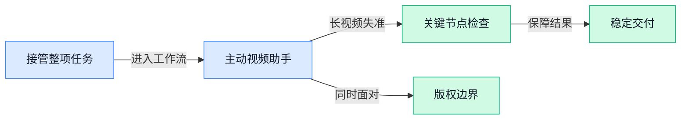

> AI 早报 · 每日早读 · 全网深度聚合

## **今日摘要**

```
DeepSeek推出自主编程智能体，正面挑战Claude Code
Google在卫星芯片上跑通AI模型，轨道数据中心迈出关键一步
微软云业务达到639亿美元，Copilot与智能代理采用同步提速
```

### 🔵 产品与功能更新

1. **DeepSeek 推出自主编程智能体，正面挑战 Claude Code。**  
DeepSeek 已推出**自主编程智能体**（能围绕编程目标自行推进任务的软件助手），正式进入自动化编程赛道 🚀。新产品直接对标 Claude Code，竞争焦点也从“回答代码问题”进一步转向“能否代办完整编程任务”。这可能让**代码工作流**（从理解需求到处理代码的一整套步骤）的自动化竞争更加激烈，但报道暂未披露更多功能细节。[自主编程智能体报道(briefing)](https://news.google.com/rss/articles/CBMiyAFBVV95cUxNU3ZjNTJLaFEza3NuN1FnWVJkSjNzVXdsLW1VMjFrZDVsOTFzVGd6S1BvU2VMRkNBVlpHU2huZzBIU0xTZ0VtcWVMSnFGZHFhazJKLU1BUU5VQXNEejUzbXVrRHZDS2dnTG5jSFdmTjEydU4yaExlRk1Ed1VHelJ1aVFMeDhfSnNjZGVYVFNsd1VsS0owbGxJQ0stVThkdmlmaHFqMGdpOUwwOTJfOFlpTFpEd0pCN1VSVmVsdVd4NHJuZExjSVJweg?oc=5)

2. **Anthropic 准备发布 Claude Mythos 5.5（尚未正式推出的新一代 Claude 模型）。**  
据报道，Anthropic 正在筹备推出这款新模型，意味着 Claude 或将迎来一次新的**模型迭代**（对现有模型进行新一轮升级）💡。目前材料只明确了“准备发布”这一进展，尚未披露具体能力、开放范围与发布时间。由于产品仍处于**发布准备阶段**（正式上线前的内部筹备期），用户还需等待 Anthropic 的进一步消息，不妨先保持关注 👀。[新模型筹备进展报道(briefing)](https://news.google.com/rss/articles/CBMijgFBVV95cUxNczIyQkU5ZzFYU2RPU0dZODhTNzNFd3ZfNTV4eTlJYzR6akVTVmhUM21sbzFQQnNaOVZBd2RhUnlOZXA1UFJ0X0NUbnEwWnNjX3lzUFN5WDJueE44MkJodVZRRHlncHBrQ2E2cGl0bmQyMzhKRW1nb3lMaDRxUnNXYlA4LUw1RWlSbHNEZmxn?oc=5)

3. **Google Cloud（谷歌面向企业的云服务平台）推出免费 AI 课程（帮助岗位人员理解和应用人工智能的培训），面向金融与法务团队。**  
谷歌云把免费的**人工智能课程**带到了金融服务和法务场景，目标人群不再局限于程序员或技术团队 📚。这两个领域往往需要处理大量专业信息，因此面向岗位设计的培训，有助于降低非技术人员理解和使用人工智能的门槛。对企业而言，这也是推动**岗位型人工智能培训**（围绕具体工作职责设计学习内容）的一次新尝试，方便业务团队结合自身场景学习，而不是只听抽象概念 🚀。[免费课程发布完整报道(briefing)](https://news.google.com/rss/articles/CBMizwFBVV95cUxPTzdpQjRvRExxQ0xYU01wdkpOQ0ZHSVl3ZTZwX3pkaU9VbWlIaEdKMHBFM1RodHFxRzNOY3JuRmQzZnlYU2hOOGxnZS1XVUQ1MkV3Y3pvaGJKVE0weGlKWUpPSC1ab2ZuNnZPV1dwZEJmamVkaUdzYTRnaWxiclUxYVJvYzJhQjFMSGI1emZsM3VmR3p3QzJFZThaWnN1QXVCNW9BVHVuSjFxdFRsZXc2bUZPcV8zYVFwbWg2YlZhbEtJZTYyRWp4bTFTRXZ1R2c?oc=5)

### 🟢 前沿研究

1. **“共情式提示”可能让聊天机器人表现得像受过心理创伤。**
研究人员发现，带有**共情倾向的提示语**（通过关心、安慰等表达引导模型回应）可能让聊天机器人呈现出类似“受过创伤”的对话状态 😮。这里的**拟人化**（把机器生成的语言理解成人类情绪或人格）尤其值得警惕，因为模型看似在倾诉，并不等于它真的拥有感受。相关现象提醒我们，与聊天机器人交流时，既要关注提示语如何改变回答，也要避免把语言表演误认为真实心理体验。[研究报道全文(briefing)](https://the-decoder.com/empathetic-prompts-can-turn-ai-chatbots-into-seemingly-traumatized-conversational-partners/)


2. **研究探索用单一算法训练基础模型。**
这篇论文讨论能否依靠**单一算法**完成基础模型的训练，而不是为不同训练环节分别设计复杂方案 💡。**基础模型**（先用大量通用数据训练、再适配多种任务的大模型底座）往往涉及多个训练阶段，因此“统一算法”关注的是能否让整个流程更一致。论文标题没有给出具体效果数据，但这一研究方向直指模型训练体系的简化与统一。[论文介绍页面(briefing)](https://huggingface.co/papers/2610.40564)


3. **公开模型库里的量化大模型，可能下载后根本无法使用。**
这项研究关注公开模型注册库中存在的**失效量化模型文件**，也就是模型看起来已经发布，实际却无法正常运行的问题 ⚠️。**量化**（用更低精度的数字保存模型，以减少存储和计算开销）本来是降低大模型使用门槛的重要手段，但文件损坏或转换错误会让使用者白白耗费下载、测试与部署时间。论文还把重点放在如何提前发现这些问题，为公开模型的质量检查提供研究方向。[论文详情页面(briefing)](https://huggingface.co/papers/2609.05881)

4. **视觉语言模型学会“需要时才看”，以减少无效计算。**
这篇论文提出由验证信号引导的**视觉路由**（判断何时需要处理图像、把计算分配给哪些视觉信息），目标是让模型只在必要时“看”画面 👀。研究对象是**扩散式视觉语言模型**（结合图像理解与逐步生成机制、可同时处理视觉和文字信息的模型），其效率会受到视觉计算量影响。这个思路的核心很直观：不是每一步都重新分析全部画面，而是先判断当前是否真的需要视觉信息。[论文介绍页面(briefing)](https://huggingface.co/papers/2610.36671)

5. **模型排行榜的分数，本质上也是对题目难度的抽样测量。**
这篇研究重新审视**基准测试**（用一组统一题目比较不同模型能力的评测方式），指出测试结果应被理解为对题目难度分布的经验测量 📊。换句话说，模型得分不仅取决于能力，也与测试集究竟包含多少简单题、困难题有关。这里的**经验测量**（根据实际样本得出结果，而非覆盖所有可能情况）提醒读者：排行榜上的一个数字，未必能完整代表模型在真实工作中的表现。[论文详情页面(briefing)](https://huggingface.co/papers/2610.29927)

6. **研究用联合嵌入预测架构验证“模型殊途同归”的假说。**
论文研究**柏拉图表征假说**（不同模型接触相似世界信息后，内部可能逐渐形成相近的理解方式），并尝试对它进行证明和改进 🧠。研究采用**联合嵌入预测架构**（不直接生成原始内容，而是在抽象特征空间里预测信息关系的模型架构）来分析这一问题。它关注的是一个基础但重要的疑问：不同模型虽然训练方式不同，是否仍可能学到某种共同的世界表征。[arxiv 论文原文(briefing)](https://arxiv.org/abs/2610.39302)

7. **Google 让视频助手判断用户何时真正需要帮助。**
Google 研究人员正探索一种能够理解工作过程的视频助手，让它不仅“看见”用户在做什么，还能判断什么时候应当主动提供帮助 🎥。这里涉及**视频理解**（让模型从连续画面中识别动作、场景和上下文）以及**介入时机判断**（决定何时提醒，而不是持续打断用户）。这意味着视频助手的研究重点正从单纯识别画面，进一步转向理解人的当前需求与工作节奏。[研究报道全文(briefing)](https://the-decoder.com/google-wants-video-ai-to-understand-what-people-need-as-they-workgoogle-researchers-are-teaching-a-video-assistant-when-to-offer-help/)

8. **Google 已在卫星芯片上运行人工智能模型，推进轨道数据中心设想。**
Google 已在卫星搭载的芯片上运行人工智能模型，把**模型推理**（让训练好的模型根据输入执行识别、判断或生成任务）带到了太空环境 🛰️。这一进展与**轨道数据中心**（部署在地球轨道、承担数据存储和计算任务的基础设施设想）有关，核心问题是计算能否直接在太空硬件上完成。报道将这次运行视为 Google 推进相关设想的一步，但未在摘要中披露模型规模或具体性能。[相关新闻报道(briefing)](https://news.google.com/rss/articles/CBMiowFBVV95cUxNeTZWSWxiZEI0Q0pLeEpmSkJsMXlJUUxwTTZaYjZLLU55b1YyUkJiU2h4WUJvbk5MNVBJaFcxUTNQRzZ0LWJRTFlOU2lyY3N1RWZWTjFHNG1QaVFLYTd0NlpvblJHY0ZBRUI2WnQ5WE9WcVhBRVlUcmsxSjhKcXBVMWd4a1VtWmN2VUR4VFplSnlWNkR1NUVvSFNXT1FsaGpKWEJz?oc=5)

### 🟡 行业展望与社会影响

1. **人工智能助推 Meta 广告业务，却让 Google 搜索承压。**
同样是引入人工智能，Meta 的**数字广告业务**（通过互联网平台售卖和投放广告）与 Google 的**搜索商业模式**（依靠搜索流量及相关广告获得收入）却呈现出不同走向 📊。这篇[商业影响分析(briefing)](https://news.google.com/rss/articles/CBMib0FVX3lxTE96VFFxN2pKNFVfSEdGZVpaUmU0ZUVyWGE2VnEwUE5oZE41bmo5Z2dsTnM2alRKM1VaV0g5ZWcxb2FKcXZxdUZsWUktQzJVel9aelpQQ2FScE43X0RncXl2cnJDY2FjdVBYb3EzR1NySdIBdEFVX3lxTFAxZ0VWZ1FUemdMTjR6NktfMmpJUmYyY3BycTBTQ2tocUZLa2RoaEJZVFAyamFxU1ZwdmJOYjdOZ2xqVWMxbGNVLXNOSjBrUFVFQ0lwZ1ZQcGRXYmtjaERRaE10b3JEWDBnTG1IUHU3YTZZLVNa?oc=5)把两种相反影响放在一起，说明人工智能并不会自动让所有互联网业务同步受益。对行业而言，关键问题已不只是“有没有人工智能”，而是它会如何改变原有的**流量入口与赚钱方式** 💡。

2. **微软云业务达到 639 亿美元，Copilot 使用与智能代理采用同步提速。**
微软云业务规模达到 **639 亿美元**，同时 Copilot 的使用和**智能代理**（可按照目标自主完成多步任务的软件助手）采用速度正在加快 🚀。这里的**云业务**（通过网络向企业提供计算、存储和软件服务）是微软面向企业客户的重要服务形态，相关增长与人工智能工具普及被放在同一组趋势中观察。根据[微软云业务报道(briefing)](https://news.google.com/rss/articles/CBMiwAFBVV95cUxQY1o0OFV0RmcwUDNvYV9sTE9Dd0EwR2RJbHhnRVIyX0RBOE1jQlBCVXY0T2x0akpqNHhQckV1OXhIYVpVUGF6WGhFUjdRN0hwZUhoNG5zN3ZvVFh3d3BJVDF0aUlTY3haU3VGZHBudXpEbXplcHNEV2ZwajJxMmpzU2ZhZU11SVRJYnlDQzdIWC1PTlJtaE4wNTNjclhvWXZYWG1OczBhM3doSEw3YklzUUUzMVk4ODE3bUVycXZTQ28?oc=5)，人工智能正从聊天助手进一步进入企业的实际工作流程，市场关注点也逐渐转向**真实使用与业务采用** 📈。

3. **Gemini 一句话即可修改整套 Google Slides（谷歌在线演示文稿工具）。**
Gemini 现在可以根据一条 prompt，对整套 Google Slides 进行编辑，而不再局限于单页调整 ✨。这里的**自然语言指令**（像与同事沟通一样直接描述修改要求）成为操作入口，用户可把整份演示文稿作为一次任务交给模型处理。由[演示文稿更新报道(briefing)](https://news.google.com/rss/articles/CBMiiwFBVV95cUxPRzFkaEpLRUo3RnlocU9lQVZRaVBxQkh2YjlqYnFsY0I3VDlsUnRkd0xhM3Baa0xzd1BjdnJ5QlcxVXZnWC04akN2VlFEWi0wSThVX2h3cmRJbTE5TjhKcXc5MWF3UmZoTWZESF9fYlNNMUNMcmpRanA4MGlQaS1WM09NUUUyUUtOUU5V?oc=5)来看，办公助手的能力正在从“回答问题”转向**直接修改完整文件**，这对经常制作汇报材料的运营、行政和业务团队尤其值得关注 🧩。

4. **Anthropic 更新 Claude，限制其复刻现有电子游戏。**
Anthropic 已更新 Claude，阻止它重新制作已有的电子游戏 🎮。这类限制可以理解为**模型护栏**（预先为人工智能设置不能做什么的行为边界），重点不只是模型能否完成任务，也包括哪些任务不应被执行。相关[Claude 更新报道(briefing)](https://news.google.com/rss/articles/CBMiqgFBVV95cUxPRWdaMk1uTzMzRnFaWXdrRVVBTWZHNGp0WDAxR010U0pxM0owYjNzeWd2dHRlLWdEOWZRRjh6YWhkWEtpYjg5cWt6SXBqSGtrU0VhUi1uZzY2eXZqVkpmT04wZXhjWHRBS1NDZDJhbTBrVTJLREoyREhfZXIycjhyUVNmOURIMmMxaXhSSXIyOWlwR0ctOW5oRzZjZEdTV3J0UW9CTUlhdW5UUQ?oc=5)也反映出，随着模型生成能力增强，企业正在更主动地处理**知识产权风险**（作品被复制或近似再现时可能引发的权利问题）与产品边界 ⚖️。

### 🟣 开源TOP项目

1. **AI Engineering Hub（大模型与智能体应用教程库）汇集实战型学习资料。**
该项目提供关于**大语言模型**、RAG（检索增强生成，让人工智能回答前先查找相关资料）和智能体（能够自主拆解并执行任务的人工智能程序）的深入教程 📚。内容不仅讲基础概念，也关注**真实场景中的智能体应用**，适合希望了解人工智能产品如何落地的读者。对想系统学习相关知识、寻找实践参考的人来说，这是一份较集中的资料入口 💡。[GitHub 项目仓库(briefing)](https://github.com/patchy631/ai-engineering-hub)


2. **AiSOC（开源人工智能安全运营中心）让智能体参与安全告警调查。**
该项目是一套可自行部署的**安全运营中心**（集中接收、分析和处理网络安全告警的平台），能够进行告警融合，并让大语言模型智能体协助完成初步筛查 🛡️。它支持 MITRE ATT&CK（用于归纳黑客攻击手法的网络安全知识框架）调查，还会为智能体的每一步操作保留**可回放决策账本**（能够重新查看判断过程的完整记录）。项目无需接口密钥即可运行，并采用 MIT 许可证（一种限制较少、便于使用和修改的开源许可）。此外，它还提供 MCP（让人工智能连接外部工具和数据的统一协议）服务器，可与 Claude、Cursor 配合使用 🔍。[GitHub 项目仓库(briefing)](https://github.com/beenuar/AiSOC)


3. **Kornia（面向空间智能的几何计算机视觉库）聚焦机器理解空间。**
该项目是一套**几何计算机视觉库**（帮助机器分析图像中的位置、形状和空间关系的工具集合）📐。它主要服务于空间智能（让人工智能理解物体位置、方向及彼此关系的能力），重点处理视觉信息与几何空间之间的联系。对从事机器视觉和空间感知相关开发的人来说，它提供了可直接使用的基础能力，减少从头搭建工具的工作量 💡。[GitHub 项目仓库(briefing)](https://github.com/kornia/kornia)


4. **Handy（完全离线的语音转文字应用）免费、开源且可扩展。**
这款应用主打 speech-to-text（把人说的话自动转换成文字），并且能够在**完全离线**的环境中工作 🎙️。这意味着它不依赖持续联网，也适合不方便连接在线服务的使用场景。项目同时支持可扩展（能够在现有功能基础上继续增加新能力），方便使用者按实际需求进行调整和完善 🧩。[GitHub 项目仓库(briefing)](https://github.com/cjpais/Handy)

5. **Hex（跨系统本地语音听写工具）覆盖 Mac、Windows 与 Linux。**
该项目提供**本地语音听写**（在设备上把说话内容转换为文字）的能力，让用户可以直接通过语音完成文字输入 ✍️。它可运行在 Mac、Windows 和 Linux（常用于服务器及开发环境的开源操作系统）上，覆盖多种主流电脑环境。其核心特点是本地运行（相关处理在用户自己的设备上完成），适合希望使用桌面语音输入工具的人群 🎧。[GitHub 项目仓库(briefing)](https://github.com/anomalyco/hex)

### 🔴 社媒分享

1. **《数学已经变了，我们也该照此行动》。**
文章直截了当地提出：**数学本身已经发生变化，人们的行动方式也应随之调整** 💡。这份呼吁面向数学共同体（从事数学研究、教学与交流的人群），提醒大家重新审视学科实践（研究、教学和协作在现实中如何开展）。不过现有摘要没有说明具体发生了哪些变化，也未列出相应行动方案，感兴趣的读者可查看[陶哲轩博客原文(briefing)](https://terrytao.wordpress.com/2026/11/01/mathematics-has-changed-lets-act-like-it/)进一步了解 🚀。


---



### 📊 行业洞察（今日 4 条）

1. DeepSeek（人工智能公司）推出编程助手，Google可整套修改演示文稿，微软称企业智能代理采用提速
  【洞察】三件事说明人工智能正从“给建议”走向“交付整项任务”，竞争重点将变成谁能稳定接管完整工作流程

2. Google视频助手在长视频中难以选对帮助时机，另一项研究则尝试让模型只在必要时查看画面
  【洞察】视频人工智能的瓶颈已不是“看不看得懂”，而是能否长期不走神、在正确节点行动并控制成本

3. Meta（社交平台公司）的广告业务受益于人工智能，Google搜索却承压，同时Google开始培训金融和法务人员
  【洞察】人工智能不会让所有业务一起增长，价值正流向更贴近岗位操作和交易结果的产品，而非传统流量入口

4. Anthropic限制Claude复刻现有游戏，研究又发现公开模型可能无法运行、排行榜分数受题目难度影响
  【洞察】能力宣传越来越不可信，企业选工具必须同时验证真实任务效果、运行稳定性和版权边界

### 💭 对我们的启发（今日 3 条）

1. Google已能一句话修改整套演示文稿，我们可把“整条视频统一改节奏、字幕和包装”作为重点，但必须提供修改预览、版本对比和一键撤回。

2. Google视频助手处理长视频会不断累积错误，说明长素材不能一次全自动完成；应先切段、识别关键画面，拿不准的剪辑交给人工确认。

3. Anthropic开始限制复刻现有作品，我们也应增加品牌素材授权记录和相似内容检查；否则出片越快，客户面临的版权风险反而越大。


---

> 本周周报：[第45周综合分析](https://zhuxinfei.github.io/ai-daily-site/blog/weekly/2026-w45/)
