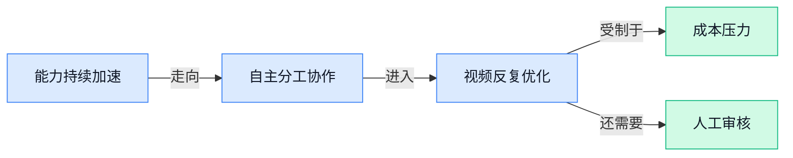

> AI 早报 · 每日早读 · 全网深度聚合

## **今日摘要**

```
Anthropic营收暴增12倍却巨亏230亿美元，警告递归自我改进已非常接近
沙特阿美斥资26亿美元，拿下Humain（沙特AI公司）49%股份
OpenAI推出Pando（代码协作后台）承接Codex开发洪峰，应对海量代码协作
```

### 🔵 产品与功能更新

1. **athenahealth（医疗健康软件公司）推出 athenaPatient MCP（把正式病历接入 Claude 的工具）。**
这款工具旨在把医疗机构掌握的**正式患者记录**连接到 Anthropic 的 Claude，让用户能基于自身健康资料与模型交互 🩺。其中，MCP（模型上下文协议，让不同数据系统以统一方式向模型提供信息）承担连接病历与 Claude 的桥梁作用。它反映出医疗人工智能产品正从通用问答走向**结合真实个人记录**的服务形态，但两篇报道标题均未披露具体开放范围与使用条件。[产品发布报道(briefing)](https://news.google.com/rss/articles/CBMirwFBVV95cUxNdXpwckVYeGZOOWMyemVjcXVsOURWT3lPcTBVYktTNl8zSzhlU21EUms5Q2d3bG03cUxZcE96RnY5TkxIdjFHd1d5LUY1MkgzajM2ZGZIbnZJcHNveWQ2cG5zV2hNZDRjbjBEcUxlQTEteXhxT3ItQTZWLWJGTFJ5VU56Mkl6R0NHN2FVYXN5b1BVdFdtSTFyZ2Z2T3NoT01FcXUtb1ktZ3BjazRUOUlR?oc=5) [医疗行业报道(briefing)](https://news.google.com/rss/articles/CBMiygFBVV95cUxQMU9mUnA3eGNRaE42VV9SdE5yWFpwUVBWazdiNFV2QmpsWFY5V1hrdV9wMEJiUFIxamVLaXNLNmNTczRGRHZkMWlDT0JWUkhhZExkc25BeWhxNDN2TThXcUszN3dVcU5VS3NCbzUySmRva0NjRmFHVmNfTXhRTWlUYWswVzNzRjRjQ3JKbk9pX2tKM2d1cHlQUWRBSDZfblZSTkV5Z2VzRnJJVTNVem05VmUwTzE3OGE1dXVZN0JJMlQydHpHUS1tVVR3?oc=5)


2. **Trajectory（帮助非技术专家参与模型训练的创业公司）融资 4500 万美元。**
这家成立仅一年的公司，希望让不懂编程的行业专家也能参与**模型训练**（用数据和反馈调整模型能力的过程）💡。本轮融资金额为 **4500 万美元**，公司最新估值达到 **3 亿美元**。其产品方向瞄准的是模型开发中的专业门槛：让掌握业务知识、但缺少技术背景的人也更容易贡献经验；现有摘要未说明具体产品形态与操作方式。[融资完整报道(briefing)](https://techcrunch.com/2026/11/02/trajectory-raises-45m-to-make-ai-model-training-accessible-to-nontechnical-experts/)

### 🟢 前沿研究

1. **DeFT-RAG（把复杂问题拆成可复用答案的检索增强生成方案）让模型学会“拆题”。**
传统**检索增强生成**（让模型回答前先从资料库查找相关内容）面对**多跳问题**（需要串联多个事实才能得到答案的复杂问题）时，容易找不全信息。DeFT-RAG（将复杂问题拆解后分别检索和作答的方案）尝试把原问题变成多个**自包含子问题**（脱离原始上下文也能独立理解的小问题），再组合答案 💡。这些子问题的答案还能重复利用，研究重点是减少同类推理中的重复检索与重复作答。[论文摘要页面(briefing)](https://arxiv.org/abs/2610.37826) 🚀


2. **辅助奖励能否让小模型真正学会自我改进？**
只看最终答案是否正确的**答案级奖励**（仅按结果打分、不判断中间思路好坏），无法区分那些“结果一样、推理过程却不同”的回答。论文因此研究**辅助轨迹偏好**（额外比较完整推理过程质量的反馈信号），看看它能否帮助小语言模型改进自身 🧠。研究还评估这种学习能否实现**迁移**（把在一种任务中学到的能力应用到其他任务），重点不只是“这次答对”，而是“以后是否也会做”。[研究论文页面(briefing)](https://arxiv.org/abs/2610.41296)

3. **视觉脚手架能补上多模态推理的“指代鸿沟”吗？**
这项研究聚焦**指代鸿沟**（模型无法准确判断文字中的“它”“这个”究竟对应图中哪个对象）对多模态推理的影响。论文考察**视觉脚手架**（通过框选、标记或结构化提示帮助模型看清对象关系的辅助信息）究竟能解决哪些问题，又有哪些问题依然无能为力 🔍。其核心价值在于区分“模型没看准对象”和“模型看准了却不会推理”，避免把所有错误都简单归咎于视觉识别。[论文介绍页面(briefing)](https://huggingface.co/papers/2610.39419) 💡

4. **全模态嵌入研究从“各自为战”走向统一融合。**
论文以综述和路线图的形式，梳理**全模态嵌入**（把文字、图片、声音等不同内容映射到同一套可比较数字表示的方法）的发展方向。这里的**嵌入**（把内容转换成一串数字，方便模型判断相似性和关联性）是跨模态搜索、匹配与理解的重要基础 🧩。研究重点从不同模态分别处理，转向如何把它们融合到统一表示中，并为后续研究整理发展路线。[综述论文页面(briefing)](https://huggingface.co/papers/2611.00172) 🚀

5. **视频生成开始接入智能体运行框架，并探索递归式自我改进。**
这篇论文把视频生成与**智能体运行支架**（为智能体提供工具、任务流程和执行环境的外部框架）结合起来，讨论智能体如何参与视频生成流程 🎬。研究同时覆盖**世界建模**（让模型学习环境如何变化，从而预测后续状态）以及智能体驱动的视频生成。另一个方向是**递归式自我改进**（模型反复检查并利用自身输出继续优化下一轮结果），意味着视频模型可能不再只是一次性接收指令并交付成片。[论文介绍页面(briefing)](https://huggingface.co/papers/2610.40191)

6. **一场 Minecraft（开放世界沙盒游戏）生存夜，逼出 50 个智能体的自发分工。**
报道显示，50 个智能体在经历一场艰难的游戏夜晚后，自行形成了鸡只交接规则、**肥料管理员**和轮班钓鱼等安排 🐔。这种现象属于**涌现协作**（没有逐条预设，却在持续互动中自发形成分工与规则），也是多智能体研究关注的核心问题。实验把抽象的群体协作变成了可观察的游戏行为，让人直观看到人工智能角色如何为了共同生存建立组织方式。[实验完整报道(briefing)](https://the-decoder.com/one-brutal-minecraft-night-scared-50-ai-agents-into-inventing-chicken-handoff-protocols-a-fertilizer-officer-and-fishing-shifts/) 🎮

### 🟡 行业展望与社会影响

1. **OpenAI 推出 Grid Protectors Program（帮助数据中心稳定用电、控制居民电费的合作计划）。**
OpenAI 将与公用事业机构合作，让未来的**算力园区（集中部署大量服务器、为人工智能提供运算能力的大型设施）**在用电时兼顾电网稳定 ⚡。该计划同时强调保护消费者电费，避免新增计算需求直接挤压普通居民的用电利益。换句话说，人工智能竞争已不只是模型能力之争，也开始深入**电网可靠性（电力系统持续、稳定供电的能力）**这一公共基础设施议题。[官方计划说明(briefing)](https://openai.com/index/grid-protectors-program)


2. **Anthropic 警告：RSI（递归式自我改进，人工智能不断提升自身训练能力）可能已非常接近。**
所谓 **RSI（人工智能通过改进训练过程持续增强自己，并可能引发能力快速跃升）**，关键不只是模型“更聪明”，而是它开始帮助打造更强的下一代模型 🤯。Anthropic 警告，这项能力可能已经非常接近；一旦形成明显的**能力加速（模型进步速度在自我推动下迅速提高）**，行业发展节奏可能发生剧烈变化。相关讨论也因此触及安全边界：人类能否及时理解、评估并控制这种快速增强，将成为重要问题。[风险分析报道(briefing)](https://techcrunch.com/2026/11/02/anthropic-warns-that-its-very-close-to-rsi-capability-aka-self-building-ai/)


3. **高盛撤回交易员和银行家的人工智能编程工具。**
报道称，高盛已从交易员和银行家的工作环境中撤下**人工智能编程工具（能够生成、补全或解释代码的软件）** 💼。这项调整涉及直接接触交易与金融业务的岗位，也把企业采用人工智能时的权限边界推到台前。对其他公司而言，工具“可以提高效率”并不等于所有岗位都能直接使用，**权限治理（规定哪些员工可以使用哪些软件和业务数据）**同样会影响落地范围。[高盛调整报道(briefing)](https://the-decoder.com/goldman-sachs-pulls-ai-coding-tools-from-traders-and-bankers/)

4. **沙特阿美斥资 26 亿美元，拿下 Humain（沙特人工智能公司）49% 股份。**
沙特阿美通过一笔 **26 亿美元交易**取得 Humain（沙特人工智能公司）49%的股份，成为其重要股东 💰。这里的**股权投资（通过购买公司股份参与其未来收益与决策）**，意味着大型能源企业正用资本直接进入人工智能产业。49%的持股比例也让这笔交易不只是普通财务投资，而成为观察能源资本与人工智能产业结合的重要信号。[交易详情报道(briefing)](https://the-decoder.com/saudi-aramco-takes-49-percent-stake-in-ai-firm-humain-with-2-6-billion-deal/)

5. **Anthropic 营收增长 12 倍，却录得 230 亿美元亏损。**
Anthropic 的**营收（公司通过销售产品和服务获得的收入）**增长至原来的 12 倍，显示市场需求正在迅速扩大 📈。但公司同期仍出现 **230 亿美元亏损**；亏损（公司支出超过收入的部分）与高速增长同时存在，说明业务扩张并不等于已经实现盈利。对行业和投资者而言，这组数字再次提醒大家：大模型公司的商业表现不能只看用户与收入增速，还必须观察其支出能否长期承受。[财务表现报道(briefing)](https://the-decoder.com/anthropic-grows-revenue-twelvefold-but-posts-23-billion-loss/)

6. **OpenAI 打造 Pando（支撑海量代码协作的后台系统），应对 Codex 带来的开发规模增长。**
OpenAI 建造了 Pando（用于存储、管理并协同处理大量代码的后台系统），以承接 Codex（帮助用户生成和修改代码的人工智能编程助手）带来的开发规模增长 🧑‍💻。这套系统兼容 **Git（记录代码修改历史、方便多人协作的版本管理工具）**，因此开发者可以沿用熟悉的工作方式。其背后的行业变化是：当人工智能能大批量生成和修改代码时，企业不仅要升级助手本身，也要扩容承载这些代码的底层系统。[OpenAI 技术说明(briefing)](https://openai.com/index/scaling-git-at-openai)

7. **马斯克因成本“高得难以持续”，收紧 Grok Bot（自动执行编程任务的人工智能机器人）额度。**
马斯克近期曾称 Grok Bot（自动接收并执行编程任务的人工智能机器人）是他见过增长最快的产品，但随后便因成本压力收紧其使用额度 🚦。**使用额度（每名用户在一定时间内可以调用服务的次数或任务量）**一旦减少，通常意味着用户不能再像此前那样频繁运行任务。这个变化直观展示了人工智能产品的现实矛盾：用户增长越快，背后的运行支出也可能越难承受。[成本与限额报道(briefing)](https://techcrunch.com/2026/11/02/elon-musk-throttles-grok-bot-limits-due-to-unsustainably-high-costs/)

### 🟣 开源TOP项目

1. **nanochat（主打 100 美元预算的 ChatGPT 开源项目）挑战低成本极限。**
nanochat 是一个公开在 GitHub 上的**代码仓库**（集中存放项目代码与说明文件的线上空间），项目将自己定位为“100 美元能买到的最佳 ChatGPT” 💰。它的核心看点是：在明确的低预算限制下，尝试打造一套 **ChatGPT 式聊天系统**（像 ChatGPT 一样通过对话完成任务的程序）。对于关注低成本人工智能实践的人来说，这个项目提供了一个值得观察的开源样本 🚀。[项目代码仓库(briefing)](https://github.com/karpathy/nanochat)


2. **worktrunk（管理多个独立代码工作区的命令行工具）瞄准并行 Agent 流程。**
worktrunk 是一款 **CLI（命令行工具，通过输入文字指令操作软件）**，专门用于管理 **Git worktree（让同一个代码仓库拥有多个独立工作目录的功能）**。它面向多个 Agent 同时工作的场景，让不同任务可以在各自的代码工作区里并行推进 💡。这类设计适合需要同时处理多条开发任务的智能体流程，重点解决工作区管理问题 (๑•̀ㅂ•́)و。[GitHub 项目主页(briefing)](https://github.com/max-sixty/worktrunk)


3. **agent-desktop（让智能体操作电脑的命令行工具）开放源代码。**
agent-desktop 是一款供人工智能 Agent 使用的 **computer use（让模型像人一样操作电脑界面）**工具 🖥️。项目采用 **CLI（在终端中输入文字命令来调用功能的操作方式）**形式，目标是让智能体获得操作计算机的入口。它关注的不是单纯生成文字，而是帮助 Agent 进一步执行电脑上的操作任务 🚀。[开源代码仓库(briefing)](https://github.com/vercel-labs/agent-desktop)


### 🔴 社媒分享

1. **美国人口普查局数据与“超级智能”叙事形成反差。**
作者重新提到一张由阿波罗全球管理（美国资产管理机构）在 2025 年 9 月制作的图表，其中显示大型企业的 **AI 采用率**（企业在实际工作中使用人工智能的比例）正在下降 📉。这组现实数据被放到“超级智能”（能力全面超过人类的假设性人工智能）话题旁边，凸显出前沿愿景与企业落地之间可能存在距离。对业务团队而言，关注人工智能时不能只看能力上限，也要观察企业是否真的愿意部署和使用。[作者分析文章(briefing)](https://simonwillison.net/2026/Nov/2/census-bureau-super-intelligence/)


2. **Astra（可直接修改模型参数的研究项目）尝试通过读写权重改进 Qwen（阿里推出的大模型系列）。**
这篇分享介绍了 Astra（能够读取和改写模型内部参数的研究项目）如何直接处理 **模型权重**（模型从训练中学到的内部数值，可类比为大脑形成的连接强弱），目标是改进 Qwen（阿里推出的大模型系列）🧠。它关注的不是单纯调整提示词，而是从模型内部参数入手。这样的“权重空间编程”（直接查看和修改模型参数的探索方式）提供了另一种优化模型的思路，具体实现与效果可查看原文。[项目介绍文章(briefing)](https://rikiyat.github.io/blog/weight-space-programming/)


3. **评论文章呼吁美国监管机构阻止 Anthropic 首次公开募股。**
这篇评论主张，美国证券交易委员会（负责监管美国证券市场和上市公司的机构）应阻止 Anthropic 的 **首次公开募股**（企业首次向公众出售股票并上市），理由是保护公众利益 ⚖️。文章把人工智能公司的上市问题放进了资本市场监管框架，而不只是讨论模型能力或产品竞争。需要注意的是，这是一项明确的政策主张，并不代表监管机构已经作出决定；其完整论证可参阅[政策评论原文(briefing)](https://www.techpolicy.press/the-sec-should-block-anthropics-ipo-to-protect-the-public/)。


4. **Google 财报未达预期，但其人工智能投入被认为比外界想象得更激进。**
分析认为，Google 此次 **财报未达预期**（实际业绩低于市场原先估计）的情形很像昔日的脸书，而这反而体现了公司的主动投入。作者的核心判断是，Google 在人工智能方向上的行动比外界给予的评价更加激进 💡。文章还从“智能代理布局”（让人工智能代替用户连续执行任务的产品策略）切入，讨论这类投入可能如何影响公司的长期竞争方式。[完整商业分析(briefing)](https://stratechery.com/2026/google-earnings-facebook-deja-vu-the-agent-play/)

5. **LLM 0.37（一款调用大模型的命令行工具及开发库）发布，集中加入两个月更新。**
LLM 0.37（帮助用户和开发者调用大模型的工具）已经发布，新版本包含作者约两个月积累的大量改动 🛠️。它既是 **命令行工具**（通过输入文字命令操作软件的方式），也是 Python（常用于数据分析和人工智能开发的编程语言）程序库，可满足不同使用场景。此次版本内容较多，想了解具体变化可查看[版本发布说明(briefing)](https://simonwillison.net/2026/Nov/2/llm/)；需要核对更新记录时，也可进入[GitHub 版本页面(briefing)](https://github.com/simonw/llm/releases/tag/0.37)。

---



### 📊 行业洞察（今日 4 条）

1. Anthropic营收增长12倍仍亏230亿美元，马斯克也因成本收紧编程机器人额度
  【洞察】市场需求很旺，但规模越大未必越赚钱，成本控制已成为AI产品能否长期经营的硬门槛。

2. Anthropic预警AI自我改进临近，视频生成研究和游戏实验又展示反复优化与自主分工
  【洞察】这些事放一起看，AI正从一次性交付走向持续执行，但错误也可能被反复放大，人工监督更重要。

3. 医疗软件开始把正式病历接入Claude，高盛却撤下部分员工的AI编程工具
  【洞察】一进一退说明企业落地的关键不是模型多聪明，而是数据是否可信、权限是否清楚、出了错谁负责。

4. Trajectory（帮助业务专家训练模型的公司）获4500万美元融资，拆题研究又强调答案复用
  【洞察】AI竞争正从堆能力转向沉淀行业经验；谁能把专家反馈变成可重复流程，谁更容易形成长期优势。

### 💭 对我们的启发（今日 3 条）

1. 视频生成开始尝试反复自我修改，我们可增加“生成—检查—重做”流程；但商品价格、功效和品牌表述必须设置人工确认，不能全自动发布。

2. Anthropic巨亏、马斯克收紧额度，提醒我们按任务分配成本：初稿和筛选使用便宜能力，最终成片再用高质量能力，并向客户明确展示消耗。

3. 正式病历接入Claude验证了“可信资料驱动内容”的价值。剪辑工具应优先读取品牌审核过的商品库，避免AI自行编造卖点，同时保留修改记录。


---

> 本周周报：[第45周综合分析](https://zhuxinfei.github.io/ai-daily-site/blog/weekly/2026-w45/)
