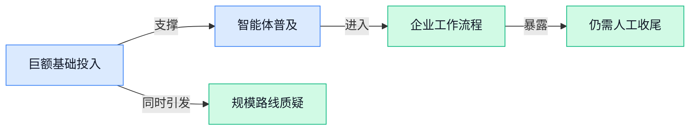

> AI 早报 · 每日早读 · 全网深度聚合

## **今日摘要**

```
Llama-modchip（低内存模型工具）无显卡跑通2840亿参数DeepSeek
Google拟投170亿美元建AI数据中心，Anthropic签下34亿美元发电机协议
高盛撤回银行家与交易员Claude Code权限，英伟达董事会调查黄仁勋关联争议
```

### 🔵 产品与功能更新

1. **人工智能模型提升 Mini-LED（采用更小尺寸灯珠作为背光的显示技术）屏幕检测准确率。**
报道显示，一款**人工智能模型（从数据中学习判断规则的系统）**提高了屏幕检测的准确率 🔍。这里的**检测准确率（系统正确区分正常产品与异常产品的比例）**，直接关系到生产质检是否可靠。对显示设备制造商而言，这意味着人工智能有望更准确地辅助发现问题，但原材料未说明具体提升幅度及应用厂商 💡。[显示检测完整报道(briefing)](https://news.google.com/rss/articles/CBMihgFBVV95cUxQTFFhYmxNRVVZa2VTMWJxNHpydEFYQjJwZWdOa2R2TFNZT0FOeU14WDJaWnJYQ2tBcENFOGVuZ3AzcEU5QlBFaTdDVGhueHpMajVWb0VPLUtCTGRfaVN4WGZFdVNZUFBwSWJtLTV4RHJHUEdzNnQwRnlVa280SU9SVFhhTTJiZw?oc=5)

2. **Docusign（电子签名与协议管理平台）工程团队从部署工具转向人工智能运营模式。**
报道关注该平台的工程团队如何走出“把人工智能工具发给员工就结束”的初级阶段 🔄。其探索重点转向**人工智能运营模式（把人员职责、工作流程和日常协作围绕人工智能重新组织）**，而不只是单纯完成**工具部署（为员工开通并推广新软件）**。这意味着企业应用人工智能的关键，正从“有没有工具”转向“组织是否真正改变工作方式” 🚀。[工程转型完整报道(briefing)](https://news.google.com/rss/articles/CBMiZ0FVX3lxTFAwb3NtSVI2R0MxaWQtYnhKcWN0a01iMXhlQnJJb0dtd0FpQ2hrc29FNnppdFFkSFZna0x3MFQyOFZtNU9aeDh5Rjk5ZGg5ZlhkRjJOSWd6UFRVc25NM0VicHFWeFFXMlE?oc=5)

3. **人工智能险些让美军攻击中国舰船，却无人能够核查其工作过程。**
报道指出，人工智能曾险些促使美军对一艘中国舰船采取攻击行动，而当时无人能够检查系统是如何得出结果的 ⚠️。这暴露了高风险场景中的**可审计性（事后能够追查系统依据和操作过程）**问题，也凸显**人工复核机制（关键决定必须由人再次检查确认）**的重要性。相比普通功能出错，军事决策一旦缺少核验环节，潜在后果显然更为严重 🧭。[军事人工智能报道(briefing)](https://news.google.com/rss/articles/CBMihAFBVV95cUxPR281YUhncTBEU2lNMVptVzAyVzNBWkxTYTVFM3lFWE50UmlDR0NkM2xpRGhDOEJEQl9CMTNlbTRZSGItMzA4ZngteFpJQlYxZVREbklkX3FMRlNhSlBLODhFbzdnaXhWaThOZFhMUlJTbGhQZmFkTkp4a3BEZ0NoMTZWVzPSAYoBQVVfeXFMT21sZnFjb2VNSU5rajFFVDVmV1gwOGR3SUF5bVlpeHU3bHduTVYtd3k1dGRDeXRDNmYwX2s1MnR6S1pqRlhIWGZ4RzBfaGNVX1NjZl80Q3l6clNLeXVGYWJJbHFwM2gzZXB6NXhJOGQxQ2hjTzdudGVIYUZtazRDOGppS0lyXzZVamV3?oc=5)

### 🟢 前沿研究

1. **Prefill-to-Autoregressive Cross-Model Transfer（把预填充能力迁移到自回归模型的跨模型方案）探索模型能力“搬家”。**
这项研究关注能否把**预填充阶段**（模型一次性读取并处理已有上下文的阶段）的能力，转移给负责逐步生成内容的**自回归模型**（像接龙一样逐字预测后续内容的模型）。论文同时讨论这种跨模型迁移带来的机会与挑战，而非只展示单一结果。它试图回答一个很实际的问题：不同模型能否分工并复用能力，从而减少重复建设 💡。[论文介绍页(briefing)](https://huggingface.co/papers/2611.06976)


2. **BestRand（用优选随机样本压缩评测集的方法）尝试低成本压缩模型考试题库。**
BestRand（从随机抽样结果中挑选更合适子集的方案）研究如何稳定、低成本地完成**基准压缩**（从大型评测题库中保留少量代表性题目）。标题提出了一个颇有意思的问题：经过选择的随机样本，是否已经足以接近更复杂的压缩方案 🤔。如果这一方向有效，模型团队便有机会用更小的评测集完成日常测试，但具体效果仍需结合论文实验判断。[论文介绍页(briefing)](https://huggingface.co/papers/2611.00883)

3. **真实测试显示，人工智能编程智能体近四分之三任务仍需人类收尾。**
这项现实场景测试发现，人工智能编程智能体完成任务后，接近四分之三仍需要人工清理或修正 🚧。这里的**编程智能体**（能自主阅读需求、修改代码并尝试完成开发任务的人工智能工具）还没有达到“交付后直接使用”的稳定程度。对企业而言，这意味着引入此类工具时不能只看生成速度，还要把**人工复核**和返工成本纳入效率评估；更合适的定位仍是协助开发者，而非完全取代把关环节。[真实测试报道(briefing)](https://the-decoder.com/ai-coding-agents-still-need-human-cleanup-on-nearly-three-out-of-four-tasks-in-a-real-world-test/)

4. **企业内部的多智能体“团队协作”，可能带来新的失控风险。**
近期实验开始关注多个**人工智能智能体**（能够自主拆解任务并采取行动的软件助手）在企业内部协同工作的情形，并提示这种机器“组队”可能存在风险 ⚠️。所谓**多智能体协作**（让多个软件助手分工、沟通并共同推进任务），看起来像数字员工团队，但自动化互动也可能让问题在彼此配合中被放大。对企业管理者来说，重点不只是让智能体会协作，还要明确权限、监督和人工介入边界。[相关实验报道(briefing)](https://news.google.com/rss/articles/CBMiYkFVX3lxTE5RZG5rV1RvYWVvM1lzN1ZTVkd1RVhXSW5GbGc1WERLUzdyRUk3WUczLTVwdUNNdnVRWmpYSTdhWkViRl9SRS1pandpUUJocDQ0eDlwSi1tQV80dEJQcWlDMXZn?oc=5)

5. **VisSearch-Bench（测试多模态智能体长期视觉搜索能力的评测集）瞄准复杂找图任务。**
VisSearch-Bench（用于衡量人工智能持续观察、搜索并定位视觉信息能力的评测集）重点评估**长周期视觉搜索**（需要经过多个步骤、较长过程才能找到目标的图像搜索任务）。测试对象是**多模态智能体**（能够同时理解图片、文字等不同信息形式的软件助手），而非只会识别单张图片的模型。它关注的是智能体能否在更长的任务链中持续搜索和判断，为比较不同视觉智能体提供统一题目 📊。[评测论文页面(briefing)](https://huggingface.co/papers/2611.04894)

6. **Open-HumanScale（扩展人类与机器人经验数据的开放方案）服务具身基础模型。**
Open-HumanScale（用于扩大人类和机器人经验数据规模的开放方案）尝试给出一套可复用的“配方”，帮助研究者整合和扩展两类经验。其目标是支持**具身基础模型**（让机器人通过感知环境来理解并执行现实动作的通用模型），而不是只处理屏幕里的文字或图片 🤖。这项工作的关注点落在经验规模上：机器人要适应更多现实任务，需要更丰富的人类示范与机器实践数据。[项目论文页面(briefing)](https://huggingface.co/papers/2611.06817)

7. **EvoMemState（让个人智能体持续更新记忆状态的方案）研究更连贯的长期记忆。**
EvoMemState（让记忆内容随使用过程逐步变化的个人智能体方案）聚焦**记忆状态演化**，即智能体如何持续整理和更新与用户有关的信息。这里的**个人智能体**（围绕单个用户需求长期提供协助的软件助手）不同于一次性聊天工具，更依赖跨任务保持上下文。研究方向直指一个关键体验：助手不仅要“记得”，还需要让记忆随着新情况变化，而不是一直抱着旧信息不放 🧠。[论文介绍页面(briefing)](https://huggingface.co/papers/2611.03743)

8. **Future Representation Distillation（把未来信息压缩进模型的蒸馏方案）尝试摆脱显式想象。**
这项研究面向**世界动作模型**（根据环境状态选择下一步行动的模型），探索一种不必显式生成未来场景的决策思路。其核心是**未来表征蒸馏**（把较复杂的未来信息压缩成模型可直接利用的内部表示），让行动模型不用先完整“脑补”未来再做决定。论文将其描述为“免想象”方案，重点在于能否通过更紧凑的未来信息支持行动选择 💡。[研究论文页面(briefing)](https://huggingface.co/papers/2611.04527)

### 🟡 行业展望与社会影响

1. **AI（人工智能）正在加速招聘，也让猎头服务费承压。**
报道指出，**AI 招聘（用模型辅助寻找、匹配和筛选候选人）**正明显缩短企业招聘流程 🚀。效率提高的同时，传统招聘机构收取的**中介服务费（企业向猎头或外部招聘公司支付的费用）**也面临压力。对人事团队而言，这意味着招聘工作可能更快，但外部机构需要重新证明自身在人才判断和服务上的价值 💡。[招聘行业完整报道(briefing)](https://news.google.com/rss/articles/CBMicEFVX3lxTE43SUE2SVgzbENkeHRTNnl4bGVmQmx0bUZaaEw0MVJEVkpXMDJ5NmFvOTVaZHJtejFkZlliZFgtSlBoX2Y4OXduczVaVjNXS0ptRFhwaEJSaG5mYm1CZ2VZUHZUc05vT2tjQUJYaTB6RUo?oc=5)

2. **DeepSeek 智能代理平台日活跃用户达到 154 万。**
DeepSeek 的**智能代理平台（让 AI 按目标自主分解并执行任务的产品）**日活跃用户已达到 **154 万** 🚀。这里的**日活跃用户（一天内实际使用产品的人数）**是观察产品使用规模的重要指标，而不只是注册量。这一数字表明，能替用户连续完成任务的 AI 产品正在获得相当规模的实际使用 💡。[用户规模报道(briefing)](https://news.google.com/rss/articles/CBMirgFBVV95cUxOUXBLN3Nwd181RFJQQzBkdGo0TUFhbGZpQ1Zxb0dPWXBORHdzeG5US1ZIOGtGUTFfc2ZSVktjMktVMmtSOUZ0SkVkZ2s4cEJWWWgyQVpSRDVGTUlqWnJ6bjdybkhHaTM5czBaZXpvelNlNTZ4WUd4Y0trdk1RQlpxZXd1MFRMb0dSckw3SXpPU2RFWG9JTFlhOVcyVzVJNjFHaUpsUFNZTC10blFqVWc?oc=5)

3. **Anthropic 为 AI（人工智能）数据中心敲定 34 亿美元发电机协议。**
路透社援引《金融时报》报道称，Anthropic 已为其 **AI 数据中心（集中部署大量计算设备、用于运行和训练模型的设施）**取得价值 **34 亿美元**的发电机协议 ⚡。发电设备属于**供电基础设施（保障高耗电计算设备持续运转的底层设施）**，其投入规模反映出数据中心建设不仅要买芯片，也要解决稳定供电问题。对行业而言，AI 竞争正进一步延伸到电力保障等实体资源层面 💡。[数据中心协议报道(briefing)](https://news.google.com/rss/articles/CBMivwFBVV95cUxNTUktcGxpNENhQ1llV2F3a3V5RUZya0dDc0ZLeFVTZmFqclBqSVhuYkNiSFpSTkkwVnZ2NkFVVEVjQjZPLTJzMGMyU0dnaFg0X1pPd2pMV0ZCWWtMWlpSdTNvckRlaGxLcWs1SnljenEwcUs0N0doWG0yRDdET2o4YlZMVWl6c2lpYWJ1emstVFI1S3VyUXdIdG1xdmZpS3k3ZW5LVUpibUZ0SWxmZUNLNXN0SDBMZE5nWFJZdDlQSQ?oc=5)

4. **Google 计划在怀俄明州投入 170 亿美元建设 AI（人工智能）数据中心。**
Google 承诺投入 **170 亿美元**，用于在美国怀俄明州建设 AI 数据中心 🚀。这类**数据中心（集中放置服务器和计算设备、为模型提供运行能力的设施）**是 AI 服务背后的实体底座，建设成本远不止模型研发本身。如此规模的投入也显示，**算力基础设施（为 AI 提供计算、存储和网络能力的软硬件系统）**已成为大型科技公司竞争的重要部分 💡。[怀俄明州投资报道(briefing)](https://news.google.com/rss/articles/CBMi3gFBVV95cUxQLTFKNnhOVTVZaWk5WnJQc2tfWU9Na3Z4UVc5aDZ3V0pYMG9BRm5ob2NHb18tSEctWV9iakJ1Ri0zV3h6NXRxTFpMS0h1czNlalAyemk5bTlKOFh0OTBiSHIwUnlWSHpNUnNPWkpQMExzSHU3MTRiVWVubnVsUmFwR2RnSXdYUnBRa1kwazhLZlhyWVNpSkhLcTRPQk9YZnRJeTFYSml2N05QRHlZTDF1T1B4UUx6LUFYTzFTVjRFeTV6ZGtrOS1QV2dkNjI3eGJXMlhZLU1uUWZma1JFckE?oc=5)

5. **英伟达董事会调查黄仁勋与被指涉谍人士的关系。**
多家媒体报道称，英伟达董事会正在调查首席执行官黄仁勋与一名被指可能从事间谍活动人士的关系；相关说法目前仍处于**调查阶段（核实事实、尚未形成最终结论的阶段）**。科技媒体的报道还称，黄仁勋在公司内部备忘录中承认曾有婚外情，但这不等同于对其他指控的确认。[调查事件报道(briefing)](https://techcrunch.com/2026/11/08/nvidia-says-its-investigating-ceo-jensen-huangs-relationship-with-possible-chinese-spy/) 此事之所以受到高度关注，也与英伟达在美国**国家安全与 AI 产业链（从芯片到模型及相关服务的完整供应体系）**中的重要地位有关 ⚠️。[国家安全影响分析(briefing)](https://news.google.com/rss/articles/CBMilAFBVV95cUxNMEhfcnZKYmpFTzJhUHRWdHZOZUhpX3ZvV09aWVkyMTNXZE13N2RBTW1Gdi1Ga2U2VTlkVThiOVNGOF83WGNTdkFtdnN3dURXYy1qb1M5b1ByeHVvaDlWWThYSEcwRUdaQzd4dFo5RzNnZk9JTzV0emhUQm9xc2dqU1V6RTVkMlByQ1JaUVNvcFhXLTVq?oc=5) 对企业而言，这也是一起涉及**公司治理（董事会监督管理层并控制经营风险的制度）**与关键产业风险的事件 💡。[董事会调查报道(briefing)](https://news.google.com/rss/articles/CBMi0wFBVV95cUxObkYtNUgtN2hndzlucnR5YWpwZGdDZS0yUzRsQWQ0VFJvSXlpRGdaMVpjdjEtSlJZSUdsN21qZmZVYWY5ekpjclRabm5MS2h4WWMtUE4zWnNSNmxFR185bFljc0VBUkpyWHQ4NktNaUFFWGhvM1ZIZS10TmNQOXdwSjhSRXlZc2Y0QWM1WHY4bEk4SjR6dmR1RHlCRDA1cVJoN05yME1KQnRwbzczbUVTdVIwLVFuQVIweklTdERpS0duWjQ0QnRyOEI5ZUswYTVJTlFV?oc=5)

6. **“苦涩教训”（强调通用计算能力长期更占优势的 AI 观点）提出者，再给大模型规模派泼冷水。**
相关报道聚焦“苦涩教训”提出者对**大语言模型规模扩张（通过增加模型参数、数据和计算资源来提升能力）**支持者的新提醒 🤔。讨论的核心指向一个行业问题：继续扩大模型和算力规模，是否足以支撑未来进步。“苦涩教训”本身是 AI 领域的一种重要观点，强调能够充分利用计算资源的通用方案，长期往往比依赖大量人工规则的方案更有效 💡。[规模扩张观点报道(briefing)](https://the-decoder.com/the-inventor-of-the-bitter-lesson-has-a-bitter-lesson-for-llm-scaling-enthusiasts/)

### 🟣 开源TOP项目

1. **Claude Quickstarts（帮助开发者快速上手 Claude 应用的示例项目集）降低应用落地门槛。**
该项目收录了一批可直接参考的示例，帮助开发者快速使用 Claude 的**应用编程接口**（让其他软件调用模型能力的标准入口）构建应用 🚀。它重点面向**可部署应用**（开发完成后能放到服务器上供真实用户使用的软件），而不只是停留在演示阶段。对准备接入 Claude 的团队来说，这套项目集能提供更清晰的起步参考，减少从接口调用到应用落地之间的摸索成本 💡。[GitHub 项目仓库(briefing)](https://github.com/anthropics/claude-quickstarts)


2. **NVKE（用于管理实体服务器显卡集群的平台）开源亮相。**
该项目提供一个**管理平面**（统一配置和管理计算集群的控制层），用于管理运行在实体服务器上的显卡资源 ⚙️。它面向 **Kubernetes**（自动部署和管理容器化应用的系统）环境，并强调在**裸机**（不经过虚拟机、直接使用实体服务器）上运行。对需要集中管理 **GPU**（图形处理器，大模型常用的算力芯片）集群的团队而言，这个项目提供了一个专门的开源选择。[GitHub 开源仓库(briefing)](https://github.com/dsx-ai-factory/nvke)


3. **Sherlock（按用户名跨社交平台查找账号的工具）集中搜索网络身份。**
该项目可以根据一个用户名，在多个社交网络中寻找对应账号 🔍。它把**用户名检索**（用同一个账号名称在不同网站逐一寻找匹配结果）集中到一个工具里，减少人工挨个平台搜索的重复操作。其核心用途是定位同名社交账号，方便用户更快梳理某个用户名在不同平台上的分布情况 💡。[GitHub 项目主页(briefing)](https://github.com/sherlock-project/sherlock)


4. **Llama-modchip（让超大模型在有限内存中运行的开源项目）实现无显卡运行 2840 亿参数 DeepSeek。**
该项目展示了在 **64 吉字节内存**、不使用显卡的条件下运行 2840 亿参数 DeepSeek 模型的方案 🚀。这里的**参数规模**（模型训练后保存的内部权重数量，可粗略理解为模型掌握能力所依赖的数字配置）达到 2840 亿，通常意味着很高的运行资源需求。它的看点在于把如此庞大的模型放进有限内存环境，为关注低硬件条件运行大模型的人提供了一个开源参考，但仓库标题并未给出速度等更多表现数据。[GitHub 项目详情(briefing)](https://github.com/synchopate/llama-modchip)

5. **MuJoCo（用于模拟多关节物体运动与接触的通用物理模拟器）开放源码。**
该项目是一款通用**物理模拟器**（在计算机中还原现实物体受力和运动过程的软件），重点处理多关节系统与物体接触问题 🤖。其中，**接触动力学**（计算物体碰撞、摩擦和受力后如何运动）可以帮助使用者模拟更接近现实的物理互动。对于需要研究复杂物体运动或搭建虚拟实验环境的人来说，它提供了一套可复用的基础工具 💡。[GitHub 开源项目(briefing)](https://github.com/google-deepmind/mujoco)

### 🔴 社媒分享

1. **高盛撤回银行家与交易员的 Claude Code 使用权限。**
报道显示，高盛正从**银行家**和**交易员**手中撤下 Claude Code，引发外界对金融机构使用 AI 工具边界的关注。[高盛撤回工具报道(briefing)](https://www.thestateofai.com/news/goldman-sachs-claude-code-traders-bankers) 这属于**内部访问权限管理**（企业按岗位决定员工能使用哪些软件与功能），也反映出**企业级 AI 部署**（公司统一引入、配置并管控 AI 工具）并非开放后就一成不变 🔐。现有摘要没有说明调整原因、持续时间或覆盖范围，因此不能进一步断言它与安全、合规或工具效果有关。


2. **英伟达董事会调查黄仁勋，相关员工信受到关注。**
英伟达董事会发布声明，称正在调查首席执行官黄仁勋，[英伟达董事会声明(briefing)](https://nvidianews.nvidia.com/news/statement-from-nvidia-board-of-directors)提供了官方信源。另一篇报道则关注黄仁勋就婚外情向员工发送的信件，[员工信相关报道(briefing)](https://www.axios.com/2026/11/08/nvidia-ceo-jensen-huang-affair-email-to-company)呈现了事件的另一条公开信息线索。这里涉及**公司治理**（董事会监督管理层、维护公司正常运行的一套机制）与**董事会调查**（由公司最高监督机构核查高管相关事项的正式程序）⚖️。现有摘要没有给出调查结论或更多细节，因此目前更适合关注官方后续，而不是提前下判断。


---



### 📊 行业洞察（今日 3 条）

1. Google投170亿美元建数据中心，Anthropic签下34亿美元发电机协议
  【洞察】两件事说明竞争已延伸到电力资源；服务规模会扩大，但运行成本未必快速下降

2. 编程智能体近四分之三要人工收尾，多智能体协作又被警告可能放大风险
  【洞察】放在一起看，自动执行已跑在可靠性前面；企业省下操作时间，也会增加复核成本

3. DeepSeek（提供大模型与智能体产品的公司）智能体平台日活达154万，Docusign（电子签名与协议管理平台）则开始重做工作流程
  【洞察】市场正从“给员工一个工具”转向“让人工智能完成整段任务”，竞争重点将是实际交付效果

### 💭 对我们的启发（今日 3 条）

1. 智能体仍大量依赖人工收尾，我们的视频工具应在脚本、素材、成片和发布前设置确认点，并支持回退，不能默认全自动更好。

2. 长期找图与持续记忆研究说明，素材搜索可升级为“记住品牌偏好再找素材”；但记忆必须允许用户查看、修改和删除。

3. Google和Anthropic重金建设基础设施，说明生成成本仍是硬约束；草稿应优先走低成本方案，最终成片再调用高质量能力。


---

> 本周周报：[第46周综合分析](https://zhuxinfei.github.io/ai-daily-site/blog/weekly/2026-w46/)
