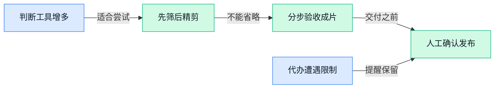

> AI 早报 · 每日早读 · 全网深度聚合

## **今日摘要**

```
据报道，OpenAI季度营收首次突破100亿美元，企业销售成推力
Anthropic称英伟达软件优势正被削弱，切换芯片从数月缩至三天
Fractile（英国芯片公司）融资7.2亿美元，跻身专用芯片赛道融资前列
```

### 🔵 产品与功能更新

1. **Google 的 Gemini Decisions API（供程序调用的决策接口）亮相，具体能力仍待确认。**
Google 的 **Gemini Decisions API（让软件调用相关决策能力的接口）**出现在本次候选资料中，相关介绍链接指向 Google 官方开发者博客。💡 这条更新面向的是**开发者接入**，而不是聊天界面上的新按钮；不过，当前摘要没有展开其具体功能。它能处理哪些决策、如何收费、是否已开放使用，现有材料均不足以确认，暂不宜据此判断业务落地价值。[决策接口介绍文章(briefing)](https://simonwillison.net/2026/Nov/11/gemini-decisions-api/)

2. **Google 搜索的人工智能模式关闭问题，在芝加哥引发抗议。**
据报道，Google 就关闭搜索引擎的**人工智能模式（搜索中由人工智能提供回答的功能）**向学区发出警告，部分芝加哥人士以抗议回应。🏫 这条消息的焦点不是新增功能，而是**学区（统筹当地多所学校的教育管理单位）如何管理搜索功能的使用**。当前提供的摘要没有说明警告的具体内容、关闭功能的后果或抗议诉求，因此不能进一步判断学校是否受到强制使用要求。[校园搜索争议报道(briefing)](https://news.google.com/rss/articles/CBMirAFBVV95cUxPeE1OM3ZDcVNTcTBtSDU3Q3huN25xTm5Ic3AwTlpFd3JLc2syUGZPNE1NTkNrU0JBYU1oU1lTT3lFUlRtRlhpQ1g5dXU3aGFyUm1IOXBFaTdOLVh4cjMxRzRpOHJLNWZTcG1jTlg3TzNQZ29DSnBxRDAyd0VDWU5Zc3RFdXltZkhhTFM1Xzg4YTBYWmhJdkEyb3dRcTVhbnpVLXgwQUV6QjZ5eHFI?oc=5)

### 🟢 前沿研究

1. **WMIP（模拟工作记忆的可编程测试工具）关注大模型能否持续记准变化。**
这项研究围绕**累积状态追踪**（随着信息不断更新，持续记住当前情况）展开，用可编程测试考察大模型的相关能力 🔍。其设计受到**工作记忆**（人在处理当前任务时，临时保存和更新信息的能力）启发，关注的不只是模型能记住什么，还有它能否跟上连续变化。现有材料仅提供标题，尚无法判断具体测试方式及模型表现，详见[工作记忆测试论文(briefing)](https://huggingface.co/papers/2603.27343)。


2. **多模型路由研究：根据提问内容，兼顾回答与成本。**
这项研究探讨**集成路由**（在多个模型之间分配请求），希望让模型选择适应不同的提问内容，同时考虑使用成本 💡。它聚焦的是**推理成本**（模型接收问题并生成回答所消耗的计算资源），而不是模型训练本身的开销。目前材料没有披露具体分配策略、成本降幅或回答质量数据，不能据此认定已经实现“更便宜且不降质”，可查看[多模型成本路由论文(briefing)](https://huggingface.co/papers/2611.10193)。

3. **Google 的 AlphaProof Code（代码验证工具）据报道用四周完成加密核心验证。**
据报道，Google 旗下研究团队用这款工具验证了 Signal（加密通信应用）的**密码学核心**（负责加密等安全功能的关键部分），标题将耗时描述为“四周，而非数年” 🚀。这里的**代码验证**（检查程序是否满足规定要求）关注的是关键代码的正确性，不应直接理解为整个应用已经不存在安全漏洞。现有材料未展示验证范围、采用的标准或“数年”对比依据，具体结论仍需结合[加密核心验证报道(briefing)](https://the-decoder.com/google-deepminds-alphaproof-code-verified-signals-cryptographic-core-in-four-weeks-instead-of-years/)理解。

4. **CogBattery（以人类表现为参照的认知测评）考察语言模型如何完成任务。**
这项研究关注语言模型在**认知任务**（涉及记忆、推理等信息处理能力的任务）中的行为及结构，并以人类作为参照 🧠。它不只关注最终答案，还将**行为结构**（完成不同任务时呈现出的表现模式及其关系）纳入评估视角。目前材料没有给出测试项目、参照人群或实验结果，因此不能据此判断模型是否具备与人相同的认知机制，详见[人类参照认知测评论文(briefing)](https://huggingface.co/papers/2607.24999)。

5. **GTAGym（基于大型商业游戏任务的测试环境）让模型在游戏任务中接受评估与训练。**
这项研究将真实的**大型商业游戏任务**引入模型评估，并用于**强化学习**（让模型根据行动得到的奖励反馈调整行为）🎮。这里的**任务环境**（模型执行操作、接收反馈的场所）把评估对象从文字回答延伸到了游戏中的任务执行。目前材料没有说明具体游戏、任务难度或训练效果，尚不能判断相关能力能否迁移到实际工作场景，可查看[游戏任务训练环境论文(briefing)](https://huggingface.co/papers/2611.13028)。

6. **通过强化学习激励大模型自我学习，研究关注“如何促学”。**
这项研究探索用**强化学习**（通过奖励反馈，引导模型调整行为）激励大模型开展自我学习 📚。标题中的**自我学习**（让模型自身参与学习过程，而不只是直接回答问题）是研究方向，但现有材料没有说明具体如何实现。由于尚无奖励设计、实验设置或效果数据，不能将其解读为模型已经能够持续自主进化，详见[自我学习激励研究论文(briefing)](https://huggingface.co/papers/2610.39671)。

### 🟡 行业展望与社会影响

1. **据报道，OpenAI 季度营收首次突破 100 亿美元，企业销售成为推力。**
据报道，OpenAI 单季度营收首次达到 **100 亿美元**，比第二季度的 67 亿美元增长近 **50%**，详见[季度营收增长报道(briefing)](https://techcrunch.com/2026/11/11/openais-quarterly-revenue-reportedly-crosses-10b-for-the-first-time/)。💰 另一篇报道将增长动力指向**企业销售**（面向公司客户销售产品与服务，而不只是面向个人用户），但也指出其季度营收仍落后于 Anthropic。这里的**营收**（销售产品和服务获得的收入，尚未扣除成本）不能直接等同于利润；这组数字体现的是销售规模的扩大，而非盈利结论，参见[企业销售驱动报道(briefing)](https://the-decoder.com/enterprise-sales-push-openais-quarterly-revenue-to-10-billion-though-it-still-trails-anthropic/)。


2. **Anthropic 称人工智能正削弱英伟达的软件优势，切换芯片从数月缩至三天。**
Anthropic 表示，人工智能正在削弱英伟达 **CUDA（让开发者调用英伟达芯片进行计算的软件平台）**形成的领先优势。⚡ 据其说法，转向 **AMD（另一家芯片厂商）**芯片所需的时间，从数月缩短到了**三天**。这条消息的关键不只是芯片性能，而是**迁移成本**（把现有软件搬到另一种芯片上所需的时间与工作量）是否正在下降；上述时间变化应理解为 Anthropic 披露的情况，而非所有企业都能直接复现的结果，详见[芯片迁移提速报道(briefing)](https://the-decoder.com/anthropic-says-ai-is-eroding-nvidias-cuda-lead-cutting-an-amd-chip-switch-from-months-to-three-days/)。


3. **美国数据经纪商向中国人工智能实验室出售训练环境，交易规模达 5 亿美元。**
据报道，美国**数据经纪商**（收集、整理并出售数据或相关资源的中间商）正在向中国人工智能实验室出售总额达 **5 亿美元**的强化学习训练环境。🧩 **强化学习训练环境**（供模型执行任务、根据反馈反复练习的“训练场”）并不是简单的一包文字资料，而是用于训练模型的任务与反馈场景。这条消息呈现了跨境人工智能交易的一种具体形态：出售的不只是数据，还包括模型练习任务的环境，详见[跨境训练环境交易报道(briefing)](https://the-decoder.com/us-data-brokers-are-selling-half-a-billion-dollars-in-rl-training-environments-to-chinese-ai-labs/)。

4. **Fractile（英国人工智能芯片公司）融资 7.2 亿美元，跻身专用芯片赛道融资前列。**
英国公司 **Fractile（研发人工智能专用芯片的企业）**完成了一轮 **7.2 亿美元融资**，成为这一赛道融资规模居前的参与者之一。💰 它参与竞争的是**专用人工智能芯片**（围绕人工智能计算需求设计，而不是追求处理各种任务的通用芯片）。这笔融资体现的是其资金实力与竞争位置的提升，并不等同于芯片性能或商业成绩已经领先，详见[英国芯片企业融资报道(briefing)](https://techcrunch.com/2026/11/11/with-720m-round-britains-fractile-gets-a-leg-up-in-the-race-for-ai-chips/)。

5. **AlphaGenome 2（预测遗传序列如何影响细胞与疾病的模型）聚焦细胞如何读取遗传信息。**
Google 介绍了 **AlphaGenome 2（用于预测遗传序列及其变化如何影响人体特定细胞类型和疾病的模型）**，研究重点是细胞如何读取遗传信息。🧬 它关注的不只是 **DNA（储存遗传信息的分子）**序列本身，还包括序列发生变化后，对不同细胞类型可能产生的影响。其目标是帮助研究者**更好地理解疾病**；原材料介绍的是预测与研究用途，并未给出临床诊断或治疗效果的结论，详见[遗传信息模型官方介绍(briefing)](https://deepmind.google/blog/alphagenome-2-deciphering-how-cells-read-dna-to-better-understand-disease/)。

### 🟣 开源TOP项目

1. **ha-mcp（连接人工智能助手与智能家居管理平台的开源项目）让家庭自动化可以交给 Claude、ChatGPT 协助配置。**
借助这个项目，用户可以通过 Claude、ChatGPT 等助手，配置和自动化 **Home Assistant（集中管理家中智能设备的平台）** 🏠。它关注的不只是聊天问答，而是让助手参与**设备管理平台的配置与自动化（让设备按预先设定的规则执行操作）**。对希望用人工智能协助管理智能家居的用户来说，这是一个值得关注的连接工具；不过，候选摘要没有说明具体支持哪些设备或操作范围，使用前仍需查阅[智能家居项目仓库(briefing)](https://github.com/homeassistant-ai/ha-mcp)。


2. **sure（面向所有人的个人财务应用）主打人人可用、共同参与。**
**sure（帮助个人管理财务的应用）**将自己定位为“面向所有人、也由大家共同打造”的个人财务应用 💰。与面向企业财务部门的工具不同，它明确聚焦于**个人财务**，并以开源项目（公开源代码、供社区查看和参与开发的软件）的形式呈现。目前候选摘要没有列出记账、预算或账户连接等具体功能，因此暂时不宜把它当作功能齐全的理财工具推荐；感兴趣的同事可以先从[个人财务应用仓库(briefing)](https://github.com/we-promise/sure)了解项目。


### 🔴 社媒分享

1. **美国联合航空禁止人工智能代理代旅客订票。**
据[美联航订票限制报道(briefing)](https://www.cbsnews.com/news/united-airlines-bans-ai-agents-booking-flights/)，美国联合航空禁止**人工智能代理（受用户委托、代为执行任务的软件助手）**替旅客预订航班 ✈️。这项限制针对的是**代客订票（由软件代表旅客完成预订操作）**，不能仅凭标题就扩大理解为禁止所有人工智能辅助出行服务。对想让助手帮忙安排出行的同事来说，需要注意：**助手能不能代为操作，也取决于服务提供方是否允许**。


2. **Atuin Threads（跨机器查看智能代理会话的工具）聚合不同设备上的任务记录。**
[跨设备会话工具介绍(briefing)](https://blog.atuin.sh/threads-agent-sessions/)介绍的核心，是把**不同机器上的智能代理会话**放到一起查看 💡。这里的**会话（用户与软件助手围绕任务展开的一段交互过程）**，不只是一个工具名称，而是理解助手正在处理什么的线索。它关注的是使用多个设备时，会话分散在哪里的问题；仅凭现有材料，还不能确认是否支持跨设备接续任务或共享完整执行状态。


3. **多向量检索模型探索“训练时就考虑信息压缩”的思路。**
[检索模型训练文章(briefing)](https://huggingface.co/blog/token-pooling)讨论的是**多向量嵌入模型（把一段内容表示成多组数字，供计算机比较相关性）**，以及如何在训练时考虑后续的信息压缩 🔍。标题中的**词元池化（将模型处理的多个文字小块的信息合并，形成更精简的表示）**，可以理解为把细碎信息归拢起来。文章关注的是**训练与信息合并如何配合**，但候选材料未提供正文，不能据此断言它已经提升检索准确率或降低使用成本。

4. **BotPsy（在本机运行的个人智能助手）采用不足十亿参数的模型。**
[本机个人助手介绍(briefing)](https://huggingface.co/blog/qvac/botpsy)介绍了一款**端侧个人助手（在用户自己的设备上运行的助手）**，其模型规模不足十亿参数 📱。**参数（模型在训练中形成的内部数值设置）**可以帮助描述模型规模，但数量少不等于实际能力一定弱，也不能直接证明运行速度更快。标题还将其定位为可承担代理任务的语言模型；至于具体能完成哪些工作、支持什么设备，现有摘要没有提供更多信息。

---



### 📊 行业洞察（今日 3 条）

1. Google与OpenAI都推出判断、打分工具，多模型分工研究也关注成本。  
   【洞察】两件事放一起看，成本竞争正落到任务怎么分工，但单次便宜不等于整单省钱。

2. Claude可协助配置智能家居，美联航却禁止助手代订机票。  
   【洞察】这组反差说明，能操作不等于获准操作，自动化产品的边界还得看服务方授权。

3. Google据报四周完成加密核心验证，另有研究测试模型能否记准变化。  
   【洞察】专项提速不代表长任务可靠，能否跟上反复修改，仍需单独验收。

### 💭 对我们的启发（今日 3 条）

1. Google推出判断工具，我们可试验先筛素材、再精剪；成本要按合格成片计算，把误筛和返工也算进去。

2. 美联航限制代订提醒我们：自动剪辑与代客发布应分开授权；发布、删素材等操作，必须让客户确认。

3. 工作记忆研究关注连续变化，我们应拿“改价格、换卖点、保留旧要求”测试剪辑助手；漏改就交回人工，别承诺越用越聪明。


---

> 本周周报：[第46周综合分析](https://zhuxinfei.github.io/ai-daily-site/blog/weekly/2026-w46/)
