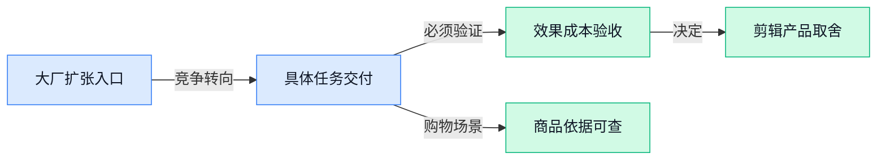

> AI 早报 · 每日早读 · 全网深度聚合

## **今日摘要**

```
Anthropic连推Claude会议测试版与制造业产品，从视频通话走进工厂
Google用Gemini升级搜索回答，再引导浏览器用户用AI查商品详情与评价
苹果应用审核被指因AI变得更难，合成器开发者受到影响
```

### 🔵 产品与功能更新

1. **Anthropic 推出 Claude Meetings（让 Claude 加入视频通话的会议功能）测试版。**
Claude 不再只在聊天窗口里回应问题：据[视频会议功能报道(briefing)](https://the-decoder.com/claude-meetings-lets-anthropics-ai-join-your-video-calls/)，**Claude Meetings（让 Claude 参与视频通话的功能）**可以加入用户的视频会议 🎥。另一则[会议测试版发布报道(briefing)](https://news.google.com/rss/articles/CBMiigFBVV95cUxQWER4dXVySGVkcFJ4OVBLVkY5eURqVllvZDJIVV9oNkpTa2lqSlpvMnhobkJDRmtuN1EwNzFIRDhHSXlaNzd4SGtMRTNaRWh4UnIzbUdONUxLcG54cWpGZm9OUjZHWmhKcmdSU2RMSXAzT3d5WC1KRUJYREJuS1VtUmlBeDRZRWtmQWc?oc=5)将其标为 **Beta（正式推出前的测试阶段）**，重点是面向实时视频通话。需要注意，所提供的材料未说明它能否自动生成纪要、提取待办事项，也没有交代支持哪些会议平台，暂时不能把“加入会议”等同于“包办会议工作”。


2. **Anthropic 推出 Claude for Manufacturing（面向制造业的 Claude 产品）。**
据[制造业产品发布报道(briefing)](https://news.google.com/rss/articles/CBMilAFBVV95cUxQQWRmQ1BneGdsLUtIeUJmSS1HeUpjVnRib1o1cnJOamNsV3k1aGNFZnR4X0J2ZjdxR1VfcGg4VUt0dHBNWlQ1SDJXRDREaDZwYk80clNHVGdoeG5icjFOdFFHUmNQLWtYOV9RWkRudWRlQ3cyQzNRdVQyRllBalFjUlEtQ0Y5RnFnV1VNbmE4ckFDc1ZK?oc=5)，Anthropic 发布了 **Claude for Manufacturing（面向制造业场景的 Claude 产品）**，将产品方向明确指向制造行业 🏭。这条消息值得相关业务团队关注，但目前提供的材料只有发布标题，**尚不足以判断它具体能解决哪些生产或管理问题**。对于考虑采用的同事，功能范围、使用条件和价格仍是需要进一步核实的信息，不宜仅凭名称就认定它已经具备排产、质检或设备维护能力。

### 🟢 前沿研究

1. **数学证明训练如何扩规模？研究从结构化教材寻找线索。**
这项研究把**结构化教材（按章节、定义、定理等层次组织的教材）**作为切入点，探讨如何扩大数学证明的训练指导规模 📚。这里的**证明监督（用证明过程为模型提供学习指导）**，关注的不只是答案对不对，还包括推导过程如何用于训练。现有材料仅提供题名，尚不能确认教材处理方式、训练规模或效果，详见[数学证明训练研究(briefing)](https://huggingface.co/papers/2610.40394)。


2. **Interactive Visual Gym（视觉交互模型评测环境）用模拟用户考察交互能力。**
这项研究将**模拟用户（由程序扮演、与模型进行互动的用户）**放进可交互的虚拟世界，用来评估视觉交互模型 🕹️。所谓**视觉交互模型（根据画面理解环境并作出交互动作的模型）**，考察重点不只是“看懂图片”，还包括如何在互动过程中作出反应。题名明确了评测场景，但没有提供具体任务、评分标准或模型成绩，参见[视觉交互评测研究(briefing)](https://huggingface.co/papers/2611.08286)。

3. **不同模型的内部理解会趋同吗？研究重新审视“柏拉图表征假说”。**
这项研究追问**表征对齐（不同模型对信息的内部表达呈现相似或对应关系）**在哪里出现，以及这种相似究竟意味着什么 🔍。它聚焦**柏拉图表征假说（认为不同模型可能逐渐形成相近内部表征的假说）**，这里的“对齐”不宜直接理解为模型更符合人类价值观。现有题名没有交代研究结论，不能据此判断该假说获得支持还是受到挑战，详见[模型表征趋同研究(briefing)](https://huggingface.co/papers/2611.12869)。

4. **Evolving Infra（面向智能体调整的大模型服务基础设施）探索规模化运行。**
这项研究关注**智能体（能够围绕目标执行多步任务的人工智能系统）**所需的大模型服务，并将“适应智能体”与“大规模运行”放在一起讨论 ⚙️。其中，**模型服务（把训练好的模型部署起来，接收请求并返回结果）**指的是模型投入使用后的运行环节，而非训练本身。题名尚未披露基础设施如何调整，也未给出成本、响应速度或服务容量的数据，参见[智能体服务设施研究(briefing)](https://huggingface.co/papers/2611.12304)。

5. **让智能体少读一点：研究外部内容的选择性读取。**
这项研究聚焦**稀疏读取（不逐字读取全部材料，而是选择其中部分内容）**，目标是在智能体处理外部资料时提高用量效率 📖。题名中的**词元效率（更节省模型处理文字时使用的文本小单元）**，强调的是读取内容与处理开销之间的关系，而不能简单理解为“文章越短越好”。现有材料没有说明内容如何筛选，也没有给出节省幅度或任务完成效果，详见[智能体精简阅读研究(briefing)](https://huggingface.co/papers/2608.22237)。

6. **视觉语言模型中的“潜隐学习”成为研究对象。**
这项研究讨论**视觉语言模型（能够结合图像与文字处理信息的模型）**中的潜隐学习现象 🔍。**潜隐学习（不以直接、明确的教学方式呈现，却可能影响模型学习的现象）**是题名指向的核心议题，但现有材料不足以说明作者具体研究了哪类影响。仅凭题名，也无法判断实验设置、影响程度或是否涉及安全风险，参见[视觉语言潜隐学习研究(briefing)](https://huggingface.co/papers/2611.08538)。

7. **SteerDistill（通过教师模型持续引导来压缩智能体的方案）探索模型量化。**
这项研究将**量化（用更低精度的数字表示模型参数，以缩小模型存储和运行负担）**用于大模型智能体，并引入教师模型的引导 🧩。题名强调**闭环引导（根据运行反馈持续调整指导，而不是只提供一次示范）**，关注的是压缩过程如何与反馈结合。材料未提供压缩比例、资源节省或任务表现，因此目前不能判断它能否兼顾轻量化与能力保持，详见[智能体量化压缩研究(briefing)](https://huggingface.co/papers/2611.13410)。

8. **FAME-QP（面向实时控制的优化求解工具）利用显卡加速计算。**
这项研究提出一个由显卡加速的**二次规划求解器（在给定限制下，为一类数学问题寻找最优方案的计算工具）**，面向实时控制需求 ⚡。它服务于**模型预测控制（先预测系统接下来如何变化，再据此反复调整当前动作的控制方式）**，重点是支撑需要及时作出决策的计算。题名没有披露实际计算速度、测试场景或与其他工具的比较结果，参见[实时控制优化研究(briefing)](https://huggingface.co/papers/2611.13766)。

### 🟡 行业展望与社会影响

1. **Google 搜索引入 Gemini 4 Hydrogen（用于升级搜索回答的模型），强调更直观的信息呈现。**
据[谷歌搜索升级公告(briefing)](https://blog.google/products-and-platforms/products/search/gemini-4-hydrogen-search-upgrade/)，Google 将在全球范围内，把 **Gemini 4 Hydrogen（为搜索提供回答能力的模型）**引入搜索服务 🚀。官方强调的改进方向是让回答**更有帮助、更具视觉表现力，也更容易理解**，重点不只是找到信息，还包括如何把信息呈现给用户。对日常依赖搜索查资料的同事来说，值得关注的是回答是否真的更易读、更好用；不过，现有摘要没有提供具体功能细节或效果数据，暂时不宜把升级目标当作已经验证的成果。


2. **Google 引导 Chrome（谷歌浏览器）用户通过 Gemini 获取商品详情与评价。**
据[浏览器购物引导报道(briefing)](https://news.google.com/rss/articles/CBMijwFBVV95cUxOUEhZZ3ItbURZOU9BNXR6RHdjbXJleFF0eEhrQTZvSm41SVhEcG5FanUtR0dua0JjRFdZUGFfTVowLXN3QVJlZmoyRG1wNm41Q2NDMnJla3ItQ3dOTEdDOG5qVXAtaDAzZ21oM3p6aS1pNmlHdHgzQTNRTm5zU1BHcjdzbXdUU2ZjQU53OFlfVQ?oc=5)，Google 正引导 **Chrome（谷歌浏览器）**用户使用 **Gemini（谷歌的人工智能助手）**了解商品信息和评价 🛍️。这条消息的重点是**购物信息的获取入口**：用户除了浏览商品页面，也被引导向助手提问。对运营和电商同事来说，值得关注的是商品资料与用户评价如何在助手中被呈现；但现有材料没有说明推荐规则，也没有提供对购买行为的影响数据。

3. **Google 推出 Gemini Decisions API（供软件调用的决策服务接口），强调快速判断与可信度。**
Google 在[决策服务官方介绍(briefing)](https://blog.google/innovation-and-ai/technology/developers-tools/gemini-decisions-api/)中介绍了 **Gemini Decisions API（让其他软件调用模型决策能力的接口）**，由专门的决策模型提供支持 💡。官方强调**快速、多模态（能结合文字、图像等不同形式的信息进行判断）和校准（让模型表达的把握程度与实际判断准确程度更一致）**，关注的不只是回答内容，也包括判断是否可靠。对业务同事而言，理解这类服务时，可以把“处理得快”和“判断得有多准”分开看；现有摘要未给出具体应用案例或准确率，因此还不足以判断它适合承担哪些业务决策。

### 🟣 开源TOP项目

1. **TensorFold（让大模型运行并生成回答的引擎）支持三类计算平台。**
TensorFold 的定位是**大模型推理引擎**（负责让训练好的模型运行起来、生成回答的软件），重点在于模型如何运行，而不是训练新模型 ⚙️。项目简介列出了三类支持平台：**Metal（苹果设备的图形与计算接口）**、**CUDA（英伟达显卡的并行计算平台）**和 **Vulkan（可跨平台使用的图形与计算接口）**。对关注模型部署的同事来说，可以先从“是否支持自己的硬件环境”这一点了解它；现有材料未提供运行速度或资源占用数据，具体信息见 [推理引擎项目仓库(briefing)](https://github.com/ashhart/TensorFold)。


2. **modern-web-guidance-src（帮助编程助手跟进网页开发最佳实践的项目）聚焦开发知识更新。**
这个项目希望让**编程 Agent（能协助编写代码、执行开发任务的智能助手）**及时跟上最新的网页开发建议 💡。它关注的是**网页开发最佳实践**（开发网页时推荐遵循的做法），而不是提供一个新的大模型。简单说，重点不只是让助手“会写代码”，还要让它掌握最新的推荐做法；候选简介没有展开具体更新机制，可通过 [网页开发指导项目仓库(briefing)](https://github.com/GoogleChrome/modern-web-guidance-src) 进一步了解。


### 🔴 社媒分享

1. **中国前沿大模型被指带有受出口管制显卡的“指纹”。**
一篇分析文章提出，中国前沿大模型中存在受出口管制的 **GPU（图形处理器，也是训练大模型的重要计算硬件）**留下的特征 🔍。这里的“指纹”指可用于辨认计算硬件的特征线索，并非字面意义上的指纹；文章将它与**出口管制（限制特定产品或设备向境外销售的政策措施）**联系起来。需要注意，候选材料只提供了标题，没有展示分析方法或证据，因此不能据此直接认定相关模型使用了哪款设备、或存在违规行为。[模型硬件指纹分析(briefing)](https://unemploymentlabs.com/checkpoint-forensics)


2. **LLMON（面向大模型的标记语言）现已进入 Granite 4.1（大模型系列）的两个版本。**
这篇分享介绍了 **LLMON（用标记组织内容、面向大模型使用的语言）**，并称其现已用于 Granite 4.1 的 **3B 和 8B（分别表示约 30 亿和 80 亿参数，参数是模型学习过程中调整的内部数值）**版本 💡。这条消息的重点是模型如何组织和表达内容，而不是发布一个新的聊天助手。由于候选材料没有正文摘要，目前无法确认它支持哪些具体功能，以及是否带来了准确性或效率提升。[模型标记语言介绍(briefing)](https://huggingface.co/blog/ibm-granite/llmon-an-llm-native-markup-language-now-in-granite)


3. **人工智能被指让苹果应用审核变难，合成器开发者受到影响。**
这篇文章将人工智能与苹果**应用审核（应用上架前，平台对其是否符合规则进行检查的流程）**中的问题联系起来，并聚焦**合成器（通过电子方式生成和调整声音的乐器或软件）**开发者 🎹。标题表达了开发者对审核流程的不满，但现有摘要没有说明人工智能具体介入了哪个环节，也没有给出被拒案例。阅读时应区分**文章提出的批评**与**已经证实的审核机制变化**，不宜仅凭标题认定苹果已全面采用人工智能审核。[合成器应用审核报道(briefing)](https://synthanatomy.com/2026/11/ai-is-turning-apples-app-review-process-into-a-nightmare-for-developers.html)

---



### 📊 行业洞察（今日 3 条）

1. Google升级搜索回答，又在浏览器引导用户向助手询问商品详情与评价。
   【洞察】两件事合看，购物入口正向直接问答延伸，品牌不能只靠吸睛，还得把商品信息讲清楚。

2. Anthropic推出Claude会议测试版和制造业产品，但具体能力披露有限。
   【洞察】大厂正争抢业务入口，垂直工具面临挤压；但进入场景不等于完成工作，竞争仍要看交付。

3. Google新模型被报道比前代贵，另有研究探索让助手少读资料、缩小模型。
   【洞察】能力升级与省钱需求并存，不能赌模型越来越便宜；但研究尚无效果数据，降本不能先记账。

### 💭 对我们的启发（今日 3 条）

1. Google引导用户询问商品评价，提醒我们给带货脚本增加“卖点对应资料”功能，方便品牌核对，避免自动编造功效。

2. Anthropic进入会议与制造业，说明场景入口也有大厂竞争；我们的自动剪辑应记录客户修改，让下次少返工，而非只增加聊天入口。

3. Google新模型被报道更贵，剪辑软件应按每条合格成片算总成本：简单字幕用便宜方案，复杂判断再升级，低把握处交人确认。


---

> 本周周报：[第46周综合分析](https://zhuxinfei.github.io/ai-daily-site/blog/weekly/2026-w46/)
