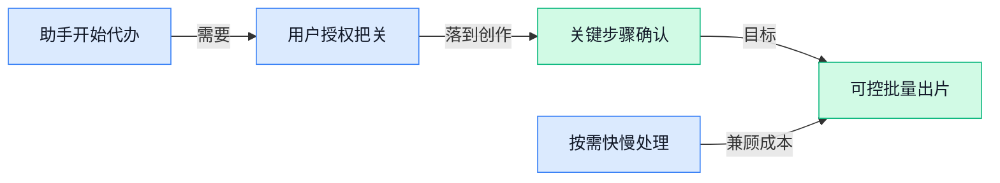

> AI 早报 · 每日早读 · 全网深度聚合

## **今日摘要**

```
OpenAI推出ChatGPT Wallet（代购支付钱包），从回答买什么到替用户结账
Google发布Gemini 4 Hydrogen（高速人工智能模型），新一代模型主打速度
Claude Meetings（视频会议功能）亮相，Claude从聊天窗口走进线上会议
```

### 🔵 产品与功能更新

1. **Claude Meetings（让 Claude 加入视频通话的功能）亮相，瞄准线上会议场景。**
据报道，Anthropic 的 **Claude Meetings（让人工智能助手加入视频通话的功能）**可以让 Claude 参与用户的视频通话，使用场景从聊天窗口延伸到了线上会议 🚀。这条更新的重点是**让助手进入会议现场**，但“加入通话”本身并不等于已经支持会议纪要、任务分配等完整流程。目前提供的摘要未包含具体功能、支持哪些会议平台或开放范围，不能据此认定它已经能替你整理会议结论，参见[克劳德会议功能报道(briefing)](https://the-decoder.com/claude-meetings-lets-anthropics-ai-join-your-video-calls/)。


2. **Google 发布 Gemini 4 Hydrogen（主打速度的新一代人工智能模型）。**
据报道，Google 推出 **Gemini 4 Hydrogen（主打快速处理与响应的人工智能模型）**，把**速度**作为这次新品的核心卖点 ⚡。这里的模型（理解输入并生成回答的核心系统）是助手能力的基础，但“主打速度”并不代表所有任务都更快，也不能直接说明回答质量更高。目前提供的材料没有具体测速结果、适用任务或开放方式，实际使用体验仍需更多信息判断，参见[谷歌速度新模型报道(briefing)](https://news.google.com/rss/articles/CBMidEFVX3lxTE5rSnBnR3JraDZDTEZpRUVKcG5uRmk0NFk4b2l6UTJid0VBY0E4NDk5M3h0U2hkbXNtcTVvdVdIeTNBQ29GV2pnSTVYRzRIUXNYTnNjaGRfNG9ETlVTN1NnU1NLdVBkNGZTaEQ4SDBqUjZJcGRr?oc=5)。

3. **OpenAI 推出 ChatGPT Wallet（让人工智能代为购物的钱包功能），强调交易安全。**
据报道，OpenAI 发布 **ChatGPT Wallet（用于让人工智能代用户购物的钱包功能）**，将应用场景指向**代为购物** 🛒。OpenAI 将其描述为一种安全的使用方式，但这属于**公司对产品的安全主张**，不能等同于已经获得独立验证。对于想让助手帮忙采购的用户，仍需进一步了解付款授权（允许助手在什么条件下花钱）的规则；当前摘要没有提供这类细节，参见[聊天助手钱包功能报道(briefing)](https://news.google.com/rss/articles/CBMiZ0FVX3lxTFBHeTFKZ0NySWhLdXF5bXRNLU5MOHJUUU9WcTVwOGFOc2xNaEstLVp6cy1Ia3BKTzJFczNBY2NOTW56SHJIWXRzY2UxY2NhQmJnQUgtZG5MemVpOG5XcWtUdjhWUzRjbjQ?oc=5)。

### 🟢 前沿研究

1. **“思考的价值”：混合决策模型学习何时该推理。**  
这项研究关注**混合决策模型**（能在快速作答与深入推理之间切换的模型），核心问题是：模型是否应该每次都“多想一会儿”。研究标题显示，它试图让模型学习在不同决策场景下判断推理的收益，从而避免不必要的计算。对需要兼顾响应速度与判断质量的智能助手来说，这一方向值得关注 🚀 [论文页面(briefing)](https://huggingface.co/papers/2611.16961)


2. **“经验交接”强化学习推动递归式自我改进。**  
论文探索**Experience-Handoff Reinforcement Learning（经验交接强化学习，把一次任务中获得的经验传给后续学习过程）**。其中，**强化学习**（模型通过尝试、获得反馈并调整策略来变强）被用于研究系统如何持续改进自身。标题并未给出具体实验结论，但它指向了一个重要问题：模型能否把过去积累的经验转化为下一轮能力提升 💡 [论文页面(briefing)](https://huggingface.co/papers/2611.16409)


3. **SO-Arena（系统一模型评测擂台）衡量能力范围与可靠性。**  
这项研究提出或围绕 **SO-Arena（用于比较系统一模型表现的评测平台）**展开分析。这里的**系统一模型**（偏向快速、直觉式作答的模型类型）与需要长时间推理的模型形成对照。研究重点不是单看模型能不能答对，而是同时观察它的能力边界与表现是否稳定，这对选择适合业务场景的模型很有参考价值 📊 [论文页面(briefing)](https://huggingface.co/papers/2611.15777)

4. **PhysLoop（物理感知自循环机制）让视频生成模型持续改进。**  
论文关注如何利用大语言模型的**物理感知**（理解物体运动、碰撞和空间变化是否符合现实规律）来改进视频生成模型。所谓**自我改进**，可以理解为模型生成视频后再检查其中的物理表现，并将发现的问题用于后续优化。这个方向针对的是人工智能视频中常见的运动不自然、物体变化不合理等问题，但候选摘要没有提供具体效果数据 🎬 [论文页面(briefing)](https://huggingface.co/papers/2611.16748)

5. **长流程智能体中，决策模型究竟是执行者、评审者还是教师？**  
这项研究讨论长流程 **Agent（智能体，能够分步骤完成任务的人工智能系统）**中的决策模型应该扮演什么角色。标题提出了三种可能身份：**Actor（执行者，负责采取行动）**、**Judge（评审者，负责判断行动好坏）**和 **Teacher（教师，负责提供改进方向）**。这类区分有助于理解复杂任务里“做事”“检查”和“指导”是否应由同一个模型承担 🤖 [论文页面(briefing)](https://huggingface.co/papers/2611.17167)

6. **JustRUA（机器人操作智能体受控研究）系统考察 GPT-6 的机器人使用能力。**  
论文标题显示，JustRUA（针对机器人操作智能体的受控研究）聚焦于 **GPT-6** 在机器人使用场景中的表现。这里的**机器人操作智能体**（能理解任务并控制机器人完成动作的人工智能系统）强调的是从语言指令走向现实操作。研究采用“受控研究”的思路，意味着重点在于以相对统一的条件观察能力，而不是只展示个别成功案例；候选信息未提供具体实验结果 🤖 [论文页面(briefing)](https://huggingface.co/papers/2611.16009)

7. **Factored One-sided Adam-Moment（分解式单边动量优化）让 SOAP 更实用、更易扩展。**  
这项研究聚焦一种名为 **SOAP** 的模型训练优化方案，并探索如何通过 **Factored One-sided Adam-Moment（分解式单边 Adam 动量，一种减少优化计算与存储负担的参数更新思路）**提升其实用性。**Adam 动量**（根据过去多次更新记录来调整当前训练步长的机制）可以理解为训练模型时帮助“控制方向和力度”的辅助工具。论文标题将重点放在实际应用与规模扩展上，但现有摘要没有说明具体性能提升幅度 ⚙️ [论文页面(briefing)](https://huggingface.co/papers/2611.16905)

8. **Unbundling Multimodal Vision Encoding（拆解多模态视觉编码）重新审视视觉输入处理。**  
论文研究如何拆解 **多模态视觉编码**（把图片、视频等视觉信息转换成模型能够理解的表示，并与文字一起处理的过程）。所谓“拆解”，意味着不再把视觉信息处理看成一个不可分的整体，而是进一步分析其中不同环节的作用。这个方向可能帮助研究者更清楚地理解视觉模型如何接收和利用信息，但候选摘要未披露具体方案与结论 👁️ [论文页面(briefing)](https://huggingface.co/papers/2611.17334)

### 🟡 行业展望与社会影响

1. **ChatGPT Wallet（可让智能助手代为购物结账的钱包功能）上线，助手开始替用户完成购买。**
OpenAI 推出 **ChatGPT Wallet（让人工智能助手代用户购物、结账的钱包功能）**，把助手的能力延伸到实际购买环节 🛒。[智能钱包上线报道(briefing)](https://news.google.com/rss/articles/CBMinAFBVV95cUxOZ2VqV2RZM3g2SEMzeEdNNmNjSmtZNzY1dTVjZ0F2WWdLdW9iaENMajhQdEpiX2t5VnFxaFdJR1ZPcVBGVmstX3ZZNXdUbFprOE5oTFFfa1Q5UkhXaXJQRER4Vkp4YWQxeEtJNmVvM3FjTWhXc1c5TnFGVzVsUVVRV002dlpSQlh3alhwMDFiZ2VvZlVuQjZ4dUJTcUM?oc=5) 另一则报道明确提到，该功能让 **Dots（可代用户执行购买任务的智能代理）**进行购买。[智能代理购买报道(briefing)](https://news.google.com/rss/articles/CBMiZ0FVX3lxTE13SGxUTFJ3TGtuYV9rQ3hCXzRLWC0xVllVb0lNOHlOelVhdU5oM0M0b1Y4SjlMS25vbGE5N21DdDcwVDlrNTByaXhiSmtsSjEzSmM4NFVQZHVEM0gwUERJSm9KVXdkR2c?oc=5) 对普通用户而言，这条消息的重点是：助手不再只是帮忙挑选商品，而是开始参与**购物与结账的实际执行**。


2. **Meta 的 Muse（可替用户致电商家的智能助手）开始代打电话，但商家未必愿意接。**
Meta 的 **Muse（能够代用户给商家打电话的智能助手）**如今可以替用户拨打商业电话，把助手的服务范围延伸到电话沟通场景 📞。不过，报道同时提醒，**不少商家可能直接挂断人工智能来电**；这里描述的是潜在阻力，并非已经统计出的拒接结果。对这类产品来说，能替用户拨出电话只是一步，**电话另一端是否愿意沟通**，同样关系到任务能否完成。[商家代拨功能报道(briefing)](https://the-decoder.com/metas-muse-now-calls-businesses-for-you-but-many-companies-might-just-hang-up-on-the-ai/)

### 🟣 开源TOP项目

1. **Plannotator（协同管理智能代理工作的工具）让计划、批注与代码审查集中到一处。**
当智能代理（代人执行任务的软件助手）开始干活，人也需要随时掌握进展、参与决策，**Plannotator** 就是为这种协作准备的工作空间 🛠️。它把计划制定、内容批注、**代码审查**（检查程序改动是否合适）和团队分享放到一起，让使用者能够介入工作过程。收集好的意见还能**一键反馈给智能代理**，把人工审核与后续执行衔接起来，具体功能见 [协作工作台项目介绍(briefing)](https://github.com/backnotprop/plannotator)。


2. **Veyra-NRVideo（视频播放与采集画面增强工具）支持多种画面来源的实时预览。**
这款面向 Windows（微软电脑操作系统）的工具，支持对**视频、图片和采集卡输入**进行实时预览，其中采集卡用于把外部设备的画面传入电脑 🎬。项目介绍列出了**人工智能超分辨率**（利用人工智能提升画面分辨率）以及 DLSS 5（项目用于图像增强的功能）等画面增强能力。它关注的不只是播放视频，也包括查看和增强外部输入画面；各项能力与使用说明可查看 [视频增强工具项目介绍(briefing)](https://github.com/Likely7/Veyra-NRVideo)。


3. **Claude Trading Skills（面向股票投资与交易的助手技能集）把市场分析任务带入 Claude Code。**
这个项目为 Claude Code（可通过扩展技能承接不同任务的编程助手）提供了一组面向**股票投资者和交易者**的技能，覆盖市场分析、技术图表分析和交易策略开发 📊。它还包含**经济日历**（集中查看重要经济事件的日程）和股票筛选功能，把看市场、查事件、选标的等需求纳入同一套技能集。它的定位是辅助投资分析与策略开发，具体覆盖范围可查看 [投资分析技能项目介绍(briefing)](https://github.com/tradermonty/claude-trading-skills)。


### 🔴 社媒分享

1. **llama.cpp（让大模型在本地设备运行的开源工具）发布 1.0.0，强调夯实本地人工智能生态基础。**
这次发布将重点放在**本地人工智能生态**（围绕在自己设备上运行模型形成的工具与配套）上，而不只是展示某个模型的能力 🚀。llama.cpp（帮助用户在本地设备运行大模型的开源工具）的新版本，以“更坚实的基础”为主题介绍更新。当前候选材料没有提供正文，因此暂不展开具体功能、性能提升或硬件支持范围，具体变化可查看[新版本发布介绍(briefing)](https://huggingface.co/blog/ggml-org/llama-cpp-v1)。


2. **人工智能帮助解读哥德尔笔记，据称其中包含数百条已证明的定理。**
据《卫报》报道，人工智能正帮助解读**哥德尔笔记**（数学家哥德尔留下的研究记录），让其中的数学内容更容易被读懂 🔍。报道标题称，这些笔记据称包含**数百条已证明的定理**（通过数学逻辑论证成立的结论），但不能将其理解为人工智能新证明了数百条定理。这里值得关注的是人工智能对既有研究记录的解读作用，具体发现和确认程度仍需以[哥德尔笔记报道(briefing)](https://www.theguardian.com/science/2026/nov/13/kurt-godel-notebooks-ai-helps-unlock-hidden-discoveries-man-who-transformed-maths)正文为准。


3. **SimReady Assets（供模拟环境使用的数字物体素材）教程：搭建机器人抓取与放置仿真。**
这篇教程围绕一个明确任务展开：利用 **SimReady Assets**（供模拟环境使用的数字物体素材），搭建机器人抓起物体、再放到指定位置的场景 🤖。标题中的**抓取与放置仿真**（在虚拟环境中模拟机器人的拿取和摆放动作），指向的是任务模拟，而非直接展示真实机器人的操作成果。当前材料未提供具体搭建步骤、所需设备或测试结果，想了解实际操作流程，可以查看[机器人仿真搭建教程(briefing)](https://huggingface.co/blog/nvidia/simready-assets-robot-pick-and-place)。


4. **做完 600 次实验后，作者分享 JEPA（通过预测抽象特征学习事物关系的模型架构）世界模型探索。**
这篇分享以**600 次实验**为切入点，讨论 JEPA（通过预测数据中的抽象特征来学习关系，而非逐个还原画面细节的模型架构）🔬。它关注的主题是**世界模型**（让模型学习环境如何变化、动作可能带来什么结果），重点不只是生成一段回答。当前候选材料没有列出实验设置和具体发现，因此不能据此判断哪些方案更有效；作者的结论可查看[六百次实验探索记录(briefing)](https://haddyalchaer.com/jepa)。

5. **XYBench（关注能否帮助解决提问背后问题的评测项目）：不只看回答，还看是否找对问题。**
XYBench（关注模型能否帮助解决提问背后问题的评测项目）把注意力放在：**用户问出口的问题，背后究竟想解决什么** 💡。这里的**评测基准**（用一组测试任务检验模型表现的标准）关注的不只是回答表面问题，还包括对背后问题的帮助。当前材料没有提供测试题、评分规则或模型成绩，因此暂不作能力排名，项目介绍见[提问背后问题评测介绍(briefing)](https://huggingface.co/blog/allenai/xybench)。

---



### 📊 行业洞察（今日 3 条）

1. 据报道，OpenAI推出购物钱包，Meta助手开始代打商家电话  
   【洞察】助手正从建议走向执行，但授权和商家配合缺一不可，能操作不等于办成事。

2. Google新品主打速度，“思考的价值”研究探索何时多想  
   【洞察】两件事指向按任务分配精力，而非一味求快；但缺少实测，还不能断言更省钱。

3. 视频物理检查研究与执行、评审分工研究，都关注做完后怎么检查  
   【洞察】自动检查值得投入，但尚无充分效果数据，不能把“自己检查”当成质量担保。

### 💭 对我们的启发（今日 3 条）

1. OpenAI购物钱包要求用户批准。我们可自动剪辑，但付费购买素材、发布视频应另行确认，不能用一次授权包办到底。

2. Google强调速度，“何时多想”研究提示我们：字幕初稿可优先求快，商品卖点核对应多检查，以每条合格视频的总成本选方案。

3. 视频物理检查研究提示：可尝试标出商品变形、动作穿帮的位置，让客户逐段确认；修改意见留作改进依据，不承诺自动审片零漏错。


---

> 本周周报：[第46周综合分析](https://zhuxinfei.github.io/ai-daily-site/blog/weekly/2026-w46/)
