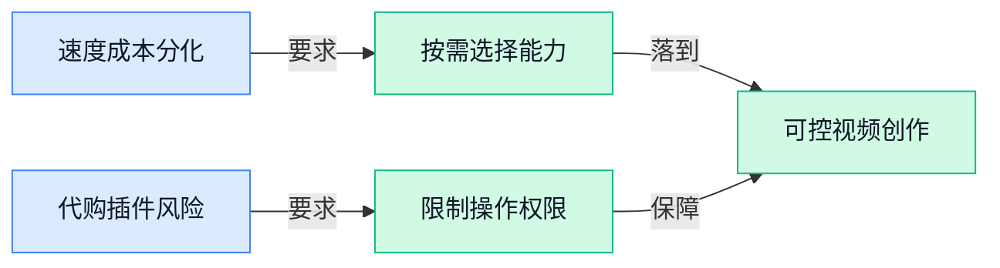

> AI 早报 · 每日早读 · 全网深度聚合

## **今日摘要**

```
Google Gemini 4 Carbon登顶数学评测，夺冠代价却是对手高达15倍的成本
Anthropic上市投资设限，银行因美国出口管制排除中国内地及香港投资者
Lovable（应用搭建平台）相关应用被曝泄露护照信息及逾20万条私信
```

### 🔵 产品与功能更新

1. **媒体称 Claude Meetings（面向会议场景的 Claude 产品）推出测试版，适配 Google Meet（谷歌视频会议工具）。**
据[会议产品测试报道(briefing)](https://news.google.com/rss/articles/CBMiZ0FVX3lxTE9ySnlmZTdLYkxHWndEcERSOENDQUY5OFNVaE9ja2Z6dk1WSFFKdlBEbzdLVUNyRHBfMFpkd096THMwVGVlM3ZTRHp4WDMxTHJ5ZnpkR1QyWnp5ZXBxWE04elZQdHQxSEU?oc=5)，Claude 的会议产品已面向谷歌视频会议工具推出**测试版**（正式发布前供用户试用、收集反馈的版本）🚀。不过，当前提供的材料仅包含报道标题，未说明具体功能、开放范围或收费方式，**不能据此认定它已支持会议纪要、录音转写等功能**。💡 对经常开会的同事来说，可以关注这一产品动向，但是否值得试用，还需要更完整的功能说明。

2. **媒体称 Google 推出 Gemini 4 Hydrogen（新款人工智能模型），主打运行速度提升。**
据[谷歌新模型发布报道(briefing)](https://news.google.com/rss/articles/CBMixgFBVV95cUxQajhXcnM0QWtWZU9NUTVMLTlhaUtXQjkzQ3BYdjZsZU9uUUQ5VmtNZ3laZUpkUU1MMVVLelJ2dWZIMXB5d0ViWHZGVmxZbkJnY1hQOGlCRmZiZEZaOVNuX0puZXAxc2tCekhWbjdLREdHT1ExUEFwdkVyN1pMa3UzSFFicHRyY1ZZajRPaUhZSVIxam0yNVhLcjcxYkhzbFNOTWQxR2VqeUdURDJIU0QxVUJ1dzlnUTNYSHBpUFlja0djNTJKWkE?oc=5)，Google 推出上述模型，报道标题以**“2.5 倍速度表现”**作为主要卖点 ⚡。但当前材料没有提供**比较基准**（用来衡量提升幅度的对照对象和测试条件），也没有附上官方发布说明，因此这一数字暂时只能作为媒体说法引用。💡 对日常使用者而言，是否真的能缩短工作等待时间，还需要看具体任务中的表现，不能直接把标题数字理解为所有操作都会同比加速。

### 🟢 前沿研究

1. **Gemini 4 Carbon（Gemini 系列模型）登顶数学评测，但成本是对手的 15 倍。**
据报道标题，**Gemini 4 Carbon** 在 MathArena（用于比较模型数学解题表现的评测榜单）上排名第一，成本却达到 GPT-6.1 Sol（报道中用于成本对比的另一款模型）的 **15 倍**。💡 这条消息同时呈现了**解题表现与使用成本**两个维度，但现有材料没有提供具体分数、测试设置或费用计算口径。判断它是否值得用于实际工作，还不能只看榜首位置，需进一步核对这些条件：[数学榜单与成本报道(briefing)](https://the-decoder.com/gemini-4-carbon-takes-the-matharena-crown-but-costs-15-times-more-than-gpt-6-1-sol/)。

2. **TTB（在使用阶段预先处理以提高画面生成效率的研究）探索更高效的新视角渲染。**
这篇论文关注**视角合成（生成从其他观察角度看到的画面）**，目标是提高特定模型生成画面的效率 🚀。标题将研究对象限定为**仅解码器模型（主要依靠逐步生成输出来完成任务的一类模型结构）**，而不是泛指所有图像或视频模型。当前材料仅有论文标题，尚不能确认具体加速幅度、画质变化或硬件要求，详见[视角合成效率研究(briefing)](https://huggingface.co/papers/2611.17331)。

3. **Open Vision Banana（探索生成式视觉感知的开放研究方案）提出完全开放的实现配方。**
这项研究聚焦**生成式视觉感知（用生成式模型完成图像理解任务）**，标题强调提供一套**完全开放的实现配方**，而不只是展示一个模型名称 💡。这里的“配方”可理解为实现这类能力的方案，但现有材料并未列出具体开放内容，不能据此认定训练数据、代码和模型都已发布。它值得关注的方向是视觉理解能力如何被实现与复用，具体任务范围和效果仍需查阅[开放视觉感知研究(briefing)](https://huggingface.co/papers/2611.15844)。

4. **Duo（面向双向同时交互的世界模型）探索更自然的互动方式。**
论文标题提出一种用于**全双工交互（双方可以同时发送和接收信息，不必严格轮流）**的模型，重点在于双向互动，而非单向输出。它被称为**世界模型（对环境及其变化进行建模、用于模拟或预测的模型）**，并强调交互双方的相互作用 💬。不过，现有材料尚未说明它处理的是语音、视频还是其他输入，也没有提供延迟或效果数据，具体实现可查看[双向交互模型研究(briefing)](https://huggingface.co/papers/2611.15131)。

5. **WorldDraft（探索代码构建世界、视频模型负责呈现的研究）重新思考视频生成分工。**
这篇论文提出一个直观问题：如果由**代码构建世界**，能否让视频模型只负责把它呈现出来？🎬 其中，**视频模型（用于生成视频画面的模型）**与**渲染（把场景描述转成可见画面的过程）**承担的是画面呈现环节，标题探索的是“构建世界”和“生成画面”之间的分工。现有材料没有展示实现方式或实验结果，因此目前应把它理解为一个研究问题，而不是已经验证的产品能力，详见[代码与视频分工研究(briefing)](https://huggingface.co/papers/2611.16217)。

### 🟡 行业展望与社会影响

1. **Cursor 确认安全事件，涉及恶意 Claude Code 扩展插件。**
据[安全事件相关报道(briefing)](https://news.google.com/rss/articles/CBMiugFBVV95cUxQZGZ6cDY2N1VKakpFcW9sN0NqTkJBck9xMGxNbGdzTDJQUmt0cmNmdzlBdWdaQ2tzbEF4U1JoZVBsWGFQTWxuZUN4WHVNcGhTMjBCOE85eWVLdFZnRk9JV0c3QWRXUnl1Y0JkM3dPNGlyNHNnR29PT3J6eU95cHZ3SW1WOHEwcUM4ZG1FR3BPSHkzaUdDc0Z0TExMSHRlV2c1OFg4REhaeGphZHd6cTR1YUliWnBFRFVlWUE?oc=5)，Cursor（人工智能编程工具）确认，一起**安全入侵事件**导致了恶意 Claude Code 扩展插件的出现。这里的**扩展插件**（给原有工具增加功能的附加程序）是理解事件的关键，不能将其直接等同于 Claude Code 本身遭到入侵 🔐。现有材料未交代具体攻击方式、受影响范围或数据损失，判断实际风险还需要更多披露。


2. **OpenAI 调整机器人研究人员分工，通用模型或改变专用研发路线。**
据[机器人研究调整报道(briefing)](https://the-decoder.com/openai-reassigns-robotics-researchers-to-other-teams-as-general-purpose-models-might-make-specialized-robotics-ai-unnecessary/)，OpenAI 正将机器人研究人员调往其他团队，背后的判断是：**通用模型**（可处理多类任务、不只服务于单一用途的模型）可能让专门为机器人开发的人工智能不再必要。这里涉及两条研发路线：让一个模型覆盖更多任务，或继续打造**机器人专用模型**（专门面向机器人任务开发的模型）🤖。值得注意的是，报道表达的是“可能”，并不意味着通用模型已经完全替代专用模型，也不能据此认定 OpenAI 放弃了机器人方向。

3. **Anthropic 上市投资资格受限，银行因美国出口管制排除中国内地及香港投资者。**
据[上市投资限制报道(briefing)](https://the-decoder.com/banks-bar-chinese-and-hong-kong-investors-from-anthropic-ipo-over-us-export-controls/)，银行因**美国出口管制**（限制特定商品、软件或技术向境外提供的监管规则），禁止中国内地及香港投资者参与 Anthropic 的上市发行。报道涉及的是 **IPO（首次公开募股，即公司首次向公众发行股票筹资）**的投资资格，而非 Claude 的产品使用权限 💡。这条消息的行业意义在于，出口管制的影响已出现在人工智能公司的融资参与环节；至于具体适用条件，现有材料没有进一步说明。

4. **黄仁勋离任引发亚洲政府关注，芯片供应与本地项目成为焦点。**
据[亚洲政府反应报道(briefing)](https://techcrunch.com/2026/11/14/asian-governments-react-to-nvidia-ceo-jensen-huangs-exit/)，针对英伟达**首席执行官**（负责公司整体经营管理的最高行政负责人）黄仁勋离任，一些亚洲政府已着手确认芯片供应承诺。其他政府则在监测对本地项目的影响，或处理正在进行的调查，关注点并不完全相同 🌏。目前材料呈现的是各方对**芯片供应承诺**（有关后续芯片供货的约定）及项目影响的确认与观察，尚不能据此断言已经发生断供或项目停摆。

5. **ChatGPT Wallet（代办购物支付钱包）登场，让助手无需接触真实卡信息即可代购。**
据[聊天钱包上线报道(briefing)](https://news.google.com/rss/articles/CBMilgFBVV95cUxQdml5MXp1UVBjd2dBRTFCTlduVkFrajExVTh6cHZrS3pMcjFqeW5ZYWJPVW5iYjZXU281OENpeFZ5S053bXBGdV8xWXd6LVhfNkNsdWR3dGVGMVBYWjVERXRKLVdDVmFFNks5NlA0OFZJX3lNWFQ2N01HYUJUemhQUmRzNGFiRG9mcXJWMnRRRm1hNWYxMVE?oc=5)，OpenAI 推出了 **ChatGPT Wallet（用于代办购物支付的钱包功能）**，将 ChatGPT 的应用场景进一步延伸到支付环节。另一则[代购支付机制报道(briefing)](https://news.google.com/rss/articles/CBMihwFBVV95cUxPZWhSdDY4UU1NV212WnA1Vm9taWxQMmU5bE52OTdKZ0hPQ3lOeE1PRm9nQl9EeUFURm9ZNHFwUUdQbWV3Y0xlQzgxS2xjUHNsSzB4MUVrcTZ4N2ZlRGdNdFdLamhYQUlvaEt3ZXV0amthQi11SmVsaUNfUC1XRkczVGV0S3RZb2s?oc=5)指出，OpenAI 的 Dots（可代用户购物的人工智能助手）能够在**不接触真实银行卡信息**的情况下代用户购买商品 🛒。这里需要区分“能够代购”和“掌握卡信息”：报道强调了两者可以分开，但现有材料尚未说明支付授权、消费限额或退款争议的具体安排。

### 🟣 开源TOP项目

1. **AG-UI（连接智能助手与应用界面的交互协议）让智能助手走进应用界面。**
这个开源项目聚焦于**智能助手与用户之间的交互**，目标是把 Agent（能够执行任务的智能助手）接入前端应用（用户直接看到和操作的网页或软件界面）🚀。它将自身定位为一套**交互协议**，也就是双方交换信息时遵循的共同规则。对业务同事来说，理解它的关键是：项目关注的不只是助手能做什么，还包括如何让用户在应用界面中与助手互动，具体定位可查看[项目官方仓库介绍(briefing)](https://github.com/ag-ui-protocol/ag-ui)。


2. **plannotator（支持规划、批注和代码审查的智能助手协作工作区）让团队参与助手工作过程。**
这个项目把**规划、决策、批注、代码审查和团队分享**放进一个工作区，帮助用户持续参与 Agent（能够执行任务的智能助手）的工作过程 💡。其中，代码审查（检查程序改动是否合适、是否存在问题）也是它支持的环节，而不只是查看助手给出的最终结果。项目还支持将**所有反馈一键发送给助手**，让团队意见能够继续传递给执行任务的一方。对需要参与规划或审核的同事来说，它的核心定位是让人持续参与、把握方向，功能概览见[协作工作区项目介绍(briefing)](https://github.com/backnotprop/plannotator)。


### 🔴 社媒分享

1. **Lovable（应用搭建平台）相关应用被曝泄露护照信息和逾 20 万条私信。**
据这份[应用隐私泄露研究(briefing)](https://www.crissyfield.de/research/lovable-en/)，Lovable 相关应用暴露了**护照信息**及**超过 20 万条私人消息**，涉及的并非只有普通公开内容 ⚠️。这里的**隐私泄露**（原本不应公开的个人资料被暴露），需要与“用户主动分享信息”区分开。当前提供的摘要没有交代泄露原因、涉及多少应用或是否已经修复，因此不能据此认定所有该平台应用都存在同样问题。


2. **英伟达被指通过循环融资交易，刻意维持显卡高价。**
这篇[显卡定价争议报道(briefing)](https://www.techspot.com/news/114558-nvidia-deliberately-kept-gpu-prices-high-through-circular.html)提出指控：英伟达通过**循环融资交易**（资金在有关联的投资、融资和采购安排之间流转），刻意维持 **GPU（擅长并行计算、常用于训练大模型的图形处理器）**的高价格 💰。报道关注的不只是芯片性能，还包括资金安排与硬件价格之间的关系。需要注意，当前材料仅提供标题，没有展示具体交易、证据或英伟达回应，阅读时应将这一说法视为**报道中的指控，而非已获证实的结论**。


3. **用可视化读懂强化学习：理解模型如何从反馈中调整行为。**
这份[强化学习可视化讲解(briefing)](https://aatishb.com/myriad/how-brains-learn/)以**可视化**形式介绍强化学习，适合想理解模型训练、又不想先啃公式的同事 💡。**强化学习（让模型根据行动后得到的奖励或惩罚，逐步调整行为的训练方式）**，核心关注的是“行动之后的反馈如何影响下一次选择”。可以带着一个问题阅读：模型得到的**奖励信号（用来评价一次行动好坏的反馈）**，究竟在鼓励它学会什么？


---



### 📊 行业洞察（今日 3 条）

1. 媒体称Google新模型提速2.5倍，另一款数学榜首模型成本达对手15倍
   【洞察】快、强、便宜并未同时实现；比较条件也不完整，选型仍得看实际任务。

2. 媒体称OpenAI钱包支持代购，Cursor（智能编程工具）确认恶意插件事件
   【洞察】自动办事越深入，权限边界越重要；能代办不代表该拿到全部资料。

3. 据报道，OpenAI拆分独立机器人团队，让通用模型承担更多任务
   【洞察】专用能力面临替代压力，但团队调整不等于效果已验证，产品仍须证明独特价值。

### 💭 对我们的启发（今日 3 条）

1. Google数学榜首的高成本提醒我们：字幕整理与复杂脚本应分开选用能力，以每条合格视频的总花费决定取舍。

2. OpenAI代购隔离真实卡信息，值得借鉴：剪辑助手只取当前素材；购买素材、发布成片仍须用户确认。

3. plannotator（让团队批注并反馈给助手的工作区）提示我们：把修改意见留在具体镜头上，确认后再改，减少整片返工。


---

> 本周周报：[第46周综合分析](https://zhuxinfei.github.io/ai-daily-site/blog/weekly/2026-w46/)
