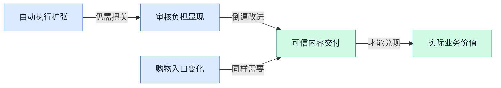

> AI 早报 · 每日早读 · 全网深度聚合

## **今日摘要**

```
Anthropic推出Claude Ship（代码审批工具），代码审查正式交给AI
Google DeepMind让智能体参与模型实验，却距离自我改进仍远
Lean（数学工具）查出Clojure（编程语言）核心未报告错误
```

### 🔵 产品与功能更新

1. **Anthropic 推出 Claude Ship（用于代码审查与审批的人工智能工具）。**
据[代码审查工具报道(briefing)](https://news.google.com/rss/articles/CBMikwFBVV95cUxNQ3h3NFdiOGRYQXEzaWU3SXYyRzVjMHNWc1Z0R0lBRFEwcENKdDhFYkN0c21yQW1oY0ZZQjBuakR6bkc3WllqMGxOVFFVSW9PcXQxM0ZqVkEtR0tWQWF4eFVVTWxBNENvaERUVElQVlY5OW9WN0tJdDliUFRyVDVsNzJvaUJWdXlpQXlYcG9vcU1tY0U?oc=5)，Anthropic 发布了 **Claude Ship（面向程序代码检查与审批环节的工具）**，把人工智能引入开发流程中的审核环节 🚀。其中，**代码审查（检查程序改动、寻找潜在问题）**，可以理解为给程序修改做一次“校对”。它还涉及**审批（决定某项改动是否获准通过）**，但当前提供的材料没有说明具体审批机制，不能据此认定工具可以完全替代人工把关。

2. **OtterlyAI（人工智能搜索曝光追踪工具）推出 ChatGPT 插件，扩展多平台追踪范围。**
据[搜索曝光工具更新报道(briefing)](https://news.google.com/rss/articles/CBMiqgFBVV95cUxPajFHR1dpYVhkd3doc3o5WUxXZFNkWUJrYnViSlBocjQ5dF9tLU0zWktOSURjbC03Q2dRM09aVTB1ekZDODFyOW1IM2Fkb2liWGx3UE9KeDBFeEVmZTRiV1lYbzhDblpHdWo2am1OZXRkeE5kNVczMFB5Q3NKQWdrSG5vQVByMUUtYy0wTnNocjhTakJSZVg4dTFDbW5TN3dJRk5uaWRmSW0wdw?oc=5)，**OtterlyAI（追踪品牌在人工智能搜索回答中曝光情况的工具）**推出官方 ChatGPT 插件，用于 **GEO（生成式引擎优化，让品牌或内容更容易出现在人工智能生成的回答中）** 💡。此次更新还新增对必应人工智能模式、深度求索、Meta Muse（Meta 旗下人工智能产品）、纳韦尔人工智能服务及 Grok（人工智能助手）的追踪支持。对品牌与运营同事来说，这类更新关注的是“**品牌有没有出现在人工智能的回答里**”；不过，当前材料没有披露各平台的具体追踪指标和使用方式。

### 🟢 前沿研究

1. **用户把任务交给智能体后，交互界面该怎么设计？**
过去约四十年，交互设计常借助**执行鸿沟**（用户知道自己想做什么，却不知道如何操作）与**评估鸿沟**（系统给出结果后，用户难以判断是否符合目标）来分析使用障碍 💡。这篇论文指出，两者都默认用户持续参与操作，但**智能体委托**（用户描述任务，再交由系统代为执行）打破了这一前提。研究由此提出一个界面设计问题：当用户不再全程参与时，原有的交互设计框架是否还够用？[智能体交互研究论文(briefing)](https://arxiv.org/abs/2611.31739)


2. **Loom Attention（让模型动态重组内部计算连接的注意力机制）提出新的模型计算思路。**
这篇论文提出，让 Transformer（目前许多大模型采用的基础架构）在处理每个 **token（模型读取和生成文字时使用的基本小块）**时，都能动态调整内部计算连接 🔄。摘要介绍的一个关键做法，是让注意力头（模型内部负责关注和汇总信息的计算单元）利用更早注意力头的输出，而不是只把各部分计算视为固定分工。它关注的是**模型内部如何组织计算**，现有摘要片段尚未提供性能提升或计算成本方面的结果。[动态计算连接论文(briefing)](https://arxiv.org/abs/2611.30634)

3. **PyRUA-Dex（借助编程智能体学习机器人双手操作的研究）聚焦灵巧协作。**
这项研究将**编程智能体**（能够编写代码来完成任务的智能助手）与机器人双手操作联系起来，探索如何学习用程序表达的控制策略 🤖。这里的**程序化策略**，可以理解为用代码规定机器人在不同情况下如何行动；“双手灵巧操作”则强调两只机械手的配合，而不只是单手动作。候选材料仅提供论文标题，尚无法判断它具体完成了哪些操作任务，以及实际效果如何。[机器人双手操作论文(briefing)](https://huggingface.co/papers/2611.33144)

4. **ROAM-Bench（通过核验证据评估智能体空间能力的测试集）关注“是否真的理解环境”。**
这项研究围绕**具身主动空间智能**（能够在环境中行动，并主动获取信息来理解空间的能力）展开，将**证据核验**作为评估切入点 🔎。其中，证据核验可以理解为检查支撑判断的信息，而不只是看最终回答；研究标题将这一思路与空间能力测试结合起来。当前材料尚未给出具体测试任务、评分规则或模型成绩，因此还不能据此判断哪些系统表现更好。[空间智能评估论文(briefing)](https://huggingface.co/papers/2611.33143)

### 🟡 行业展望与社会影响

1. **Google DeepMind（谷歌旗下人工智能研究团队）让智能体参与模型实验，但距离自我改进仍远。**
据报道，**智能体（能自主执行任务的人工智能助手）**已掌控该团队用于 Gemini（谷歌的人工智能模型）实验的部分算力，也就是运行模型实验所需的计算资源 🔬。不过，这距离**递归式自我改进（人工智能改进自身，再用改进后的能力继续提升自己）**仍然遥远。这里需要分清：让助手参与实验，不等于它已经能持续、自主地把自己变得更强，不能把研发环节的自动化直接看作自我进化。[模型实验自动化报道(briefing)](https://the-decoder.com/ai-agents-now-control-part-of-deepminds-compute-for-gemini-experiments-but-recursive-self-improvement-remains-distant/)


2. **Anthropic 掌门人反对让人工智能治理社会，否认主张交出人类控制权。**
Anthropic 首席执行官达里奥·阿莫代伊表示，让人工智能治理社会是个**“坏主意”**，并反驳了竞争对手对他的相关指责，称所谓他支持放弃**人类自主权（由人自己作出选择、掌握决定权）**的说法“荒谬” 🧭。[人工智能治理表态(briefing)](https://the-decoder.com/anthropic-ceo-dario-amodei-says-letting-ai-govern-society-would-be-a-bad-idea/) 与此同时，报道指出，领先的人工智能公司正越来越多地推进**研发自动化（让人工智能承担部分研究和模型开发工作）**。这场争论的关键区别是：让人工智能参与研发，与让它掌握社会治理的决定权，并不是一回事。[人类控制权争议报道(briefing)](https://techcrunch.com/2026/11/25/anthropics-dario-amodei-calls-accusations-of-surrendering-human-control-to-ai-absurd/)


### 🟣 开源TOP项目

1. **Google 发布 Cogentic（聚焦数学与计算机科学问题的研究论文项目）论文，涵盖整数分解、离散对数等方向。**  
Google 发布了一组 Cogentic 论文，主题包括**整数分解**（把一个大整数拆成质因数）和**离散对数**（在特定数学结构中反推出指数，常用于密码学）等问题。该项目以论文形式整理相关研究内容，适合关注数学计算与密码学基础研究的同事了解。🚀 [Cogentic 论文项目(briefing)](https://github.com/google-research/google-research/tree/master/cogentic_research_papers)


2. **Anthropic 发布更短的 GRH（广义黎曼猜想，数论中的重要猜想）Lean（用于形式化数学证明的编程语言）验证版本。**  
Anthropic 相关的 GRH 验证方案出现了一个更短版本，核心是用 Lean（让计算机逐步检查数学证明的工具）表达并核验这一猜想。**形式化验证**（把数学推理写成计算机能够检查的步骤）有助于减少证明过程中的遗漏，但这条材料仅说明版本更短，并未进一步给出验证结果。💡 [GRH Lean 项目仓库(briefing)](https://github.com/lsernau/grh-lean)


### 🔴 社媒分享

1. **作者用 Lean（用于数学证明与程序验证的工具）检查 Clojure（编程语言）核心，称发现未被报告的错误。**
作者分享了一次**用验证工具检查编程语言核心实现**的实践，并称找到了此前未被报告的问题 🔍。这里的 **Lean（可以让计算机核查推理是否成立的工具）**，与 Clojure（被检查的编程语言）分别扮演“检查工具”和“检查对象”的角色。候选材料未提供具体错误、验证过程或修复情况，因此目前不能进一步判断问题的影响范围，细节可查看[核心代码验证记录(briefing)](https://s.conao3.com/blog/2026/e4f733)。


2. **《纽约时报》因人工智能功能，提醒摄影师不要更新 Photoshop（照片编辑软件）。**
据报道，《纽约时报》提醒摄影师不要更新 **Photoshop（用于照片编辑和图像处理的软件）**，原因涉及其中的人工智能功能 📷。这条消息的关注点不是新功能是否好用，而是**新闻摄影工作中是否应该采用带有这些功能的软件更新**。候选材料没有说明涉及哪些功能、限制适用范围或具体执行方式，不能将其扩大解读为全面禁止人工智能修图，相关信息可参阅[摄影软件更新警示报道(briefing)](https://www.theverge.com/ai-artificial-intelligence/1041227/the-new-york-times-warns-photographers-not-to-update-photoshop-over-ai-features)。


3. **在一张 RTX PRO 6000（英伟达专业显卡）上，探索 Inkling 2 Mini（文中用于运行优化实验的模型）的运行优化。**
这篇分享聚焦于 **Inkling 2 Mini 的推理优化（让训练好的模型更高效地处理输入、给出结果）**，使用的硬件是一张 RTX PRO 6000（英伟达专业显卡）⚙️。标题提到 **爬山式优化（反复尝试局部调整，逐步寻找更好配置）**，重点是如何在既定硬件条件下继续改进模型运行表现。候选材料没有提供速度、显存占用或优化前后的对比数字，因此暂不判断提升幅度，具体过程可查看[单卡推理优化记录(briefing)](https://huggingface.co/blog/inkling-2-mini-inference-hillclimb)。


---



### 📊 行业洞察（今日 3 条）

1. Anthropic研究发现近两成企业应用未产生价值，《纽约时报》又因人工智能功能提醒摄影师暂缓更新修图软件。
   【洞察】功能多不等于客户敢用：审核负担和使用限制，都可能抵消自动化收益。

2. Google让智能助手自主开展部分模型实验，Anthropic掌门人则反对让人工智能治理社会。
   【洞察】两件事不矛盾：执行可以交出去，决定权不能默认交出去，产品需要明确授权边界。

3. Google的人工智能助手升级购物功能，OtterlyAI（追踪品牌在人工智能回答中曝光的工具）扩大追踪范围。
   【洞察】购物入口与曝光衡量正一起变化，但被推荐不等于成交，品牌仍需验证真实收益。

### 💭 对我们的启发（今日 3 条）

1. Anthropic研究提到审核负担：剪辑软件应统计“初稿到可发布”的总用时，别只展示生成速度，否则省下的操作可能变成返工。

2. 《纽约时报》的更新警示提醒我们：自动剪辑与生成改画面应分开授权，保留原素材和修改记录，商品外观变化必须人工确认。

3. Google升级购物功能，不代表视频会自动获得推荐。可先让脚本关联商品资料，统一价格、规格和卖点，再小规模验证获客效果。


---

> 本周周报：[第48周综合分析](https://zhuxinfei.github.io/ai-daily-site/blog/weekly/2026-w48/)
