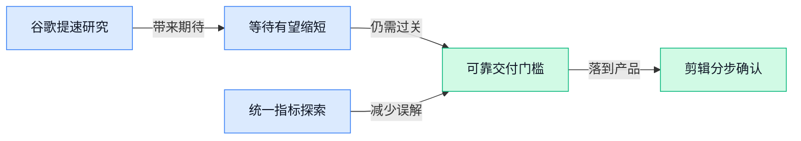

> AI 早报 · 每日早读 · 全网深度聚合

## **今日摘要**

```
OpenAI据报反诉Apple，指控窃取商业秘密，两大巨头对簿公堂
SAP（企业管理软件商）据报考虑大规模裁员，AI转型牵动岗位调整
Google的DeepCrossAttention（模型提速方案）在质量相当时最高约提速三倍
```

### 🔵 产品与功能更新

1. **ERGO NEXT（本条消息中的应用发布方）宣布推出 ChatGPT 应用。**
据报道，**ERGO NEXT（本条消息中的应用发布方）**已推出一款 ChatGPT 应用（围绕 ChatGPT 提供功能的软件产品）🚀。不过，当前候选材料仅提供了发布消息的标题，**没有说明具体功能、使用方式、收费情况或开放范围**。💡 对想尝试新工具的同事而言，目前还无法据此判断它能解决哪些工作问题，建议先查看[应用发布消息报道(briefing)](https://news.google.com/rss/articles/CBMiY0FVX3lxTE1ockZxYWRXNXVHUWNrX21tSnFNNkR3SWt5TUFJVWVMU3RvUzhZdi0yS3o3aUs2US1XR1lCWjJDc2tyMGFOSzdEMlpqSHIxOXJORXZUX2Fpbm5fT01GZS1UekVnbw?oc=5)，再决定是否试用。

### 🟢 前沿研究

1. **ShowNow（面向世界模型的细粒度推测式流式输出研究）聚焦交互响应速度。**
这项研究关注**世界模型（用于模拟环境及其变化的模型）**如何更及时地响应交互，标题将核心思路概括为“细粒度推测式流式输出”⚡。可以把这一思路理解为：尝试把输出拆成更小的部分，并提前推测后续内容，而不是始终等待完整结果生成。当前材料仅提供标题，尚无法判断它具体减少了多少等待时间，以及预测出错时如何处理，详见[交互世界模型论文(briefing)](https://huggingface.co/papers/2611.34693)。


2. **机器人操作研究关注“边界感知”，探索智能体调度与动作学习的配合。**
这篇论文把**智能体编排（由智能体组织和调度任务执行）**与机器人操作中的策略学习放在一起研究 🤖。标题强调**边界感知策略学习（让决定机器人如何行动的机制考虑边界信息）**，但未说明“边界”具体指任务分界、动作范围，还是其他约束。因而目前还不能据此判断它是否提升了操作安全性或成功率，具体定义与实验需查看[机器人操作研究论文(briefing)](https://huggingface.co/papers/2611.32238)。

3. **智能体操作数据库出错，什么决定损失大小？**
这项研究提出了一个直接关系业务风险的问题：人工智能智能体在**数据库（集中存储和管理业务记录的系统）**中犯错后，究竟什么决定损害程度 🔍。它关注的不只是“会不会出错”，而是**出错后的影响有多大**，这也是理解自动化操作风险时值得区分的两个问题。现有材料没有给出影响因素、测试场景或结论，不能据此断言哪种防护最有效，详见[数据库误操作研究论文(briefing)](https://huggingface.co/papers/2611.30483)。

4. **重新审视大模型的“上下文工程师”角色：研究焦点转向输入信息的组织。**
这篇论文重新讨论大模型作为**上下文工程师（为模型组织和准备完成任务所需信息的角色）**的用途 💡。与只关注最终答案不同，这一研究视角把注意力放在**上下文（模型处理当前任务时能够参考的信息）**如何准备和组织上。标题没有披露具体方案或效果，因此暂不能判断这种做法是否能提高任务表现，详见[上下文工程研究论文(briefing)](https://huggingface.co/papers/2611.30494)。

5. **人工智能生成图片检测研究：尝试读取已有视觉知识，而非改造模型。**
这项研究围绕**人工智能生成图片检测**展开，标题明确强调“读取，而非适配”🖼️。它关注如何利用**冻结的视觉知识（保留视觉模型已经学到的知识，不继续修改相关模型参数）**，将研究重点放在挖掘现有能力，而不是进一步改造模型。当前材料未提供检测准确率、适用图片类型或对比结果，尚不能判断实际识别能力，详见[生成图片检测研究论文(briefing)](https://huggingface.co/papers/2611.34719)。

6. **临床建模研究将决策、人体结构对应与置信度校准结合起来。**
这篇论文以**临床决策**为出发点，研究多模态建模（结合多种形式的信息进行分析），并将解剖定位与置信度校准纳入研究框架 🩺。其中，**解剖定位（把分析内容与具体人体结构对应起来）**关注模型“在看哪里”，**置信度校准（让模型表达的把握程度与实际可靠性相匹配）**则关注模型“有多确定”。现有标题未说明使用了哪些临床数据，也未提供验证结果，因此不能把它理解为已可用于实际诊疗，详见[临床决策建模论文(briefing)](https://huggingface.co/papers/2611.32993)。

### 🟡 行业展望与社会影响

1. **SAP（企业管理软件公司）据报考虑大规模裁员，人工智能转型牵动岗位调整。**
路透社援引消息人士称，**SAP 正考虑大规模裁员**；另一篇报道则称，其转向人工智能的计划涉及至少 **1 万个岗位**。💼 两篇报道都将人员调整与人工智能转型联系起来，但“考虑裁员”与“已执行裁员”不是一回事，也不能直接理解为这些岗位已被人工智能替代。现有材料未提供岗位分布、执行时间或安置方案，具体范围仍需关注后续披露，参见[路透裁员动向报道(briefing)](https://news.google.com/rss/articles/CBMiqAFBVV95cUxOYXlTRnczX1kzVVFWNmpBWWZscmx0cGVUUGNOMFctTUV5WmJVa1NrQ3N1NmFURDhfNUVEUXJiU09lc1NPV1UyUms1ZUdpMFMwZHdnaHcxcjJHdjBuQWRpZ2dwZ3ZVUUxBTU1fMHpLYl9pSExQOTVURGpSZ3JLazhwSVpWUkdJeGVsaElsZTNPVUY3N0JoUlVfcm5qbEhoQ2JYQ3lpWXBJU2g?oc=5)与[万人裁员计划报道(briefing)](https://the-decoder.com/sap-plans-to-cut-at-least-10000-jobs-as-it-pivots-to-ai/)。

2. **《哈佛商业评论》：生成式人工智能可能进一步拉大头部企业优势。**
《哈佛商业评论》的一篇文章提出，**生成式人工智能（能根据指令生成文字、图片等内容的人工智能）**正在让头部企业获得更大的竞争优势。💡 这一观点关注的不是某款工具有多好用，而是新工具普及后，**企业之间的竞争差距如何变化**。现有材料没有展示具体案例和论证，因此不能据此断言所有大公司都会受益、小公司都会落后，观点出处见[头部企业优势分析(briefing)](https://news.google.com/rss/articles/CBMihwFBVV95cUxORVhOS3M5N2w0TUMxeVQ1cmkwX1JKSzQxck94YWpYVGVBSGFIeU41M1pMaG9SQmlDdGk4NjN1eUtXSXE1M3NyQzF2bmdjRmVqbE1jUkI3U21DNFhkUjlJUHNfa3RQSjhEb2xnR2ZyLUc2YVpJQ3pQS20yQmZXTE5GenVCaUF0SEk?oc=5)。

3. **OpenAI 据报反诉 Apple，指控其窃取商业秘密。**
半岛电视台与另一家科技媒体均报道称，**OpenAI 对苹果提起反诉**（在已有诉讼中，被告反过来向对方提出诉讼请求），并指控其窃取商业秘密。⚖️ 争议涉及的**商业秘密**，指不公开、具有商业价值且受到保密保护的信息，并不等同于已经公开的知识或产品功能。需要明确的是，**诉讼指控不等于法院认定**；现有材料未提供证据细节或裁判结果，参见[商业秘密反诉报道(briefing)](https://news.google.com/rss/articles/CBMirAFBVV95cUxON1UyNzVUM1VWYllDUVB5Rl9LVDYwZExiMWt2WFp4eWVUckVjdDhqbFFfSXR1b2NiRm9LbFZQZ2xlZTNkRmtaSkZnb2M4ekJwVkVxbE1jdmNlazc2QUMxallwb1JpTWRvVk9ZOW12SVM5MTZ4RS1CQkNGcW5qZlMySWJZTjBkNXBtZXByR0NuVWdJZWVXWW8zcWRsTUF1ZUJXMlNVNWxEM2l0VThn0gGyAUFVX3lxTE16T05QbEdEbTdCUklBU3kyX05YX2RxaTZrVl9yWTEtWDF4dThXOFAyODNDTjFHTy1LRmJkZEJpd1E0eTBOaWxkS0NXV1BIWFo0V1ZTU01JMzd5bVpkMHFWTEhSNEVBT3E1cXd1NVJFbEJtSXFURGpxMzlKOWtNTXg1amFKZDhEOWttUlhkU1Y2UmVnSUgwRWZqWmJmTzdRaVBNM01pczFxTnh0RzYxRk02MFE?oc=5)。

4. **英伟达 Blackwell（用于人工智能计算的芯片系列）据报现身上海数据中心，涉及禁售限制。**
一篇转述彭博社消息的报道称，**受到禁售限制的英伟达芯片**出现在上海一座数据中心（集中部署服务器、承担计算与数据存储的设施）。🔎 报道标题还称，该设施与艾丽斯·黄存在关联，但现有材料没有说明关联性质或芯片进入设施的具体路径。阅读这类消息时，应区分**媒体报道、关联关系与违规认定**，不能仅凭标题推断相关人员的责任，参见[受限芯片流向报道(briefing)](https://the-decoder.com/banned-nvidia-blackwell-chips-turn-up-in-a-shanghai-data-center-linked-to-alice-huang-bloomberg-reports/)。

### 🟣 开源TOP项目

1. **Convex（相关开发工具项目）的技能被指未告知用户就发送应用创意。**  
有用户指出，Convex 的技能（供人工智能助手调用的任务扩展）会把用户的应用创意发送到远程服务器（网络上的外部计算机），且没有明确告知用户。争议焦点在于，用户输入的产品想法是否被透明地传输到外部。相关反馈已公开在 [GitHub 问题追踪页(briefing)](https://github.com/convex/convex-backend-skill/issues/64)，开发者和使用团队可据此关注数据流向与告知机制。⚠️


2. **Claude-BugHunter（面向 Claude Code 的漏洞发现技能包）收录 85 项技能。**  
这个开源项目为 Claude Code 提供一套漏洞发现与外部红队测试（模拟攻击者检查系统防护）的工具包，包含 **85 项技能**和 **16 个斜杠命令**（输入快捷指令即可触发预设操作）。项目还整理了 **681 种已公开漏洞报告模式**，覆盖 **24 类核心漏洞**，帮助使用者参考历史报告识别安全问题。除此之外，它还加入企业身份系统与基础设施攻击矩阵（按攻击目标和路径整理的检查清单），面向更系统的安全测试场景。[Claude-BugHunter 项目主页(briefing)](https://github.com/elementalsouls/Claude-BugHunter) 🛡️


### 🔴 社媒分享

1. **多州起诉 SpaceX（美国太空探索公司），要求阻止 Grok（聊天与图像生成助手）生成儿童性虐待及非自愿私密影像。**
据[州总检察长公告(briefing)](https://www.oag.state.va.us/media-center/news-releases/jay-jones/3162-attorneys-general-jones-and-rayfield-file-suit-against-spacex-parent-company-of-x-xai-and-grok-over-creation-and-promotion-of-child-exploitation-and-non-consensual-images-on-platform)，多州已对 **SpaceX（美国太空探索公司）**提起诉讼，矛头指向 **Grok（聊天与图像生成助手）**生成相关影像的问题。⚖️ 诉讼涉及儿童性虐待影像，以及**非自愿私密影像**（未经当事人同意制作或传播的私密内容），诉求是阻止此类内容继续生成。需要区分的是，**提起诉讼不等于法院已经作出判决**，这条消息报道的是州政府采取法律行动。


2. **Google 的 DeepCrossAttention（提升模型计算效率的研究方案）可在质量相当时实现最高约三倍提速。**
Google 分享了 **DeepCrossAttention（提升模型计算效率的研究方案）**，称其能够在模型质量相当的情况下，实现**最高约三倍的速度提升** 🚀。这项研究聚焦于**残差连接**（让前面处理过的信息继续传到后续计算环节，像给信息留一条直通道），尝试改善模型内部的信息传递方式。💡 对读者来说，重点是“**质量相当时更快**”，而不是“回答质量提高三倍”；具体研究内容可见[谷歌模型提速研究(briefing)](https://research.google/blog/supercharging-transformer-residual-connections/)。


---



### 📊 行业洞察（今日 3 条）

1. OpenAI据报正统一业务指标定义，另一项研究关注输入信息的组织
   【洞察】两者都指向“先把资料讲清楚”；可靠交付不能只靠模型猜，否则快也可能白做。

2. Convex（帮人开发应用的工具）被指外传创意，OpenAI据报反诉苹果窃密
   【洞察】两件事都提醒：便利不等于获准使用信息；指控尚待核实，产品仍需明确授权。

3. Google称新研究在质量相当时最高提速约三倍
   【洞察】这是效率机会，不是视频工具降价承诺；实际成本还取决于能否用于出片，以及返工多少。

### 💭 对我们的启发（今日 3 条）

1. OpenAI据报正统一业务指标定义。我们可先让品牌商确认卖点、禁用词和素材用途，再自动剪辑，减少整片返工。

2. Convex（帮人开发应用的工具）的外传争议提醒我们：未发布素材交给外部处理前，应说明用途并让客户确认。

3. Google提速研究值得跟进，但剪辑工具选服务应算“每条合格成片成本”，把等待、重试和人工修改一起计入。


---

> 本周周报：[第48周综合分析](https://zhuxinfei.github.io/ai-daily-site/blog/weekly/2026-w48/)
